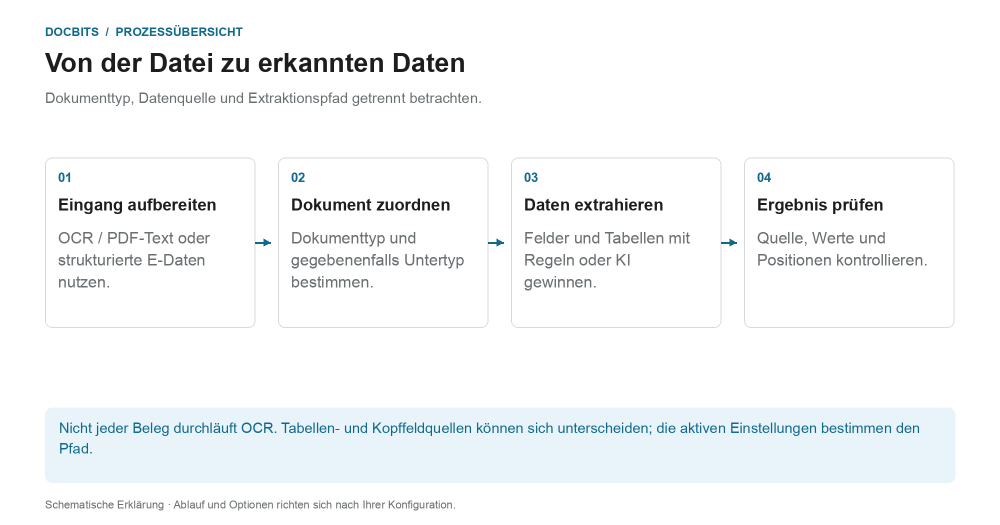

# Klassifizierung und Extraktion

[AI Table](../../../../end-user-and-partner-section/end-user-section/ai-table/README.md) · [Structured Output für Tabellen](../../../../end-user-and-partner-section/end-user-section/ai-table/structured-output.md)

## Welche Einstellung wirkt an welchem Prozessschritt?

<figure><figcaption>
Dokumenttyp, Datenquelle und Extraktionspfad getrennt betrachten. Die Grafik ist schematisch; maßgeblich sind die aktiven Einstellungen Ihrer Organisation.
</figcaption></figure>

Klassifizierung beantwortet die Frage **„Was für ein Dokument ist das?“**. Extraktion beantwortet **„Welche Werte enthält es?“**. Die Einstellungen dieser Seite wirken an unterschiedlichen Stellen der Verarbeitung und sollten nicht als ein einzelner KI-Schalter verstanden werden.

1. **Eingabe vorbereiten:** Bei PDFs kann vorhandener Text oder OCR verwendet werden; unterstützte elektronische Dokumente können strukturierte Werte liefern. Eine aktivierte Aufteilung kann ein eingehendes Dokument anhand der konfigurierten Barcode- oder QR-Kriterien trennen.
2. **Dokumenttyp bestimmen:** Klassifizierungsregeln und Modelle ordnen Dokumente einem Typ und bei Bedarf einem Untertyp zu. Diese Zuordnung ist von der späteren Feld- und Tabellenextraktion zu unterscheiden.
3. **Werte extrahieren:** Tabellen können je nach Konfiguration und geltenden gespeicherten Regeln unterschiedliche Wege nehmen. Kopffelder haben eigene Quellenkennzeichen. Das gewählte KI-Modell allein erklärt daher nicht jede Zeile oder jeden Feldwert.
4. **Ergebnis nachvollziehen:** Prüfen Sie im Validierungsbildschirm, welcher Tabellen-Tab die Zeilen enthält und welches Quellenkennzeichen ein Kopffeld trägt. Fehlt ein Verarbeitungsschritt, lesen Sie die Dokumentprotokolle, bevor Sie Einstellungen ändern.

### Regelpfad und KI-Pfad unterscheiden

Passende gespeicherte Tabellenregeln können die Tabellenextraktion für die betreffende Vorlage oder den betreffenden Lieferanten bestimmen. Ohne passende Regeln kann der KI-Pfad verwendet werden, wenn die KI-Tabellenextraktion aktiviert ist. Einzelne Spalten können eigene KI-Optionen haben. Eine KI-Quelle für ein Kopffeld bedeutet nicht, dass die gesamte Tabelle aus der KI stammt.

Die Diagnoseanleitung [Welcher Extraktionspfad wurde verwendet?](../../../../overview-and-basics/faq/document-processing/which-extraction-path-was-used.md) erklärt Tabs, Quellenkennzeichen und Protokolle. Die Seite [KI-Modell](ai-model.md) erläutert den Organisationsstandard und vorlagenbezogene Überschreibungen.

<figure><figcaption>
General enthält Einstellungen zur Verarbeitung. AI Models ist hier sichtbar, weil das Modul aktiviert ist; die eigenen Klassifizierungsmodelle sind vom Selektor der Extraktionsstufe getrennt. Das gespeicherte Barcode-Muster ist unkenntlich gemacht.
</figcaption></figure>
<!-- English source image: dbdc-193-general-overview-en-20261030.png -->

## Übersicht

In den Einstellungen für **Classification and Extraction** können Sie:

* steuern, wie hochgeladene Dokumente **aufgeteilt** werden und wie viele Seiten verarbeitet werden
* die **Betragsformatierung** für den Betragsvergleich konfigurieren
* die **Tabellenextraktion** einrichten, einschließlich des je Lieferant verwendeten KI-Modells
* die Verarbeitung nicht unterstützter **ZUGFeRD**-Dateien ein- oder ausschalten
* **Klassifizierungsregeln** definieren, die automatisch einen Dokumenttyp zuweisen
* die **AI Models** und ihre trainierten Labels prüfen

Die Seite hat **General** und **Classification Rules**, dazu **AI Models**, wenn das Modul für Modelle und Labels für Ihre Organisation aktiviert ist. Eigene Klassifizierungsmodelle und Labels unter **AI Models** sind vom Selektor der Extraktionsstufe unter **General → Extraction** getrennt.

| Tab | Inhalt |
|---|---|
| General | Document Splitting, Document Processing, Amount Formatting, Table Extraction, Electronic Document |
| Classification Rules | Regex-Regeln, die Dokumente anhand des Quellnamens klassifizieren |
| AI Models | Individuell trainierte Modelle mit ihren Labels, Dokumenttypen und Prioritäten |

## Zugriff auf die Einstellungen für Klassifizierung und Extraktion

Gehen Sie zu **Settings → Document Types → Classification and Extraction**.

## General

Der Tab **General** fasst Einstellungen in aufklappbaren Abschnitten zusammen. Die meisten Steuerelemente speichern, sobald sich ihr Wert ändert. Ein geändertes, nicht leeres **Barcode Pattern** verwendet seine Aktion zur Validierung bzw. **Save**, und eine Änderung der Version der Tabellenextraktion erfordert eine Bestätigung. Prüfen Sie Organisation und beabsichtigtes Verhalten, bevor Sie ein Steuerelement bearbeiten.

### Dokumentenaufteilung

**Split** entscheidet, ob ein hochgeladenes Dokument in mehrere Dokumente aufgeteilt wird, wenn auf einer seiner Seiten ein Barcode erscheint. Das Dropdown bietet:

* **Do not split uploaded documents** – die Standardeinstellung; das Dokument wird als eine Datei verarbeitet.
* **Split by Barcode/QR-Code** – das Dokument wird an jedem erkannten Barcode geteilt.

<figure><figcaption>
Prüfen Sie die Aufteilungsmethode und die Barcode-Typen, bevor Sie sie ändern. Das organisationsspezifische Muster ist unkenntlich gemacht; es wurde kein Wert geändert.
</figcaption></figure>
<!-- English source image: dbdc-193-document-splitting-en-20261030.png -->

Ist **Split by Barcode/QR-Code** gewählt, erscheinen zwei weitere Felder:

* **Barcode Type** – ein oder mehrere zu erkennende Barcode-Typen, zum Beispiel *CODE-128* oder *QR-CODE*.
* **Barcode Pattern** – ein Regex, dem der Barcode-Wert entsprechen muss, bevor die Aufteilung ausgelöst wird. Lassen Sie das Feld leer, um bei jedem Barcode der gewählten Typen zu teilen. Das Muster wird vor dem Speichern validiert; ein ungültiger Ausdruck wird sofort gemeldet.

Nach einer erfolgreichen Aufteilung wird das Ausgangsdokument gelöscht, und die Seiten laufen als eigenständige Dokumente weiter, die denselben Batch teilen.

<figure><figcaption>
Beispiel mit dem Muster <code>^INV\d{6}$</code>: Die Codes auf Blatt 3 und 6 passen und beginnen jeweils ein neues Dokument, der Code auf Blatt 4 passt nicht und teilt nichts, und das Gummiband steht für den Batch, den die entstehenden Dokumente gemeinsam haben.
</figcaption></figure>

### Dokumentverarbeitung

**Pages to process** begrenzt, wie viele Seiten pro Dokument per OCR erkannt, klassifiziert und extrahiert werden.

<figure><figcaption>
Dieses Beispiel hat ein Limit von 10 verarbeiteten Seiten. Das Feld erklärt, dass leer oder 0 alle Seiten bedeutet; der angezeigte Wert wurde nicht geändert.
</figcaption></figure>
<!-- English source image: dbdc-193-document-processing-en-20261030.png -->

* Leer oder **0** bedeutet, dass alle Seiten verarbeitet werden.
* Eine Zahl *N* begrenzt OCR, Klassifizierung und Extraktion auf die ersten *N* Seiten. Das vollständige Dokument wird weiterhin gespeichert, angezeigt und exportiert; Seiten jenseits des Limits werden schreibgeschützt angezeigt.

### Betragsformatierung

Zwei Schalter steuern, wie Beträge gegen Stammdaten und Bestellungen verglichen werden.

<figure><figcaption>
Die beiden Schalter für den Betragsvergleich sind in diesem Beispiel ausgeschaltet. Prüfen Sie die beabsichtigte Regel, bevor Sie einen der Schalter ändern.
</figcaption></figure>
<!-- English source image: dbdc-193-amount-formatting-en-20261030.png -->

* **Allow Rounding During Amount Comparison** – wenn aktiviert, ist eine Toleranz von ±0,5 zulässig. Wenn deaktiviert, gilt ±0,05.
* **Require Exact Match for Amount Comparison** – wenn aktiviert, müssen Beträge exakt übereinstimmen, ohne Toleranz. Wenn deaktiviert, gilt ±0,05.

Nur einer der beiden Schalter kann gleichzeitig aktiv sein; das Einschalten des einen schaltet den anderen aus.

### Tabellenextraktion


**Voraussetzungen für eine funktionierende Tabellenextraktion**

* Der Dokumenttyp hat **table columns** (Settings → Document Processing → Document Types → [Table Columns](../../global-settings/document-types/table-columns/README.md)). Ohne Spalten gibt es nichts, in das extrahiert werden könnte.
* **Table Extraction** oder **AI Table Extraction** ist unten für die gesamte Organisation eingeschaltet.
* Das Dokument hat lesbaren Text: OCR wurde ausgeführt, oder für digital erzeugte PDFs wird E-Text verwendet ([OCR Settings](../ocr-settings.md)).
* Training und KI-Modelle gelten **pro Lieferant**. Eine trainierte Tabelle gilt nur für Dokumente des Lieferanten, für den sie trainiert wurde.


Sie können Tabellen aus Dokumenten extrahieren, indem Sie entweder **Table Extraction** oder **AI Table Extraction** einschalten. Eine trainierte Tabelle (ob KI-basiert oder manuell) ist immer mit einem bestimmten Lieferanten verknüpft.

<figure><figcaption>
Der Selektor der Extraktionsstufe liegt unter General → Extraction. Der Kopf der Tabelle für Lieferanten-Überschreibungen ist darunter zu sehen; vorhandene Zeilendaten sind unkenntlich gemacht, und es wurde keine Einstellung geändert.
</figcaption></figure>
<!-- English source image: dbdc-193-table-extraction-en-20261030.png -->

**Table Extraction:** Aktiviert die regelbasierte Tabellenextraktion. Tabellen werden pro Lieferant im Validierungsbildschirm trainiert (*Go to table extraction view*).\
Mehr zum Training erfahren Sie [hier](../../../setup/document-training/training-line-fields-table-training/defining-tables-and-columns.md).

**AI Table Extraction:** Nutzt KI, um die Tabelle jedes Lieferanten ohne Training zu extrahieren. Sind die Ergebnisse für einen Lieferanten nicht genau genug, trainieren Sie die Tabelle dieses Lieferanten; die gespeicherten Regeln haben dann für diesen Lieferanten Vorrang vor der KI.

**Use Table Extraction Vision (AI):** Wählen Sie die Eingabe für die KI-Tabellenextraktion aus einem Dropdown mit vier Modi. Das ist eine Modusauswahl und kein eigener Ein-/Aus-Schalter. Ein Wechsel des gewählten Modus speichert die Einstellung sofort:

* **Off (text only)** – Es wird nur OCR-Text verwendet.
* **Images only** – Es wird nur das Seitenbild gelesen.
* **Hybrid (text and images)** – Textlayer und Seitenbild werden in derselben Anfrage kombiniert.
* **Auto (decided per document)** – DocBits wählt für jedes Dokument Texteingabe oder Hybrid.

<figure><figcaption>
Die vier Eingabemodi im aktuellen englischen Dev-Menü. Das Menü wurde geöffnet und geschlossen, ohne einen anderen Modus zu wählen; es wurde keine Extraktion ausgeführt.
</figcaption></figure>
<!-- English source image: dbdc-3-four-vision-options-en-20261031.png -->

**Use Structured Extraction (AI):** Der Schalter setzt den Organisationsstandard für strukturierte Ausgabe. Welche Spalten angefordert werden, hängt von der dreistufigen Use AI-Auswahl ab; auch Vorlagenüberschreibungen und Lieferantentraining wirken mit. Lesen Sie die vollständige [Anleitung zu Konfiguration, Vorschau und Beispiel](../../../../end-user-and-partner-section/end-user-section/ai-table/structured-output.md) für Structured Output für Tabellen.

**Table Extraction for Costing Element:** Wenn aktiviert, kann DocBits Kostenelemente aus Tabellen auf Positionsebene extrahieren und entsprechend klassifizieren.\
Eine ausführliche Erklärung finden Sie [hier](table-extraction-for-costing-element.md).

**Auto Extract Tax Code:** Wenn aktiviert, füllt das System das Feld **Tax Code** im Validierungsbildschirm automatisch aus, sofern ein Steuercode-Feld konfiguriert ist.\
Weitere Informationen zu dieser Einstellung finden Sie [hier](auto-extract-tax-code.md).

**Save extraction rules (Admin only):** Nur Administratoren können im Tabellentraining auf *Save Rules* klicken. Schalten Sie die Einstellung ein, wenn Benutzer immer wieder Regeln speichern, die die Extraktion eines Lieferanten beeinträchtigen.

**Extract hidden fields:** Felder, die in den Feldeinstellungen als ausgeblendet markiert sind, werden ebenfalls extrahiert. Nutzen Sie das, wenn ein Wert für eine Regel oder einen Export benötigt wird, aber nicht im Validierungsbildschirm angezeigt werden soll.

**AI Model:** Legt das Organisationsmodell für Feld- und Tabellenextraktion fest. Das Menü bietet Full, Fast, Nexus, Nexus Flash, Auto und Auto Nexus. Prüfen Sie Verfügbarkeit, Qualität, Laufzeit und Kosten mit repräsentativen Dokumenten. Eine Stufe ist nicht für jedes Dokument die genaueste oder schnellste. Vorlagenbezogene Überschreibungen können die Organisationseinstellung ersetzen. Die Tabelle unter dem Selektor zeigt:

* welche **Lieferanten** welches KI-Modell verwenden
* ob sie strukturierte Extraktion (KI) und E-Text verwenden
* Optionen, um einen Eintrag zu löschen und den Lieferanten damit auf den Standard zurückzusetzen

Diese Einstellung wird [hier](ai-model.md) ausführlich erklärt.

#### Warum sieht die Tabelle pro Lieferant anders aus?

Die Tabellenverarbeitung hängt von gespeicherten Regeln und Einstellungen im jeweiligen Lieferanten- oder Vorlagenkontext ab:

* **Gespeicherte Regeln** (Tabellentraining): Position der Tabelle und Zuordnung ihrer Spalten im Layout dieses Lieferanten.
* **KI-Tabellen-Tags und Formatierungsregeln**: Hinweise, die der Benutzer für die KI-Tabelle dieses Lieferanten gespeichert hat.
* **Vorlagenbezogenes KI-Modell:** Die im Validierungsbildschirm getroffene Auswahl wird je Organisation und aktueller Extraktionsvorlage gespeichert. Sie ändert nicht automatisch jede Vorlage desselben Lieferanten. Ohne Überschreibung gilt die anwendbare Organisationseinstellung.

Lieferant A mit gespeicherten Regeln zeigt daher im Tab *Extracted table* des Validierungsbildschirms eine deterministische Tabelle, während Lieferant B ohne Regeln die *AI Extracted table* erhält. Damit Lieferant B sich wie A verhält, trainieren Sie die Tabelle von B einmal. Um einen Lieferanten zurückzusetzen, löschen Sie seine Regeln im Validierungsbildschirm oder setzen Sie seine Trainingsdaten in der Tabelle AI Model zurück.

#### Preference-Schlüssel

Jeder Schalter in diesem Abschnitt wird als Organisations-Preference gespeichert. Verwenden Sie den Schlüssel, wenn Sie den Wert über die API (`/preferences/set_preference`), ein Skript oder über das DocBits MCP (`get_preference` / `set_preference`) setzen.

| Einstellung (UI-Bezeichnung) | Preference-Schlüssel | Werte |
|---|---|---|
| Split | `SPLIT_DOCUMENT_ON_BARCODE` | `true` / `false` |
| Barcode Type | `SPLIT_DOCUMENT_BARCODE_TYPE` | Liste von Barcode-Typnamen |
| Barcode Pattern | `SPLIT_DOCUMENT_BARCODE_PATTERN` | Regex-Zeichenfolge |
| Pages to process | `RESTRICT_TO_PAGES` | Zahl; leer oder `0` = alle Seiten |
| Allow Rounding During Amount Comparison | `AMOUNTS_ROUNDING` | `true` / `false` |
| Require Exact Match for Amount Comparison | `AMOUNTS_NO_ROUNDING` | `true` / `false` |
| Table Extraction | `TABLE_EXTRACTION_SETTING` | `true` / `false` |
| AI Table extraction | `USE_AI_TABLE_EXTRACTION` | `true` / `false` |
| Use Table Extraction Vision (AI) | `TABLE_EXTRACTION_VISION_MODE` | `off`, `vision`, `hybrid`, `auto`; ohne Wert entscheidet die alte Preference über den Modus |
| Use Table Extraction Vision (AI) – alter Schalter | `TABLE_EXTRACTION_USE_VISION` | `true` / `false`; bedeutet effektiv `vision` |
| Use Structured Extraction (AI) | `USE_STRUCTURED_EXTRACTION` | `true` / `false` |
| Table extraction for costing element | `CHARGES_TABLE_EXTRACTION` | `true` / `false` |
| Auto extract tax code | `AUTO_EXTRACT_TAX_CODE` | `true` / `false` |
| Save extraction rules (Admin only) | `ONLY_ADMIN_CAN_SAVE_RULES` | `true` / `false` |
| Extract hidden fields | `EXTRACT_HIDDEN_FIELDS` | `true` / `false` |
| AI Model | `AI_MODEL` | `gpt-6-sol` (Full), `gpt-6-luna` (Fast), `qwen3.8-max` (Nexus), `glm-5.3-flash` (Nexus Flash), `auto` (Auto), `auto-nexus` (Auto Nexus) |
| Table extraction version (Bestätigungsdialog) | `TBL_EXT_VERSION` | Versionszeichenfolge |
| OCR Settings → Use AI data for tables if available | `USE_AI_DATA_FOR_TABLE` | `true` / `false` |
| OCR Settings → Use E-Text if available | `USE_ETEXT_IF_AVAILABLE` | `true` / `false` |

Hinweise:

* Boolesche Preferences werden als Zeichenfolgen `true` / `false` gespeichert. Ein nicht gesetzter Schlüssel verwendet den Standard dieser Einstellung; in der Oberfläche erscheint **Extract hidden fields** als eingeschaltet, solange der Schlüssel nicht gesetzt ist. Gehen Sie nicht davon aus, dass jeder fehlende Schlüssel false bedeutet. Wenn Sie `1` oder `0` senden, speichert DocBits `true` / `false`.
* Ein nicht gesetzter `AI_MODEL` bedeutet **Fast**.
* Ein nicht gesetztes `TABLE_EXTRACTION_VISION_MODE` wird aus dem alten Schalter `TABLE_EXTRACTION_USE_VISION` aufgelöst: `true` ergibt `vision`, alles andere `off`.
* Das Ändern eines Schlüssels wirkt für Dokumente, die danach verarbeitet werden. Starten Sie ein Dokument neu, um es mit der neuen Einstellung erneut zu extrahieren.
* Vorlagenbezogene Überschreibungen unterscheiden sich von Organisations-Preferences. Den genauen Geltungsbereich erklärt die Anleitung zum KI-Modell.

### Elektronisches Dokument

**Process Unsupported ZUGFeRD PDF:** Wenn aktiviert, werden nicht unterstützte **ZUGFeRD**-Versionen als Standard-PDFs verarbeitet, und das eingebettete XML wird ignoriert.

Die Liste der unterstützten **ZUGFeRD**-Versionen finden Sie [hier](../../global-settings/document-types/edi/zugferd/README.md).

<figure><figcaption>
Electronic Document enthält die Option für nicht unterstützte ZUGFeRD-PDFs. Der angezeigte Zustand ist eine vorhandene Einstellung; für diese Aufnahme wurde kein Dokument verarbeitet.
</figcaption></figure>
<!-- English source image: dbdc-193-electronic-document-en-20261030.png -->

## Klassifizierungsregeln

Der Tab **Classification Rules** listet die Regeln, die während der Verarbeitung automatisch einen Dokumenttyp zuweisen. Jede Regel gleicht ein **Regex-Muster** mit dem Quellnamen des Dokuments ab und setzt bei einem Treffer den Dokumenttyp und optional einen Unterdokumenttyp.

Wechseln Sie zum Tab, indem Sie oben auf der Seite auf **Classification Rules** klicken.

<figure><figcaption>
Bestehende Regeln durchsuchen oder mit Add eine Regel vorbereiten. Vorhandene Regelzeilen sind unkenntlich gemacht; dies ist kein Beispiel einer leeren Liste.
</figcaption></figure>
<!-- English source image: dbdc-193-rules-list-en-20261030.png -->

Die Tabelle hat eine Zeile pro Regel mit diesen Spalten:

* **Type** – wo das Muster angewendet wird. Es gibt zwei Typen: **Barcode** und **E-Mail**.
* **Pattern** – der für die Regel gespeicherte Regex.
* **Document Type** – der Dokumenttyp, der zugewiesen wird, wenn das Muster passt.
* **Sub Document Type** – der Unterdokumenttyp, der zugewiesen wird, wenn das Muster passt.
* **Sub Organization** – die Unterorganisation, auf die die Regel beschränkt ist. Leer bedeutet, dass die Regel für alle Unterorganisationen gilt.
* **Actions** – das Zeilenmenü mit *Edit* und *Delete*.

Das Suchfeld über der Tabelle filtert alle Spalten, einschließlich der Anzeigelabels der Dropdown-Spalten.

### Neue Klassifizierungsregel hinzufügen

1.  Klicken Sie über der Tabelle auf **Add**.

    <figure><figcaption>
Add öffnet dieses leere Regelformular. Prüfen Sie Muster und Zieltyp vor Save; Cancel schließt den Dialog, ohne eine Regel anzulegen.
</figcaption></figure>
    <!-- English source image: dbdc-193-rule-add-en-20261030.png -->
2. Füllen Sie die Felder aus:
   * **Pattern** (erforderlich) – der Regex, nach dem die Regel sucht.
   * **Type** (erforderlich) – **Barcode** oder **E-Mail**. Das entscheidet, gegen welchen Quellnamen das Muster abgeglichen wird.
   * **Sub Organization** *(optional)* – beschränkt die Regel auf eine Unterorganisation.
   * **Document Type** – der Dokumenttyp, der zugewiesen wird, wenn das Muster passt.
   * **Sub Document Type** *(optional)* – ein spezifischerer Typ; die Liste hängt vom gewählten Dokumenttyp ab. Ein Wechsel des Dokumenttyps leert den Unterdokumenttyp.
3.  Klicken Sie auf **Save**.

Der Dialog validiert das Muster vor dem Speichern. Ein Muster, das bereits eine andere Regel verwendet, wird mit *Pattern already exists* abgelehnt; ein leeres Muster wird mit der Meldung zum Pflichtfeld abgelehnt.

#### Musterhilfe

Der Schalter **Show help** unter dem Musterfeld öffnet eine Inline-Referenz mit den Quellnamen-Formaten, gegen die das Muster abgeglichen wird:

* **O365** – `Shared Email + Folder › Shared Email › Folder › Email › Id`
* **Gmail** – `Email + Folder › Folder › Email › Id`

<figure><figcaption>
Show help erklärt, gegen welchen Quellnamen der Regex abgeglichen wird. Referenz und Beispiele werden angezeigt, ohne eine Regel einzugeben oder zu speichern.
</figcaption></figure>
<!-- English source image: dbdc-193-rule-pattern-help-en-20261030.png -->

Beispiele im Panel:

* `.*@acme\.de.*` – jede Quelle aus diesem Postfach
* `^ap@acme\.de:.*` – ein bestimmtes Postfach, jeder Ordner

Tipp: Verankern Sie mit `^` / `$` für exakte Treffer, maskieren Sie Punkte als `\.`, und verwenden Sie `:` als Feldtrenner. Der erste Satz von Feldern, der im Quellnamen vorhanden ist, gewinnt.

Wenn Sie den Typ **E-Mail** verwenden, wird das Muster gegen die Postfach- und Ordnernamen der importierten Mail abgeglichen, nicht gegen den Dokumentinhalt.

### Klassifizierungsregel bearbeiten

1.  Klicken Sie in der Spalte **Actions** der Regel, die Sie ändern möchten, auf die drei Punkte.
2.  Wählen Sie **Edit**. Der Dialog öffnet sich mit den aktuellen Werten der Regel.
3. Nehmen Sie Ihre Änderungen an Muster, Typ, Unterorganisation, Dokumenttyp oder Unterdokumenttyp vor.
4.  Klicken Sie auf **Save**.

Es gilt dieselbe Validierung wie beim Hinzufügen einer Regel: Das Muster darf nicht leer sein und darf das Muster einer anderen Regel nicht duplizieren.

### Klassifizierungsregel löschen

1. Klicken Sie in der Spalte **Actions** auf die drei Punkte.
2. Wählen Sie **Delete**.

Die Regel wird sofort aus der Liste entfernt. Das Löschen einer Regel ändert keine Dokumente, die bereits mit ihr klassifiziert wurden.

## KI-Modelle

Der Tab **AI Models** zeigt die individuell trainierten Modelle, die für die Dokumentklassifizierung verfügbar sind, und ihre Labels. Er erscheint nur, wenn das Modul für Modelle und Labels für Ihre Organisation aktiviert ist.

<figure><figcaption>
AI Models ist ein optionaler Tab für eigene Klassifizierungsmodelle und Labels. In dieser Organisation hat das erfolgreiche Lesen der Liste keine Modelle ergeben; das beschreibt nicht die Einstellung der Extraktionsstufe.
</figcaption></figure>
<!-- English source image: dbdc-193-ai-models-empty-en-20261030.png -->

Ist für die Organisation kein eigenes Modell verfügbar, zeigt der Tab *No Record Found!*.

### Modelle

Jedes Modell ist ein aufklappbarer Eintrag mit:

* dem **Modellnamen** und einem Badge **Default** an dem Modell, das verwendet wird, wenn nichts anderes zutrifft.
* der Anzahl der für dieses Modell trainierten **Labels**.
* pro Modell, nach dem Aufklappen: **Type**, **First page only** und **Version**.

Unter diesen Angaben werden die Labels des Modells aufgelistet.

### Labels

Labels sind das, was das Modell lernt. Jedes Label ordnet ein Muster, das das Modell erkennt, einem Dokumenttyp zu.

* **Name** – der Name des Labels.
* **Next model** – ein Modell, das die Ausgabe dieses Labels weiterverarbeitet.
* **DOC TYPE** – der Dokumenttyp, der durch das Label zugewiesen wird.
* **Sub Document Type** – ein spezifischerer Typ für das Label.
* **Priority** – die Reihenfolge, in der die Labels ausgewertet werden; niedrigere Zahlen zuerst.

Das Suchfeld über der Label-Tabelle filtert die Labels des ausgewählten Modells.

### Ein Label bearbeiten

Klicken Sie in einer Label-Zeile auf das Stiftsymbol, um den Bearbeitungsdialog zu öffnen. Er bietet **Next model** und **Document Type**; setzen Sie eines davon, denn der Dialog verlangt entweder ein nächstes Modell oder einen Dokumenttyp. Klicken Sie auf **Save**, um die Änderung anzuwenden.

## Verwandte Seiten

* [AI Model](ai-model.md) – die sechs Extraktionsstufen und wie ein Lieferant sein eigenes Modell erhält
* [Auto Extract Tax Code](auto-extract-tax-code.md)
* [Table Extraction for Costing Element](table-extraction-for-costing-element.md)
* [OCR Settings](../ocr-settings.md)

<figure><figcaption>
Aktuelle Extraktionssteuerelemente. Structured Output ist in dieser vorhandenen Konfiguration ausgeschaltet, daher wird keine Schema-Vorschau angezeigt. Es wurde keine Extraktionseinstellung geändert.
</figcaption></figure>
