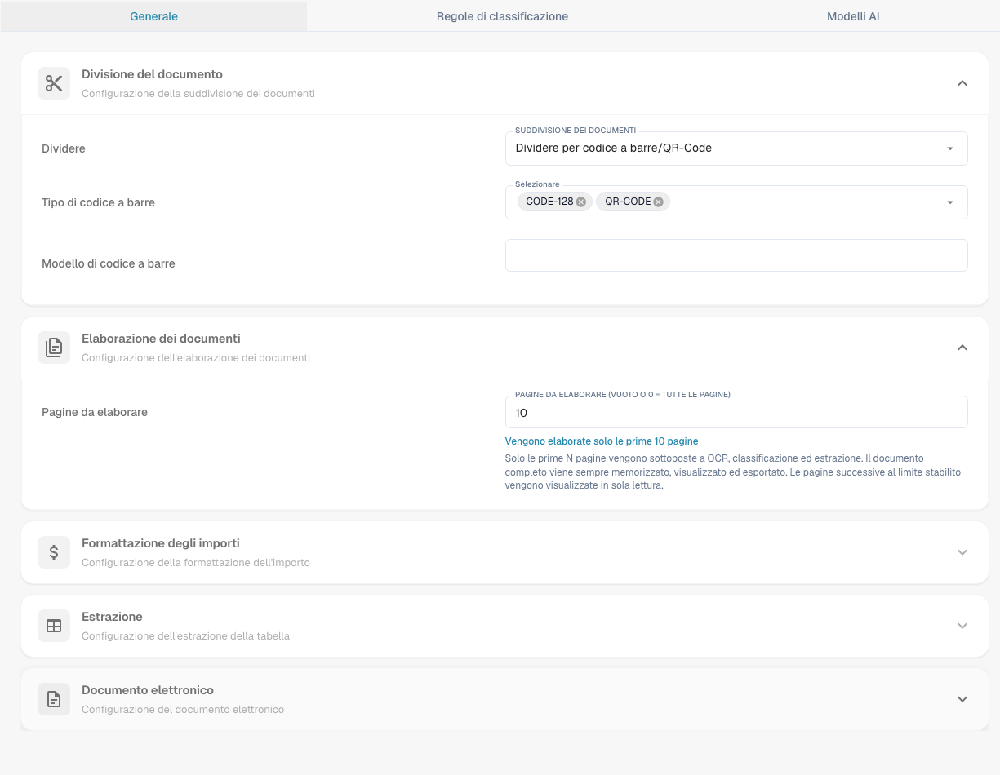
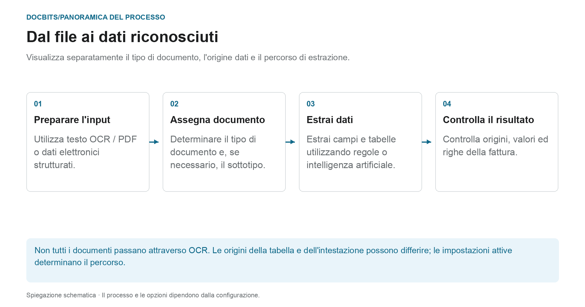

# Classificazione ed estrazione

<figure><figcaption>
Scheda Generale con impostazioni di elaborazione. Il modello di codice a barre dell&#x27;organizzazione è nascosto; nessuna impostazione è stata modificata.
</figcaption></figure>

[AI Table](../../../../end-user-and-partner-section/end-user-section/ai-table/README.md) · [Structured Output per le tabelle](../../../../end-user-and-partner-section/end-user-section/ai-table/structured-output.md)

## Quale impostazione funziona in quale fase del processo?

<figure><figcaption>
Visualizza separatamente il tipo di documento, l&#x27;origine dati e il percorso di estrazione. Il diagramma è schematico; le impostazioni attive della tua organizzazione determinano il comportamento effettivo.
</figcaption></figure>

La classificazione risponde alla domanda **“Che tipo di documento è questo?”**. L'estrazione risponde **“Che valori contiene?”**. Le impostazioni in questa pagina influiscono su diversi punti di elaborazione e non devono essere intese come un singolo interruttore AI.

1. **Preparare l'input:** Per PDFs è possibile utilizzare il testo esistente o OCR; i documenti elettronici supportati possono fornire valori strutturati. Una divisione attivata può separare un documento in entrata in base al codice a barre configurato o ai criteri QR.
2. **Determina il tipo di documento:** Regole e modelli di classificazione assegnano i documenti a un tipo e, se necessario, a un sottotipo. Questa assegnazione deve essere distinta dalla successiva estrazione di campi e tabelle.
3. **Estrai valori:** le tabelle possono seguire percorsi diversi a seconda della configurazione e delle regole salvate applicabili. I campi di intestazione hanno i propri indicatori di origine. Il modello AI selezionato da solo quindi non spiega ogni valore di riga o campo.
4. **Traccia il risultato:** nella schermata di convalida, controlla quale scheda della tabella contiene le righe e quale indicatore di origine ha un campo di intestazione. Se manca una fase di elaborazione, leggere i registri del documento prima di modificare le impostazioni.

### Distinguere tra percorso regole e percorso AI

Le opportune regole della tabella salvate possono determinare l'estrazione della tabella per il modello o il fornitore pertinente. Senza regole adeguate, il percorso AI può essere utilizzato quando è attivata l'estrazione della tabella AI. Le singole colonne possono avere le proprie opzioni AI. Una fonte AI per un campo di intestazione non significa che l'intera tabella provenga dall'AI.

La guida diagnostica [Quale percorso di estrazione è stato utilizzato?](../../../../overview-and-basics/faq/document-processing/which-extraction-path-was-used.md) spiega le schede, gli identificatori di origine e i registri. La pagina [Modello di intelligenza artificiale](ai-model.md) spiega gli standard dell'organizzazione e le sostituzioni relative al modello.

## Panoramica

Nelle impostazioni di **Classification and Extraction** puoi:

* Abilitare la **suddivisione dei documenti** in base ai codici QR
* Configurare la **formattazione degli importi**
* Impostare l'**estrazione delle tabelle**
* Attivare o disattivare l'elaborazione dei file **ZUGFeRD** non supportati
* Definire regole di classificazione speciali
* Monitorare i **modelli AI** addestrati su misura usati nel processo di classificazione

Questa pagina spiega in dettaglio tutte le impostazioni disponibili.

## **Accedere alle impostazioni di Classificazione ed estrazione**

Per accedere alle impostazioni di **Classification and Extraction**, vai su:\
**Settings → Document Processing → Classification and Extraction**

## Suddivisione dei documenti

Nella sezione **Suddivisione dei documenti** puoi configurare se un documento caricato debba essere suddiviso in più documenti ogni volta che su una delle sue pagine compare un **codice a barre**.

Per attivare questa funzione:

1. Vai alla sezione **Suddivisione dei documenti**.
2.  Apri il menu a discesa.

    
3.  Seleziona **Suddividi per codice a barre/codice QR**.

    

Avrai quindi la possibilità di:

* Selezionare uno o più tipi di codice a barre da rilevare.
*   Specificare un pattern regex a cui il codice a barre deve corrispondere per attivare la suddivisione del documento.

    

Dopo una suddivisione riuscita, il documento originale viene eliminato e le pagine proseguono come documenti separati che condividono lo stesso batch.

<figure><figcaption>
Esempio con il pattern <code>^INV\d{6}$</code>: i codici sui fogli 3 e 6 corrispondono e ciascuno avvia un nuovo documento, il codice sul foglio 4 non corrisponde e non suddivide nulla, e l&#x27;elastico rappresenta il batch condiviso dai documenti risultanti.
</figcaption></figure>

## Formattazione degli importi

Nella sezione **Formattazione degli importi** hai due opzioni:

* **Consenti l'arrotondamento nel confronto degli importi:**\
  Se abilitata, durante il confronto degli importi è ammessa una tolleranza di ±0,5.\
  Se disabilitata, si applica una tolleranza predefinita di ±0,05.
* **Richiedi corrispondenza esatta nel confronto degli importi:**\
  Se abilitata, gli importi devono corrispondere esattamente, senza tolleranza.\
  Se disabilitata, è ammessa una tolleranza di ±0,05.

<mark style="color:red;">**Nota**</mark>: solo una di queste due impostazioni può essere attiva alla volta.

## Estrazione delle tabelle


**Prerequisiti per un'estrazione delle tabelle funzionante**

* Il tipo di documento ha delle **colonne della tabella** (Settings → Document Processing → Document Types → [Colonne della Tabella](../../global-settings/document-types/table-columns/README.md)). Senza colonne non c'è nulla in cui estrarre i dati.
* **Estrazione delle tabelle** o **Estrazione AI delle tabelle** è attivata qui sotto, per l'intera organizzazione.
* Il documento ha testo leggibile: l'OCR è stato eseguito, oppure viene usato l'E-Text per i PDF nativi digitali ([Impostazioni OCR](../ocr-settings.md)).
* L'addestramento e i modelli AI sono **per fornitore**. Una tabella addestrata vale solo per i documenti del fornitore su cui è stata addestrata.


Puoi estrarre le tabelle dai documenti abilitando **Estrazione delle tabelle** oppure **Estrazione AI delle tabelle**. Una tabella addestrata (sia basata sull'AI che manuale) è sempre collegata a un fornitore specifico.

**Estrazione delle tabelle:** attiva l'estrazione delle tabelle basata su regole. Le tabelle vengono addestrate per fornitore nella schermata di validazione (*Vai alla vista di estrazione delle tabelle*).\
Maggiori informazioni sull'addestramento [qui](../../../setup/document-training/training-line-fields-table-training/defining-tables-and-columns.md).

**Estrazione AI delle tabelle:** usa l'AI per estrarre la tabella di qualsiasi fornitore senza addestramento. Se i risultati per un fornitore non sono abbastanza accurati, addestra la tabella di quel fornitore; le regole salvate hanno quindi la precedenza sull'AI per quel fornitore.

**Usa Estrazione delle tabelle Vision (AI):** l'AI legge l'immagine della pagina invece del livello di testo. Aiuta con i documenti scansionati e con le tabelle prive di una chiara struttura testuale; è più lenta. Il menu a discesa accanto all'interruttore determina quanto intensamente viene utilizzata l'immagine della pagina:

* **Disattivato (solo testo)** – Viene utilizzato solo il livello di testo. È l'impostazione predefinita.
* **Solo immagini** – Viene letta solo l'immagine della pagina.
* **Ibrido (testo e immagini)** – Il livello di testo e l'immagine della pagina vengono combinati nella stessa richiesta.
* **Auto (deciso per documento)** – DocBits decide per documento se il livello di testo è sufficiente.

La modalità è memorizzata nella chiave di preferenza `TABLE_EXTRACTION_VISION_MODE`; il vecchio interruttore `TABLE_EXTRACTION_USE_VISION` rimane e significa di fatto *Solo immagini*.

**Utilizzare l'estrazione strutturata (IA):** L'interruttore imposta il valore organizzativo dell'output strutturato. Le colonne richieste dipendono da Predefinito/Sì/No in Use AI, dalle impostazioni del modello di estrazione e dall'addestramento del fornitore. La guida completa spiega configurazione, anteprima ed esempio. [Structured Output per le tabelle](../../../../end-user-and-partner-section/end-user-section/ai-table/structured-output.md).

**Estrazione della tabella per l'elemento di costo:** se abilitata, DocBits può estrarre gli elementi di costo dalle tabelle a livello di riga e classificarli di conseguenza.\
Spiegazione dettagliata disponibile [qui](table-extraction-for-costing-element.md).

**Estrazione automatica del codice fiscale:** se abilitata, il sistema compila automaticamente il campo **Codice fiscale** nella schermata di validazione, a condizione che sia configurato un campo per il codice fiscale.\
Maggiori informazioni su questa impostazione [qui](auto-extract-tax-code.md).

**Salva regole di estrazione (solo Admin):** solo gli amministratori possono fare clic su *Salva regole* nell'addestramento della tabella. Attivala quando gli utenti continuano a salvare regole che compromettono l'estrazione di un fornitore.

**AI Model:** imposta il modello organizzativo per l'estrazione di campi e tabelle. Il menu offre Full, Fast, Nexus, Nexus Flash, Auto e Auto Nexus. Verifica disponibilità, qualità, durata e costi con documenti rappresentativi. Un livello non è sempre il più accurato o il più veloce per ogni documento. Le sostituzioni del modello possono sostituire l'impostazione dell'organizzazione. La tabella sotto il selettore mostra:

* Quali **fornitori** usano quale modello AI
* Se usano l'estrazione strutturata (AI) e l'E-Text
* Le opzioni per eliminare una voce e reimpostare così il fornitore al valore predefinito

Questa impostazione è spiegata in dettaglio [qui](ai-model.md).

### Perché la tabella appare diversa da fornitore a fornitore?

L'elaborazione della tabella dipende dalle regole e dalle impostazioni salvate nel contesto del fornitore o del modello pertinente:

* **Regole salvate** (addestramento della tabella): posizione della tabella e mappatura delle sue colonne sul layout di quel fornitore.
* **Tag della tabella AI e regole di formattazione**: i suggerimenti che l'utente ha salvato per la tabella AI di quel fornitore.
* **Modello AI specifico del modello:** la selezione effettuata nella schermata di convalida viene salvata per organizzazione e modello di estrazione corrente. Non cambia automaticamente ogni modello dello stesso fornitore. Senza una sostituzione, viene utilizzata l'impostazione dell'organizzazione applicabile.

Quindi il fornitore A con regole salvate mostra una tabella deterministica nella scheda *Tabella estratta* della schermata di validazione, mentre il fornitore B senza regole riceve la *Tabella estratta dall'AI*. Per far comportare il fornitore B come A, addestra una volta la tabella di B. Per reimpostare un fornitore, elimina le sue regole nella schermata di validazione oppure reimposta i suoi dati di addestramento nella tabella del Modello AI.

### Chiavi delle preferenze

Ogni interruttore di questa sezione viene memorizzato come preferenza dell'organizzazione. Usa la chiave quando imposti il valore tramite l'API (`/preferences/set_preference`), uno script o il DocBits MCP (`get_preference` / `set_preference`).

| Impostazione (etichetta UI) | Chiave della preferenza | Valori |
|---|---|---|
| Estrazione delle tabelle | `TABLE_EXTRACTION_SETTING` | `true` / `false` |
| Estrazione AI delle tabelle | `USE_AI_TABLE_EXTRACTION` | `true` / `false` |
| Usa Estrazione delle tabelle Vision (AI) | `TABLE_EXTRACTION_VISION_MODE` | `off` (predefinito), `vision`, `hybrid`, `auto` |
| Usa Estrazione delle tabelle Vision (AI) – vecchio interruttore | `TABLE_EXTRACTION_USE_VISION` | `true` / `false`; significa di fatto `vision` |
| Usa Estrazione strutturata (AI) | `USE_STRUCTURED_EXTRACTION` | `true` / `false` |
| Estrazione della tabella per l'elemento di costo | `CHARGES_TABLE_EXTRACTION` | `true` / `false` |
| Estrazione automatica del codice fiscale | `AUTO_EXTRACT_TAX_CODE` | `true` / `false` |
| Salva regole di estrazione (solo Admin) | `ONLY_ADMIN_CAN_SAVE_RULES` | `true` / `false` |
| Modello AI | `AI_MODEL` | `gpt-6-sol` (Full), `gpt-6-luna` (Fast), `qwen3.8-max` (Nexus), `glm-5.3-flash` (Nexus Flash), `auto` (Auto), `auto-nexus` (Auto Nexus) |
| Versione dell'estrazione delle tabelle (finestra di conferma) | `TBL_EXT_VERSION` | stringa di versione |
| OCR Settings → Usa i dati AI per le tabelle se disponibili | `USE_AI_DATA_FOR_TABLE` | `true` / `false` |
| OCR Settings → Usa E-Text se disponibile | `USE_ETEXT_IF_AVAILABLE` | `true` / `false` |

Note:

* Le preferenze booleane vengono memorizzate come stringhe `true` / `false`; una chiave mai impostata vale `false`. Se invii `1` o `0`, DocBits memorizza `true` / `false`.
* `AI_MODEL` non impostato significa **Fast**.
* Un `TABLE_EXTRACTION_VISION_MODE` non impostato viene dedotto dal vecchio interruttore `TABLE_EXTRACTION_USE_VISION`: `true` dà `vision`, qualunque altro valore dà `off`.
* La modifica di una chiave ha effetto sui documenti elaborati in seguito. Riavvia un documento per estrarlo di nuovo con la nuova impostazione.
* Le sostituzioni del modello differiscono dalle preferenze dell'organizzazione. La guida al modello AI spiega l'ambito esatto.

## Documento elettronico

**Elabora PDF ZUGFeRD non supportati:** se abilitata, le versioni **ZUGFeRD** non supportate vengono elaborate come PDF standard e l'XML incorporato viene ignorato.

L'elenco delle versioni **ZUGFeRD** supportate è disponibile [qui](../../global-settings/document-types/edi/zugferd/README.md).

## **Regole di classificazione**

Nella sezione **Regole di classificazione** puoi definire pattern **regex** e criteri specifici per aiutare il sistema a classificare automaticamente i documenti durante l'elaborazione.

Per accedere a questa sezione, fai clic sulla scheda **Regole di classificazione** in cima alla pagina.

### **Aggiungere una nuova regola di classificazione**

Per creare una nuova regola:

1.  Fai clic su **Aggiungi** in alto a destra.

    
2. Compila i seguenti campi:
   * **Pattern**: il pattern regex che il sistema deve cercare per attivare la classificazione.
   * **Tipo**: dove cercare il pattern (ad esempio **Codice a barre**).
   * **Sotto-organizzazione** _(facoltativo)_: specifica a quale sotto-organizzazione si applica la regola.
   * **Tipo di documento**: definisce il tipo di documento da assegnare quando il pattern corrisponde.
   *   **Sottotipo di documento** _(facoltativo)_: specifica un sottotipo per una classificazione più dettagliata.

       
3.  Fai clic su **Save** per salvare la regola di classificazione.

    

### **Modificare una regola di classificazione**

Per modificare una regola esistente:

1.  Fai clic sui tre punti nella colonna **Azioni**.

    
2.  Seleziona **Edit**.

    
3. Apporta le modifiche desiderate.
4.  Fai clic su **Save** per applicare gli aggiornamenti.

    

### **Eliminare una regola di classificazione**

Per eliminare una regola:

1.  Fai clic sui tre punti nella colonna **Azioni**.

    
2.  Seleziona **Delete**.

    

## Modelli AI

La sezione **Modelli AI** mostra tutti i modelli addestrati su misura che sono stati ottimizzati specificamente per le tue esigenze.

### Accedere alla sezione Modelli AI

Per aprire questa sezione, fai clic sulla scheda **Modelli AI** in cima alla pagina.

### Categorie di modelli

I modelli sono organizzati in categorie. Sotto il nome di ogni categoria è indicato il numero di modelli che contiene.\
Fai clic su una categoria per vederne i dettagli.

In cima alla pagina della categoria selezionata trovi le informazioni principali su ogni modello:

* **Tipo**: il tipo di modello.
* **Solo prima pagina**: indica se il modello elabora solo la prima pagina di un documento.
* **Versione**: il numero di versione del modello.

### Tabella dei modelli

Tutti i modelli di una categoria sono elencati in una tabella che include le seguenti informazioni:

* **Nome**: il nome del modello.
* **Modello successivo**: il modello che elaborerà ulteriormente l'output del modello corrente.
* **Tipo di documento**: il tipo di documento principale assegnato dal modello durante la classificazione.
* **Sottotipi di documento**: i sottotipi in cui il documento viene ulteriormente classificato.
* **Priorità**: il livello di priorità che determina la posizione del modello nella coda di classificazione.

### Modificare un modello

Per modificare un modello:

1.  Fai clic sull'icona a forma di penna nella colonna **Azioni** accanto al modello che vuoi modificare.

    
2. Aggiorna i campi disponibili:
   * **Modello successivo**: seleziona il modello che deve elaborare l'output del modello corrente.
   * **Tipo di documento**: scegli il tipo di documento con cui il modello deve classificare l'input.
3.  Fai clic su **Save** per applicare le modifiche.

    

<figure><figcaption>
Controlli attuali di estrazione. Structured Output è disattivato in questa configurazione esistente, quindi l&#x27;anteprima dello schema non appare. Nessuna impostazione di estrazione è stata modificata.
</figcaption></figure>
