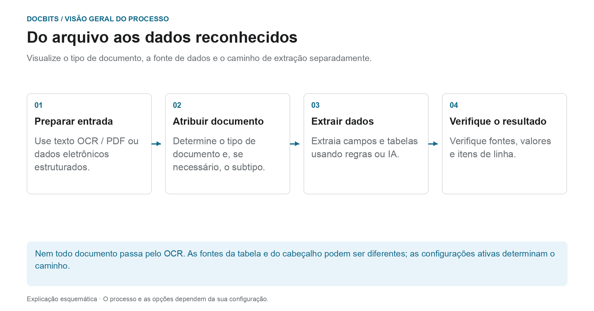

# Classificação e extração

[AI Table](../../../../end-user-and-partner-section/end-user-section/ai-table/README.md) · [Structured Output para tabelas](../../../../end-user-and-partner-section/end-user-section/ai-table/structured-output.md)

## Qual configuração atua em cada etapa do processo?

<figure><figcaption>
Veja o tipo de documento, a fonte de dados e o caminho de extração separadamente. O diagrama é esquemático; as configurações ativas da sua organização determinam o comportamento real.
</figcaption></figure>

A classificação responde à pergunta **“Que tipo de documento é este?”**. A extração responde **“Que valores contém?”**. As configurações nesta página afetam pontos diferentes do processamento e não devem ser entendidas como um único interruptor de IA.

1. **Preparar a entrada:** Nos PDFs pode usar-se o texto existente ou o OCR; os documentos eletrónicos suportados podem fornecer valores estruturados. Uma divisão ativada pode separar um documento recebido com base nos critérios de código de barras ou QR configurados.
2. **Determinar o tipo de documento:** As regras e os modelos de classificação atribuem documentos a um tipo e, se necessário, a um subtipo. Esta atribuição deve distinguir-se da extração posterior de campos e tabelas.
3. **Extrair valores:** As tabelas podem seguir caminhos diferentes consoante a configuração e as regras guardadas aplicáveis. Os campos de cabeçalho têm os seus próprios indicadores de origem. O modelo de IA selecionado, por si só, não explica portanto cada linha ou valor de campo.
4. **Seguir o resultado:** No ecrã de validação, verifique que separador de tabela contém as linhas e que indicador de origem tem um campo de cabeçalho. Se faltar uma etapa de processamento, leia os registos do documento antes de alterar configurações.

### Distinguir entre o caminho das regras e o caminho da IA

As regras de tabela guardadas adequadas podem determinar a extração da tabela para o modelo ou fornecedor em causa. Sem regras adequadas, pode usar-se o caminho da IA quando a extração de tabelas por IA está ativada. Colunas individuais podem ter as suas próprias opções de IA. Uma origem de IA para um campo de cabeçalho não significa que toda a tabela venha da IA.

O guia de diagnóstico [Que caminho de extração foi usado?](../../../../overview-and-basics/faq/document-processing/which-extraction-path-was-used.md) explica separadores, identificadores de origem e protocolos. A página [Modelo de IA](ai-model.md) explica o padrão da organização e as substituições associadas ao modelo.

<figure><figcaption>
General contém configurações de processamento. AI Models está visível aqui porque o módulo está ativado; os seus modelos de classificação personalizados são separados do seletor de nível de extração. O padrão de código de barras guardado está oculto.
</figcaption></figure>
<!-- English source image: dbdc-193-general-overview-en-20261030.png -->

## Visão geral

Nas configurações de **Classification and Extraction**, pode:

* Controlar como os documentos carregados são **divididos** e quantas páginas são processadas
* Configurar a **formatação de valores** para a comparação de montantes
* Configurar a **extração de tabelas**, incluindo o modelo de IA usado por fornecedor
* Ativar ou desativar o processamento de ficheiros **ZUGFeRD** não suportados
* Definir **regras de classificação** que atribuem automaticamente um tipo de documento
* Consultar os **AI Models** e as suas etiquetas treinadas

A página tem **General** e **Classification Rules** e, além disso, **AI Models** quando o módulo de modelos e etiquetas está ativado para a sua organização. Os modelos de classificação personalizados e as etiquetas em **AI Models** são separados do seletor de nível de extração em **General → Extraction**.

| Separador | Conteúdo |
|---|---|
| General | Document Splitting, Document Processing, Amount Formatting, Table Extraction, Electronic Document |
| Classification Rules | Regras regex que classificam documentos pelo nome de origem |
| AI Models | Modelos treinados personalizados com as suas etiquetas, tipos de documento e prioridade |

## Aceder às configurações de classificação e extração

Aceda a **Settings → Document Types → Classification and Extraction**.

## General

O separador **General** agrupa as configurações em secções recolhíveis. A maioria dos controlos guarda quando o valor muda. Um **Barcode Pattern** não vazio e alterado usa a sua ação de validação/**Save**, e uma alteração de versão da extração de tabelas exige confirmação. Reveja a organização e o comportamento pretendido antes de editar um controlo.

### Document Splitting

**Split** determina se um documento carregado é dividido em vários documentos quando aparece um código de barras numa das suas páginas. A lista pendente oferece:

* **Do not split uploaded documents** – a predefinição; o documento é processado como um único ficheiro.
* **Split by Barcode/QR-Code** – o documento é dividido em cada código de barras detetado.

<figure><figcaption>
Reveja o método de divisão e os tipos de código de barras antes de os alterar. O padrão específico da organização está oculto; nenhum valor foi alterado.
</figcaption></figure>
<!-- English source image: dbdc-193-document-splitting-en-20261030.png -->

Quando **Split by Barcode/QR-Code** está selecionado, aparecem mais dois campos:

* **Barcode Type** – um ou mais tipos de código de barras a detetar, por exemplo *CODE-128* ou *QR-CODE*.
* **Barcode Pattern** – uma regex que o valor do código de barras tem de cumprir antes de a divisão ser desencadeada. Deixe-o vazio para dividir em qualquer código de barras dos tipos selecionados. O padrão é validado antes de ser guardado; uma expressão inválida é comunicada imediatamente.

Depois de uma divisão bem-sucedida, o documento principal é eliminado e as páginas continuam como documentos separados que partilham o mesmo lote.

<figure><figcaption>
Exemplo com o padrão <code>^INV\d{6}$</code>: os códigos das folhas 3 e 6 correspondem e cada um inicia um novo documento, o código da folha 4 não corresponde e não divide nada, e o elástico representa o lote que os documentos resultantes partilham.
</figcaption></figure>

### Document Processing

**Pages to process** limita quantas páginas são sujeitas a OCR, classificadas e extraídas por documento.

<figure><figcaption>
Este exemplo tem um limite de 10 páginas processadas. O campo explica que vazio ou 0 significa todas as páginas; o valor apresentado não foi alterado.
</figcaption></figure>
<!-- English source image: dbdc-193-document-processing-en-20261030.png -->

* Vazio ou **0** significa que todas as páginas são processadas.
* Um número *N* limita o OCR, a classificação e a extração às primeiras *N* páginas. O documento completo continua a ser guardado, apresentado e exportado; as páginas além do limite são apresentadas em modo de leitura.

### Amount Formatting

Dois interruptores controlam como os montantes são comparados com os dados mestres e com os pedidos de compra.

<figure><figcaption>
Os dois interruptores de comparação de montantes estão desligados neste exemplo. Inspecione a política pretendida antes de alterar qualquer um deles.
</figcaption></figure>
<!-- English source image: dbdc-193-amount-formatting-en-20261030.png -->

* **Allow Rounding During Amount Comparison** – quando ativado, é permitida uma tolerância de ±0.5. Quando desativado, aplica-se ±0.05.
* **Require Exact Match for Amount Comparison** – quando ativado, os montantes têm de coincidir exatamente, com tolerância zero. Quando desativado, aplica-se ±0.05.

Apenas um dos dois interruptores pode estar ativo de cada vez; ativar um desativa o outro.

### Table Extraction


**Pré-requisitos para uma extração de tabelas funcional**

* O tipo de documento tem **colunas de tabela** (Settings → Document Processing → Document Types → [Table Columns](../../global-settings/document-types/table-columns/README.md)). Sem colunas, não há nada para onde extrair.
* **Table Extraction** ou **AI Table Extraction** está ligado abaixo, para toda a organização.
* O documento tem texto legível: o OCR foi executado ou usa-se E-Text para PDFs nativos digitais ([OCR Settings](../ocr-settings.md)).
* O treino e os modelos de IA são **por fornecedor**. Uma tabela treinada aplica-se apenas a documentos do fornecedor com que foi treinada.


Pode extrair tabelas de documentos ativando **Table Extraction** ou **AI Table Extraction**. Uma tabela treinada (com base em IA ou manual) está sempre associada a um fornecedor específico.

<figure><figcaption>
O seletor de nível de extração está em General → Extraction. O cabeçalho da tabela de substituições por fornecedor é mostrado abaixo; os dados das linhas existentes estão ocultos e nenhuma configuração foi alterada.
</figcaption></figure>
<!-- English source image: dbdc-193-table-extraction-en-20261030.png -->

**Table Extraction:** Ativa a extração de tabelas baseada em regras. As tabelas são treinadas por fornecedor no ecrã de validação (*Go to table extraction view*).\
Saiba mais sobre o treino [aqui](../../../setup/document-training/training-line-fields-table-training/defining-tables-and-columns.md).

**AI Table Extraction:** Usa IA para extrair a tabela de qualquer fornecedor sem treino. Se os resultados de um fornecedor não forem suficientemente precisos, treine a tabela desse fornecedor; as regras guardadas passam então a ter precedência sobre a IA para esse fornecedor.

**Use Table Extraction Vision (AI):** Escolha a entrada para a extração de tabelas por IA numa lista pendente com quatro modos. Trata-se de uma seleção de modo, não de um interruptor separado de ligar/desligar. Alterar o modo selecionado guarda a configuração imediatamente:

* **Off (text only)** – Só é usado o texto do OCR.
* **Images only** – Só é lida a imagem da página.
* **Hybrid (text and images)** – A camada de texto e a imagem da página são combinadas no mesmo pedido.
* **Auto (decided per document)** – O DocBits escolhe, por documento, entre entrada só de texto ou híbrida.

<figure><figcaption>
Os quatro modos de entrada no menu Dev em inglês atual. O menu foi aberto e fechado sem selecionar outro modo; não foi executada nenhuma extração.
</figcaption></figure>
<!-- English source image: dbdc-3-four-vision-options-en-20261031.png -->

**Use Structured Extraction (AI):** O interruptor define o padrão de saída estruturada da organização. As colunas pedidas dependem da seleção tri-estado Use AI; as substituições de modelo e o treino por fornecedor também contam. Leia o [guia completo de configuração, pré-visualização e exemplo](../../../../end-user-and-partner-section/end-user-section/ai-table/structured-output.md) para a Structured Output para tabelas.

**Table Extraction for Costing Element:** Quando ativada, o DocBits pode extrair elementos de custo das tabelas ao nível da linha e classificá-los em conformidade.\
Explicação detalhada disponível [aqui](table-extraction-for-costing-element.md).

**Auto Extract Tax Code:** Quando ativada, o sistema preenche automaticamente o campo **Tax Code** no ecrã de validação, desde que esteja configurado um campo de código de imposto.\
Mais informações sobre esta configuração [aqui](auto-extract-tax-code.md).

**Save extraction rules (Admin only):** Só os administradores podem clicar em *Save Rules* no treino de tabelas. Ative-a quando os utilizadores continuam a guardar regras que quebram a extração de um fornecedor.

**Extract hidden fields:** Os campos marcados como ocultos nas configurações de campos também são extraídos. Use-a quando um valor é necessário para uma regra ou uma exportação mas não deve aparecer no ecrã de validação.

**AI Model:** Define o modelo da organização para a extração de campos e tabelas. O menu oferece Full, Fast, Nexus, Nexus Flash, Auto e Auto Nexus. Verifique a disponibilidade, a qualidade, o tempo de execução e o custo com documentos representativos. Um nível não é sempre o mais preciso ou o mais rápido para todos os documentos. As substituições de modelo podem substituir a configuração da organização. A tabela abaixo do seletor mostra:

* Que **fornecedores** usam que modelo de IA
* Se usam extração estruturada (IA) e E-Text
* Opções para eliminar uma entrada e repor assim o fornecedor no valor predefinido

Esta configuração é explicada em detalhe [aqui](ai-model.md).

#### Porque é que a tabela parece diferente de fornecedor para fornecedor?

O processamento da tabela depende das regras guardadas e das configurações no contexto do fornecedor ou do modelo em causa:

* **Regras guardadas** (treino de tabelas): posição da tabela e mapeamento das suas colunas no layout desse fornecedor.
* **Etiquetas e regras de formatação da tabela de IA**: indicações que o utilizador guardou para a tabela de IA desse fornecedor.
* **Modelo de IA específico do modelo:** A seleção feita no ecrã de validação é guardada por organização e modelo de extração atual. Não altera automaticamente todos os modelos do mesmo fornecedor. Sem uma substituição, usa-se a configuração aplicável da organização.

Assim, o fornecedor A com regras guardadas mostra uma tabela determinística no separador *Extracted table* do ecrã de validação, enquanto o fornecedor B sem regras recebe a *AI Extracted table*. Para que o fornecedor B se comporte como o A, treine a tabela de B uma vez. Para repor um fornecedor, elimine as suas regras no ecrã de validação ou reponha os seus dados de treino na tabela do AI Model.

#### Chaves de preferência

Cada interruptor desta secção é guardado como uma preferência da organização. Use a chave quando definir o valor através da API (`/preferences/set_preference`), de um script ou do DocBits MCP (`get_preference` / `set_preference`).

| Configuração (etiqueta na interface) | Chave de preferência | Valores |
|---|---|---|
| Split | `SPLIT_DOCUMENT_ON_BARCODE` | `true` / `false` |
| Barcode Type | `SPLIT_DOCUMENT_BARCODE_TYPE` | lista de nomes de tipos de código de barras |
| Barcode Pattern | `SPLIT_DOCUMENT_BARCODE_PATTERN` | cadeia regex |
| Pages to process | `RESTRICT_TO_PAGES` | número; vazio ou `0` = todas as páginas |
| Allow Rounding During Amount Comparison | `AMOUNTS_ROUNDING` | `true` / `false` |
| Require Exact Match for Amount Comparison | `AMOUNTS_NO_ROUNDING` | `true` / `false` |
| Table Extraction | `TABLE_EXTRACTION_SETTING` | `true` / `false` |
| AI Table extraction | `USE_AI_TABLE_EXTRACTION` | `true` / `false` |
| Use Table Extraction Vision (AI) | `TABLE_EXTRACTION_VISION_MODE` | `off`, `vision`, `hybrid`, `auto`; quando não definida, a preferência antiga determina o modo |
| Use Table Extraction Vision (AI) – interruptor antigo | `TABLE_EXTRACTION_USE_VISION` | `true` / `false`; significa, na prática, `vision` |
| Use Structured Extraction (AI) | `USE_STRUCTURED_EXTRACTION` | `true` / `false` |
| Table extraction for costing element | `CHARGES_TABLE_EXTRACTION` | `true` / `false` |
| Auto extract tax code | `AUTO_EXTRACT_TAX_CODE` | `true` / `false` |
| Save extraction rules (Admin only) | `ONLY_ADMIN_CAN_SAVE_RULES` | `true` / `false` |
| Extract hidden fields | `EXTRACT_HIDDEN_FIELDS` | `true` / `false` |
| AI Model | `AI_MODEL` | `gpt-6-sol` (Full), `gpt-6-luna` (Fast), `qwen3.8-max` (Nexus), `glm-5.3-flash` (Nexus Flash), `auto` (Auto), `auto-nexus` (Auto Nexus) |
| Table extraction version (confirmation dialog) | `TBL_EXT_VERSION` | cadeia de versão |
| OCR Settings → Use AI data for tables if available | `USE_AI_DATA_FOR_TABLE` | `true` / `false` |
| OCR Settings → Use E-Text if available | `USE_ETEXT_IF_AVAILABLE` | `true` / `false` |

Notas:

* As preferências booleanas são guardadas como as cadeias `true` / `false`. Uma chave não definida usa o valor predefinido dessa configuração; a interface mostra **Extract hidden fields** como ligada quando não está definida. Não assuma que toda a chave ausente significa false. Se enviar `1` ou `0`, o DocBits guarda `true` / `false`.
* `AI_MODEL` não definido significa **Fast**.
* Um `TABLE_EXTRACTION_VISION_MODE` não definido é resolvido a partir do interruptor antigo `TABLE_EXTRACTION_USE_VISION`: `true` resolve para `vision`, qualquer outro valor para `off`.
* Alterar uma chave produz efeito nos documentos processados posteriormente. Reinicie um documento para o extrair novamente com a nova configuração.
* As substituições de modelo diferem das preferências da organização. O guia AI Model explica o âmbito exato.

### Electronic Document

**Process Unsupported ZUGFeRD PDF:** Se estiver ativado, as versões **ZUGFeRD** não suportadas são processadas como PDFs padrão e o XML incorporado é ignorado.

A lista de versões **ZUGFeRD** suportadas encontra-se [aqui](../../global-settings/document-types/edi/zugferd/README.md).

<figure><figcaption>
Electronic Document contém a opção para PDFs ZUGFeRD não suportados. O estado apresentado é uma configuração existente; não foi efetuado qualquer processamento de documentos para esta captura.
</figcaption></figure>
<!-- English source image: dbdc-193-electronic-document-en-20261030.png -->

## Classification Rules

O separador **Classification Rules** lista as regras que atribuem automaticamente um tipo de documento durante o processamento. Cada regra compara um **padrão regex** com o nome de origem do documento e, em caso de correspondência, define o tipo de documento e, opcionalmente, um subtipo de documento.

Mude para o separador clicando em **Classification Rules** no topo da página.

<figure><figcaption>
Pesquise regras existentes ou escolha Add para preparar uma regra. As linhas de regras existentes estão ocultas; este não é um exemplo de lista vazia.
</figcaption></figure>
<!-- English source image: dbdc-193-rules-list-en-20261030.png -->

A tabela tem uma linha por regra, com estas colunas:

* **Type** – onde o padrão é aplicado. Existem dois tipos: **Barcode** e **E-Mail**.
* **Pattern** – a regex guardada para a regra.
* **Document Type** – o tipo de documento atribuído quando o padrão corresponde.
* **Sub Document Type** – o subtipo de documento atribuído quando o padrão corresponde.
* **Sub Organization** – a suborganização à qual a regra está limitada. Vazio significa que a regra se aplica a todas as suborganizações.
* **Actions** – o menu da linha com *Edit* e *Delete*.

O campo de pesquisa acima da tabela filtra todas as colunas, incluindo as etiquetas apresentadas nas colunas de lista pendente.

### Adicionar uma nova regra de classificação

1.  Clique em **Add** acima da tabela.

    <figure><figcaption>
Add abre este formulário de regra em branco. Verifique o padrão e o tipo de destino antes de Save; Cancel fecha-o sem criar uma regra.
</figcaption></figure>
    <!-- English source image: dbdc-193-rule-add-en-20261030.png -->
2. Preencha os campos:
   * **Pattern** (obrigatório) – a regex que a regra procura.
   * **Type** (obrigatório) – **Barcode** ou **E-Mail**. Isto decide contra que nome de origem o padrão é comparado.
   * **Sub Organization** *(opcional)* – limita a regra a uma suborganização.
   * **Document Type** – o tipo de documento atribuído quando o padrão corresponde.
   * **Sub Document Type** *(opcional)* – um tipo mais específico; a lista depende do tipo de documento selecionado. Alterar o tipo de documento limpa o subtipo de documento.
3.  Clique em **Save**.

A caixa de diálogo valida o padrão antes de guardar. Um padrão já usado por outra regra é rejeitado com *Pattern already exists*; um padrão vazio é rejeitado com a mensagem de campo obrigatório.

#### Ajuda do padrão

O interruptor **Show help** abaixo do campo de padrão abre uma referência em linha com os formatos de nome de origem contra os quais o padrão é comparado:

* **O365** – `Shared Email + Folder › Shared Email › Folder › Email › Id`
* **Gmail** – `Email + Folder › Folder › Email › Id`

<figure><figcaption>
Show help explica contra que nome de origem a regex é comparada. A referência e os exemplos são apresentados sem introduzir ou guardar uma regra.
</figcaption></figure>
<!-- English source image: dbdc-193-rule-pattern-help-en-20261030.png -->

Exemplos apresentados no painel:

* `.*@acme\.de.*` – qualquer origem dessa caixa de correio
* `^ap@acme\.de:.*` – uma caixa de correio específica, qualquer pasta

Dica: ancore com `^` / `$` para correspondências exatas, escape pontos como `\.` e use `:` como separador de campos. O primeiro conjunto de campos presente no nome de origem vence.

Se usar o tipo **E-Mail**, o padrão é comparado com os nomes da caixa de correio e da pasta do correio importado, não com o conteúdo do documento.

### Editar uma regra de classificação

1.  Clique nos três pontos na coluna **Actions** da regra que pretende alterar.
2.  Selecione **Edit**. A caixa de diálogo abre com os valores atuais da regra.
3. Faça as suas alterações ao padrão, tipo, suborganização, tipo de documento ou subtipo de documento.
4.  Clique em **Save**.

Aplica-se a mesma validação da adição de uma regra: o padrão não pode estar vazio nem duplicar o padrão de outra regra.

### Eliminar uma regra de classificação

1. Clique nos três pontos na coluna **Actions**.
2. Selecione **Delete**.

A regra é removida da lista imediatamente. Eliminar uma regra não altera documentos que já foram classificados com ela.

## AI Models

O separador **AI Models** mostra os modelos treinados personalizados disponíveis para a classificação de documentos e as respetivas etiquetas. Só aparece quando o módulo de modelos e etiquetas está ativado para a sua organização.

<figure><figcaption>
AI Models é um separador opcional para modelos de classificação personalizados e etiquetas. Nesta organização, a leitura bem-sucedida da lista não devolveu modelos; isto não descreve a configuração do nível de extração.
</figcaption></figure>
<!-- English source image: dbdc-193-ai-models-empty-en-20261030.png -->

Se não existir nenhum modelo personalizado para a organização, o separador mostra *No Record Found!*.

### Modelos

Cada modelo é uma entrada expansível com:

* O **nome do modelo** e um badge **Default** no modelo que é usado quando nada mais se aplica.
* O número de **etiquetas** treinadas para esse modelo.
* Por modelo, uma vez expandido: **Type**, **First page only** e **Version**.

Abaixo dessa informação, são listadas as etiquetas do modelo.

### Etiquetas

As etiquetas são o que o modelo aprende. Cada etiqueta mapeia um padrão que o modelo reconhece para um tipo de documento.

* **Name** – o nome da etiqueta.
* **Next model** – um modelo que continua o processamento da saída desta etiqueta.
* **DOC TYPE** – o tipo de documento atribuído pela etiqueta.
* **Sub Document Type** – um tipo mais específico para a etiqueta.
* **Priority** – a ordem em que as etiquetas são avaliadas; primeiro os números mais baixos.

O campo de pesquisa acima da tabela de etiquetas filtra as etiquetas do modelo selecionado.

### Editar uma etiqueta

Clique no ícone de caneta numa linha de etiqueta para abrir a caixa de diálogo de edição. Esta oferece **Next model** e **Document Type**; defina um deles, pois a caixa de diálogo exige um modelo seguinte ou um tipo de documento. Clique em **Save** para aplicar a alteração.

## Páginas relacionadas

* [AI Model](ai-model.md) – os seis níveis de extração e como um fornecedor obtém o seu próprio modelo
* [Auto Extract Tax Code](auto-extract-tax-code.md)
* [Table Extraction for Costing Element](table-extraction-for-costing-element.md)
* [OCR Settings](../ocr-settings.md)

<figure><figcaption>
Controlos de extração atuais. Structured Output está desativado nesta configuração existente, por isso não é apresentada nenhuma pré-visualização do esquema. Nenhuma configuração de extração foi alterada.
</figcaption></figure>
