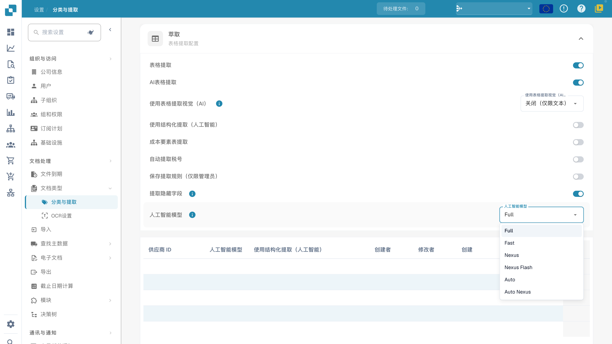

# AI Model

## 概述

**AI Model** 设置用于定义在文档处理过程中，**字段抽取**和**表格抽取**默认使用哪个 AI 模型。\
使用当前的模型选择器和模板偏好表来查看组织设置和覆盖项。关于费用，请查阅您所在环境中可用的信息和您的订阅条款。

## 如何访问

1.  转到 **Settings** → **Document Types** → **Classification and Extraction** → **General**

    <figure><figcaption>
当前的抽取设置和 AI Model 菜单：Full、Fast、Nexus、Nexus Flash、Auto 和 Auto Nexus。表中的私有值已隐藏；未选择模型，也未删除偏好。
</figcaption></figure>
2.  展开 **Extraction**，找到 **AI Model** 设置。

## AI 模型选项

当前菜单提供 **Full**、**Fast**、**Nexus**、**Nexus Flash**、**Auto** 和 **Auto Nexus**。这些是产品层级名称。可用选项、底层模型和 token 费用都可能变化；请查看当前环境中的信息和您的订阅条款，而不要依赖历史上的供应商模型名称或固定价格。

<figure><figcaption>
当前开发环境菜单中六个抽取层级的细节。打开和关闭菜单后，原有选择保持不变。
</figcaption></figure>

| 选项 | 用代表性文档需要核实的内容 |
| --- | --- |
| **Full** | 复杂版式的抽取结果、处理时间和费用。 |
| **Fast** | 日常文档的结果和处理时间；名称并不保证适用于每个文档。 |
| **Nexus** | 用相同的文档样本比较这一替代选项。 |
| **Nexus Flash** | 在实际版式上同时检查质量和延迟。 |
| **Auto** | 检查自动选择的结果和费用。 |
| **Auto Nexus** | 检查 Nexus 自动选择选项的结果和费用。 |

当当前抽取模板没有覆盖项时，其模型设置会回退到组织配置。未设置的供应商特定值并不普遍意味着 Fast。更改模型前请用固定样本进行比较；仅更改模型并不能保证字段校验、PO 匹配、审批或导出成功。

## AI 模型分配表

**Validation screen** 提供供应商特定模型的入口。其覆盖项按组织和当前抽取模板（`tfidf_id`）保存；它不会无条件更新同一供应商的每个模板或历史文档。\
\
更多信息请参阅相应文档[此处](../../../../end-user-and-partner-section/end-user-section/validation-screen/supplier-specific-ai-model-for-field-and-table-extraction.md)。

分配表汇总了与模板相关的抽取偏好。列会因产品版本而异；请使用当前的列标题查看供应商关联、模型、抽取选项和审计信息：

* **Supplier ID** – 供应商的唯一标识符
* **AI Model** – 为此模板条目配置的层级
* **Use Structured Extraction (AI)**（如存在）– 此条目的结构化抽取偏好
* **E-Text** – 指示是否启用了 E-Text 功能
* **Created By / Modified By / Created On / Modified On** – 谁设置了该条目以及何时设置
* **Action** – 包含删除该条目的选项

### 删除条目——移除模板覆盖项

管理员删除条目之前，应先确定它属于哪个抽取模板以及其中包含的所有偏好。删除可能移除模板的多个覆盖项，而不只是模型设置：

1.  在供应商条目旁的 **Action** 列中点击三个点，然后选择 **Delete**。

2.  会出现确认对话框——确认您要删除该条目。

删除后，后续处理会读取适用的组织配置和此模板的回退值。与同一供应商关联的其他模板可能保留各自的覆盖项。删除不会自动重新处理历史文档。本指南未执行任何删除，也未产生相应的抽取结果。

## 设置与覆盖项

Structured Output 有独立的组织/模板设置，与模型层级分开。请在文档上的 More options 中更改；确认后会保存覆盖项并重新启动该文档。设置列表中的指示器为只读。删除偏好条目可能同时移除多个覆盖项。[表格的 Structured Output](../../../../end-user-and-partner-section/end-user-section/ai-table/structured-output.md)。
