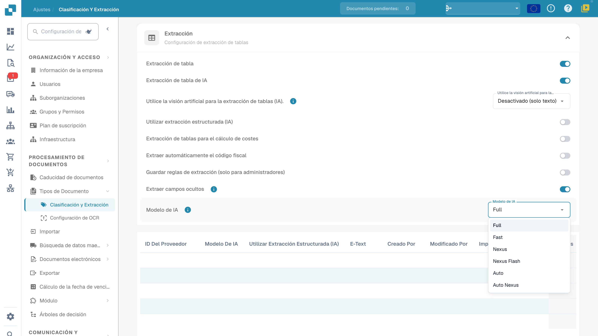

# AI Model

## Descripción general

La opción **AI Model** permite definir qué modelo de IA se usa de forma predeterminada para la **extracción de campos** y la **extracción de tablas** durante el procesamiento de documentos.\
Use el selector de modelo actual y la tabla de preferencias de plantilla para revisar la configuración de la organización y las anulaciones. Para los costes, consulte la información disponible en su entorno y las condiciones de su suscripción.

## Cómo acceder

1.  Vaya a **Settings** → **Document Types** → **Classification and Extraction** → **General**

    <figure><figcaption>
Ajustes de extracción actuales y menú AI Model: Full, Fast, Nexus, Nexus Flash, Auto y Auto Nexus. Los valores privados de la tabla están ocultos; no se ha seleccionado ningún modelo ni eliminado preferencias.
</figcaption></figure>
2.  Despliegue **Extraction** y localice la opción **AI Model**.

## Opciones de modelo de IA

El menú actual ofrece **Full**, **Fast**, **Nexus**, **Nexus Flash**, **Auto** y **Auto Nexus**. Son nombres de niveles de producto. Las opciones disponibles, los modelos subyacentes y los costes por token pueden cambiar; compruebe la información de su entorno actual y las condiciones de su suscripción en lugar de fiarse de un nombre histórico de modelo de proveedor o de un precio fijo.

<figure><figcaption>
Detalle de los seis niveles de extracción en el menú actual del entorno de desarrollo. Abrir y cerrar el menú dejó la selección existente sin cambios.
</figcaption></figure>

| Opción | Qué comprobar con documentos representativos |
| --- | --- |
| **Full** | Resultados de extracción en diseños complejos, tiempo de procesamiento y coste. |
| **Fast** | Resultados y tiempo de procesamiento en documentos del día a día; el nombre no es una garantía para todos los documentos. |
| **Nexus** | Compare esta opción alternativa con la misma muestra de documentos. |
| **Nexus Flash** | Compruebe tanto la calidad como la latencia en sus diseños reales. |
| **Auto** | Compruebe los resultados y los costes de la selección automática. |
| **Auto Nexus** | Compruebe los resultados y los costes de la opción de selección automática de Nexus. |

Cuando la plantilla de extracción actual no tiene anulación, su ajuste de modelo recurre a la configuración de la organización. Un valor específico de proveedor sin definir no significa de forma universal Fast. Compare una muestra fija antes de cambiar de modelo; un cambio de modelo por sí solo no garantiza la validación de campos, la conciliación con pedidos, la aprobación ni un export correcto.

## Tabla de asignación de modelos de IA

La **pantalla de validación** ofrece un punto de entrada para el modelo específico del proveedor. Su anulación se guarda para la organización y la plantilla de extracción actual (`tfidf_id`); no actualiza sin condiciones todas las plantillas ni los documentos históricos del mismo proveedor.\
\
Para más información, consulte la documentación correspondiente [aquí](../../../../end-user-and-partner-section/end-user-section/validation-screen/supplier-specific-ai-model-for-field-and-table-extraction.md).

La tabla de asignación resume las preferencias de extracción relacionadas con la plantilla. Las columnas varían según la versión del producto; use los encabezados actuales para revisar la asociación de proveedor, el modelo, las opciones de extracción y la información de auditoría:

* **Supplier ID** – El identificador único del proveedor
* **AI Model** – El nivel configurado para esta entrada de plantilla
* **Use Structured Extraction (AI)**, si aparece – La preferencia de extracción estructurada de esta entrada
* **E-Text** – Indica si la función E-Text está activada
* **Created By / Modified By / Created On / Modified On** – Quién estableció la entrada y cuándo
* **Action** – Contiene la opción de eliminar la entrada

### Eliminar entrada: quitar anulaciones de plantilla

Antes de que un administrador elimine una entrada, debe identificar su plantilla de extracción y todas las preferencias que contiene. Eliminar puede quitar varias anulaciones de la plantilla, no solo el ajuste de modelo:

1.  Haga clic en los tres puntos de la columna **Action**, junto a la entrada del proveedor, y seleccione **Delete**.

2.  Aparecerá un diálogo de confirmación: confirme que desea eliminar la entrada.

Tras la eliminación, el procesamiento posterior lee la configuración de organización aplicable y los valores de reserva de esta plantilla. Otras plantillas asociadas al mismo proveedor pueden conservar anulaciones independientes. La eliminación no reprocesa automáticamente documentos históricos. Para esta guía no se ha eliminado ninguna entrada ni se ha realizado la extracción resultante.

## Ajustes y anulaciones

Structured Output tiene un ajuste de organización/plantilla propio, separado del nivel de modelo. Cámbielo en More options del documento; la confirmación guarda la anulación y reinicia ese documento. Los indicadores de la lista de ajustes son de solo lectura. Eliminar una entrada de preferencia puede quitar varias anulaciones a la vez. [Structured Output para tablas](../../../../end-user-and-partner-section/end-user-section/ai-table/structured-output.md).
