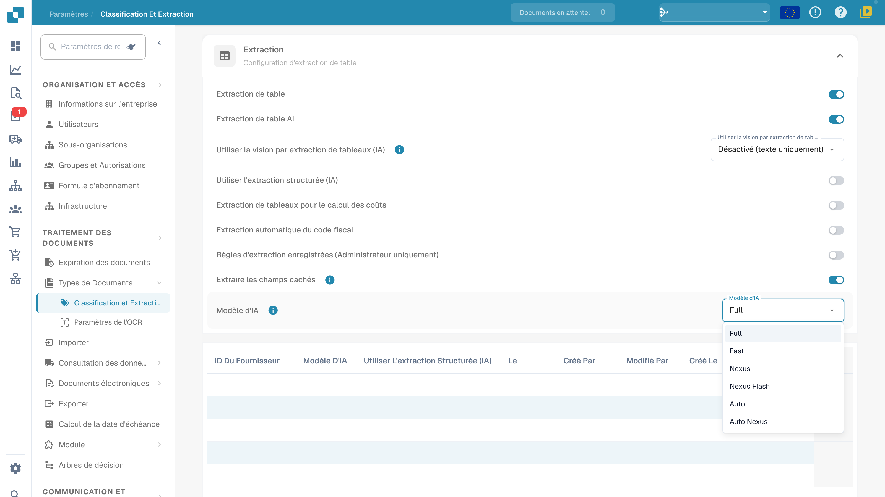

# AI Model

## Vue d'ensemble

Le paramètre **AI Model** permet de définir quel modèle d'IA est utilisé par défaut pour l'**extraction de champs** et l'**extraction de tableaux** pendant le traitement des documents.\
Utilisez le sélecteur de modèle actuel et le tableau des préférences de modèle pour vérifier le paramètre de l'organisation et les surcharges. Pour les coûts, consultez les informations disponibles dans votre environnement et les conditions de votre abonnement.

## Comment y accéder

1.  Accédez à **Settings** → **Document Types** → **Classification and Extraction** → **General**

    <figure><figcaption>
Paramètres d'extraction actuels et menu AI Model : Full, Fast, Nexus, Nexus Flash, Auto et Auto Nexus. Les valeurs privées du tableau sont masquées ; aucun modèle n'est sélectionné et aucune préférence supprimée.
</figcaption></figure>
2.  Dépliez **Extraction** et repérez le paramètre **AI Model**.

## Options de modèle d'IA

Le menu actuel propose **Full**, **Fast**, **Nexus**, **Nexus Flash**, **Auto** et **Auto Nexus**. Ce sont des noms de niveaux de produit. Les options disponibles, les modèles sous-jacents et les coûts en tokens peuvent changer ; vérifiez les informations de votre environnement actuel et les conditions de votre abonnement plutôt que de vous fier à un nom de modèle de fournisseur historique ou à un prix fixe.

<figure><figcaption>
Détail des six niveaux d'extraction dans le menu actuel de l'environnement de développement. L'ouverture et la fermeture du menu ont laissé la sélection existante inchangée.
</figcaption></figure>

| Option | Ce qu'il faut vérifier avec des documents représentatifs |
| --- | --- |
| **Full** | Résultats d'extraction sur des mises en page complexes, temps de traitement et coût. |
| **Fast** | Résultats et temps de traitement sur des documents courants ; le nom ne garantit rien pour chaque document. |
| **Nexus** | Comparez cette option alternative avec le même échantillon de documents. |
| **Nexus Flash** | Vérifiez à la fois la qualité et la latence sur vos mises en page réelles. |
| **Auto** | Vérifiez les résultats et les coûts de la sélection automatique. |
| **Auto Nexus** | Vérifiez les résultats et les coûts de l'option de sélection automatique Nexus. |

Lorsque le modèle d'extraction actuel n'a pas de surcharge, son paramètre de modèle revient à la configuration de l'organisation. Une valeur spécifique au fournisseur non définie ne signifie pas universellement Fast. Comparez un échantillon fixe avant de changer de modèle ; un changement de modèle seul ne garantit ni la validation des champs, ni le rapprochement avec les commandes, ni l'approbation, ni la réussite de l'export.

## Tableau d'affectation des modèles d'IA

L'**écran de validation** offre un point d'entrée pour le modèle spécifique au fournisseur. Sa surcharge est enregistrée pour l'organisation et le modèle d'extraction actuel (`tfidf_id`) ; elle ne met pas à jour sans condition tous les modèles ou documents historiques appartenant au même fournisseur.\
\
Pour plus d'informations, consultez la documentation correspondante [ici](../../../../end-user-and-partner-section/end-user-section/validation-screen/supplier-specific-ai-model-for-field-and-table-extraction.md).

Le tableau d'affectation résume les préférences d'extraction liées au modèle. Les colonnes varient selon la version du produit ; utilisez les en-têtes actuels pour examiner l'association de fournisseur, le modèle, les options d'extraction et les informations d'audit :

* **Supplier ID** – L'identifiant unique du fournisseur
* **AI Model** – Le niveau configuré pour cette entrée de modèle
* **Use Structured Extraction (AI)**, lorsqu'il est présent – La préférence d'extraction structurée de cette entrée
* **E-Text** – Indique si la fonction E-Text est activée
* **Created By / Modified By / Created On / Modified On** – Qui a défini l'entrée et quand
* **Action** – Contient l'option de suppression de l'entrée

### Supprimer une entrée : retirer les surcharges de modèle

Avant qu'un administrateur ne supprime une entrée, il doit identifier son modèle d'extraction et toutes les préférences qu'il contient. La suppression peut retirer plusieurs surcharges du modèle, pas seulement le paramètre de modèle :

1.  Cliquez sur les trois points de la colonne **Action** à côté de l'entrée fournisseur et sélectionnez **Delete**.

2.  Une boîte de dialogue de confirmation apparaît — confirmez que vous voulez supprimer l'entrée.

Après la suppression, le traitement suivant lit la configuration d'organisation applicable et les valeurs de repli de ce modèle. D'autres modèles associés au même fournisseur peuvent conserver des surcharges indépendantes. La suppression ne retraite pas automatiquement les documents historiques. Pour ce guide, aucune entrée n'a été supprimée et aucune extraction en découlant n'a été effectuée.

## Paramètres et surcharges

Structured Output a un paramètre d'organisation/de modèle distinct du niveau de modèle. Modifiez-le dans More options sur le document ; la confirmation enregistre la surcharge et redémarre ce document. Les indicateurs de la liste des paramètres sont en lecture seule. Supprimer une entrée de préférence peut retirer plusieurs surcharges à la fois. [Structured Output pour les tableaux](../../../../end-user-and-partner-section/end-user-section/ai-table/structured-output.md).
