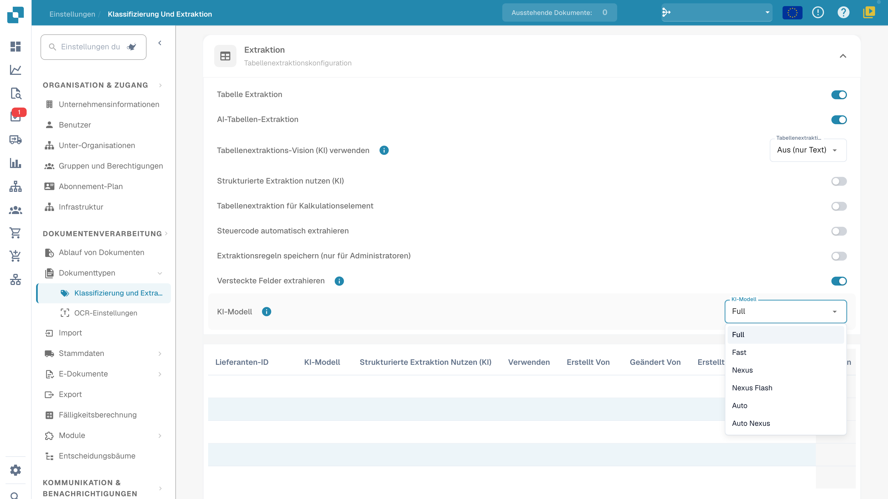

# AI Model

## Übersicht

Die Einstellung **AI Model** legt fest, welches KI-Modell während der Dokumentenverarbeitung standardmäßig für die **Feldextraktion** und die **Tabellenextraktion** verwendet wird.\
Nutzen Sie die aktuelle Modellauswahl und die Tabelle der vorlagenbezogenen Einstellungen, um die Organisationseinstellung und die Überschreibungen zu prüfen. Zu Kosten lesen Sie die Angaben in Ihrer Umgebung und Ihre Vertragsbedingungen.

## So greifen Sie zu

1.  Navigieren Sie zu **Settings** → **Document Types** → **Classification and Extraction** → **General**

    <figure><figcaption>
Aktuelle Extraktionseinstellungen mit dem Menü AI Model und den sechs Modellstufen. Private Tabellenwerte sind ausgeblendet; es wurde kein Modell ausgewählt und keine Einstellung gelöscht.
</figcaption></figure>
2.  Klappen Sie **Extraction** auf und suchen Sie die Einstellung **AI Model**.

## KI-Modell-Optionen

Das aktuelle Menü bietet **Full**, **Fast**, **Nexus**, **Nexus Flash**, **Auto** und **Auto Nexus**. Das sind Produktstufen. Verfügbare Optionen, zugrunde liegende Modelle und Token-Kosten können sich ändern; prüfen Sie die Angaben Ihrer aktuellen Umgebung und Ihre Vertragsbedingungen, statt sich auf einen historischen Anbietermodellnamen oder einen festen Preis zu verlassen.

<figure><figcaption>
Detail der sechs Extraktionsstufen im aktuellen Entwicklungsmenü. Öffnen und Schließen des Menüs ließ die vorhandene Auswahl unverändert.
</figcaption></figure>

| Option | Was Sie mit repräsentativen Dokumenten prüfen sollten |
| --- | --- |
| **Full** | Extraktionsergebnisse bei komplexen Layouts, Verarbeitungszeit und Kosten. |
| **Fast** | Ergebnisse und Laufzeit bei Alltagsdokumenten; der Name garantiert nicht für jedes Dokument ein bestimmtes Ergebnis. |
| **Nexus** | Vergleich dieser Alternative mit derselben Dokumentstichprobe. |
| **Nexus Flash** | Qualität und Laufzeit bei den tatsächlich verarbeiteten Layouts. |
| **Auto** | Ergebnisse und Kosten der automatischen Auswahl. |
| **Auto Nexus** | Ergebnisse und Kosten der automatischen Auswahl innerhalb der Nexus-Optionen. |

Hat die aktuelle Extraktionsvorlage keine Überschreibung, greift ihre Modelleinstellung auf die Konfiguration der Organisation zurück. Ein nicht gesetzter lieferantenspezifischer Wert bedeutet nicht allgemein Fast. Vergleichen Sie eine feste Stichprobe, bevor Sie Modelle wechseln; ein Modellwechsel allein garantiert weder Feldvalidierung noch PO-Abgleich, Freigabe oder erfolgreichen Export.

## KI-Modell-Zuweisungstabelle

Der **Validierungsbildschirm** bietet einen Einstieg für lieferantenspezifische Modelle. Die Überschreibung wird für die Organisation und die aktuelle Extraktionsvorlage (`tfidf_id`) gespeichert; sie aktualisiert nicht bedingungslos jede Vorlage oder jedes historische Dokument desselben Lieferanten.\
\
Weitere Informationen finden Sie in der entsprechenden Dokumentation [hier](../../../../end-user-and-partner-section/end-user-section/validation-screen/supplier-specific-ai-model-for-field-and-table-extraction.md).

Die Zuweisungstabelle fasst vorlagenbezogene Extraktionspräferenzen zusammen. Die Spalten hängen von der Produktversion ab; prüfen Sie die aktuellen Überschriften für Lieferantenzuordnung, Modell, Extraktionsoptionen und Änderungsinformationen:

* **Supplier ID** – Die eindeutige Kennung des Lieferanten
* **AI Model** – Die für diesen Vorlageneintrag konfigurierte Stufe
* **Use Structured Extraction (AI)**, falls vorhanden – Die Präferenz für strukturierte Extraktion dieses Eintrags
* **E-Text** – Gibt an, ob die E-Text-Funktion aktiviert ist
* **Created By / Modified By / Created On / Modified On** – Wer den Eintrag gesetzt hat und wann
* **Action** – Enthält die Option, den Eintrag zu löschen

### Eintrag löschen – Vorlagenbezogene Überschreibungen entfernen

Bevor ein Administrator einen Eintrag löscht, sollte er die zugehörige Extraktionsvorlage und alle darin enthaltenen Präferenzen feststellen. Das Löschen kann mehrere Überschreibungen der Vorlage entfernen, nicht nur die Modelleinstellung:

1.  Klicken Sie in der Spalte **Action** neben dem Lieferanteneintrag auf die drei Punkte und wählen Sie **Delete**.

2.  Ein Bestätigungsdialog erscheint – bestätigen Sie, dass Sie den Eintrag löschen möchten.

Nach dem Löschen liest die weitere Verarbeitung die anwendbare Organisationskonfiguration und die Rückfallwerte für diese Vorlage. Andere Vorlagen desselben Lieferanten können eigene Überschreibungen behalten. Das Löschen verarbeitet historische Dokumente nicht automatisch erneut. Für diese Anleitung wurde kein Eintrag gelöscht und keine daraus folgende Extraktion durchgeführt.

## Einstellungen und Überschreibungen

Structured Output hat eine eigene Organisations-/Vorlageneinstellung, getrennt von der Modellstufe. Ändern Sie sie unter More options am Dokument; die Bestätigung speichert die Überschreibung und startet dieses Dokument neu. Die Anzeigen in der Einstellungsliste sind schreibgeschützt. Das Löschen eines Präferenzeintrags kann mehrere Überschreibungen zugleich entfernen. [Structured Output für Tabellen](../../../../end-user-and-partner-section/end-user-section/ai-table/structured-output.md).
