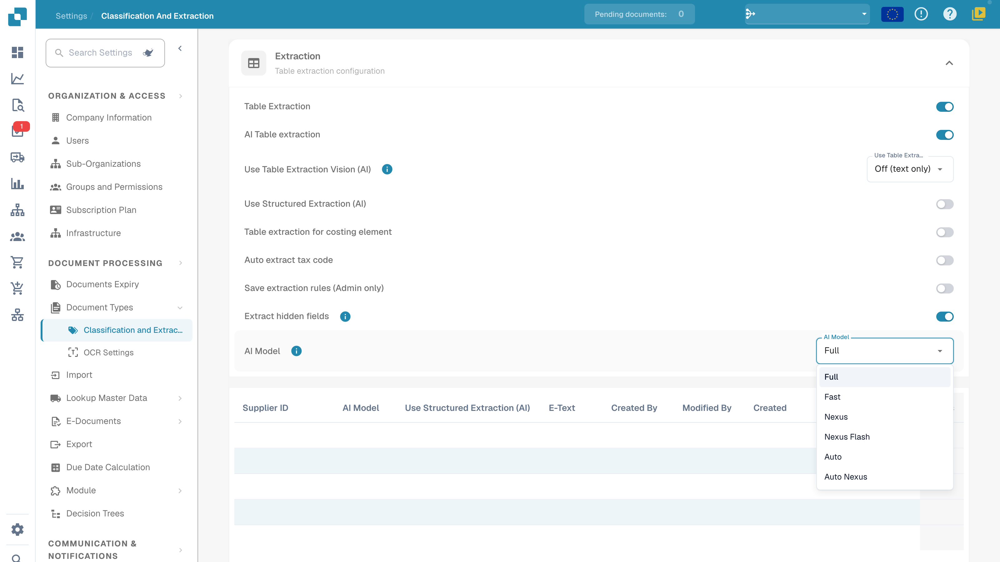
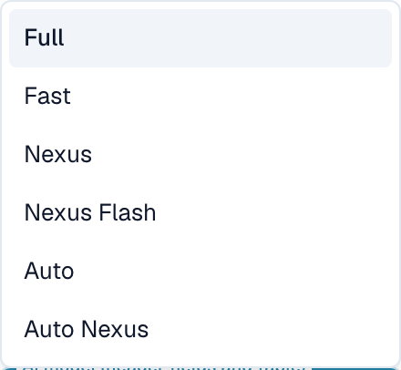

# AI Model

## Panoramica

L'impostazione **AI Model** permette di definire quale modello AI viene usato per impostazione predefinita per l'**estrazione dei campi** e l'**estrazione delle tabelle** durante l'elaborazione dei documenti.\
Usa il selettore di modello attuale e la tabella delle preferenze del modello per verificare l'impostazione dell'organizzazione e gli override. Per i costi, consulta le informazioni disponibili nel tuo ambiente e le condizioni del tuo abbonamento.

## Come accedere

1.  Vai a **Settings** → **Document Types** → **Classification and Extraction** → **General**

    <figure><figcaption>
Impostazioni di estrazione attuali e menu AI Model: Full, Fast, Nexus, Nexus Flash, Auto e Auto Nexus. I valori privati della tabella sono nascosti; nessun modello è stato selezionato e nessuna preferenza eliminata.
</figcaption></figure>
2.  Espandi **Extraction** e individua l'impostazione **AI Model**.

## Opzioni di modello AI

Il menu attuale offre **Full**, **Fast**, **Nexus**, **Nexus Flash**, **Auto** e **Auto Nexus**. Sono nomi di livelli di prodotto. Le opzioni disponibili, i modelli sottostanti e i costi in token possono cambiare; verifica le informazioni del tuo ambiente attuale e le condizioni del tuo abbonamento invece di affidarti a un nome storico di modello di provider o a un prezzo fisso.

<figure><figcaption>
Dettaglio dei sei livelli di estrazione nel menu attuale dell'ambiente di sviluppo. Aprire e chiudere il menu ha lasciato invariata la selezione esistente.
</figcaption></figure>

| Opzione | Cosa verificare con documenti rappresentativi |
| --- | --- |
| **Full** | Risultati di estrazione su layout complessi, tempo di elaborazione e costo. |
| **Fast** | Risultati e tempo di elaborazione su documenti quotidiani; il nome non è una garanzia per ogni documento. |
| **Nexus** | Confronta questa opzione alternativa con lo stesso campione di documenti. |
| **Nexus Flash** | Verifica sia la qualità sia la latenza sui tuoi layout reali. |
| **Auto** | Verifica i risultati e i costi della selezione automatica. |
| **Auto Nexus** | Verifica i risultati e i costi dell'opzione di selezione automatica Nexus. |

Quando il modello di estrazione attuale non ha un override, la sua impostazione di modello ricade sulla configurazione dell'organizzazione. Un valore specifico del fornitore non impostato non significa universalmente Fast. Confronta un campione fisso prima di cambiare modello; un cambio di modello da solo non garantisce validazione dei campi, riconciliazione con gli ordini, approvazione o export riuscito.

## Tabella di assegnazione del modello AI

La **schermata di validazione** offre un punto di accesso per il modello specifico del fornitore. Il suo override viene salvato per l'organizzazione e il modello di estrazione attuale (`tfidf_id`); non aggiorna incondizionatamente ogni modello o documento storico dello stesso fornitore.\
\
Per maggiori informazioni, consulta la documentazione corrispondente [qui](../../../../end-user-and-partner-section/end-user-section/validation-screen/supplier-specific-ai-model-for-field-and-table-extraction.md).

La tabella di assegnazione riassume le preferenze di estrazione legate al modello. Le colonne variano in base alla versione del prodotto; usa le intestazioni attuali per esaminare associazione fornitore, modello, opzioni di estrazione e informazioni di audit:

* **Supplier ID** – L'identificatore univoco del fornitore
* **AI Model** – Il livello configurato per questa voce di modello
* **Use Structured Extraction (AI)**, se presente – La preferenza di estrazione strutturata di questa voce
* **E-Text** – Indica se la funzione E-Text è attiva
* **Created By / Modified By / Created On / Modified On** – Chi ha impostato la voce e quando
* **Action** – Contiene l'opzione per eliminare la voce

### Eliminare una voce: rimuovere gli override del modello

Prima che un amministratore elimini una voce, deve identificare il modello di estrazione a cui appartiene e tutte le preferenze che contiene. L'eliminazione può rimuovere più override del modello, non solo l'impostazione del modello:

1.  Clicca sui tre punti nella colonna **Action** accanto alla voce del fornitore e seleziona **Delete**.

2.  Compare una finestra di conferma — conferma di voler eliminare la voce.

Dopo l'eliminazione, l'elaborazione successiva legge la configurazione dell'organizzazione applicabile e i valori di riserva per questo modello. Altri modelli associati allo stesso fornitore possono mantenere override indipendenti. L'eliminazione non rielabora automaticamente i documenti storici. Per questa guida non è stata eliminata alcuna voce e non è stata eseguita alcuna estrazione derivante.

## Impostazioni e override

Structured Output ha un'impostazione di organizzazione/modello separata dal livello di modello. Modificala in More options sul documento; la conferma salva l'override e riavvia quel documento. Gli indicatori nell'elenco delle impostazioni sono di sola lettura. Eliminare una voce di preferenza può rimuovere più override insieme. [Structured Output per le tabelle](../../../../end-user-and-partner-section/end-user-section/ai-table/structured-output.md).
