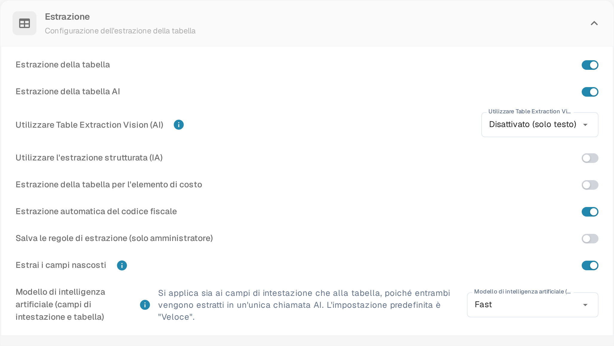

# Estrazione della tabella per l'elemento di costo

Gli elementi di costo sono addebiti o altri importi rappresentati come righe della tabella della fattura. Se questa funzione è abilitata e il documento contiene righe estratte, DocBits può classificare quelle righe rispetto agli elementi di costo configurati per l'organizzazione. Un revisore può correggere la classificazione di una riga nella tabella del documento.

## Abilitare l'impostazione

1. Apri **Impostazioni → Tipi di Documento** e seleziona **Classificazione ed Estrazione** sotto la voce **Tipi di Documento**.
2. Rimani su **Generale** ed espandi **Estrazione**.
3. Trova **Estrazione della tabella per l'elemento di costo** sotto i campi richiesti per l'estrazione della tabella. Un amministratore può attivare questo interruttore per l'organizzazione.

<figure><figcaption>
L'interruttore <strong>Estrazione della tabella per l'elemento di costo</strong> si trova tra <strong>Utilizzare l'estrazione strutturata (IA)</strong> ed <strong>Estrazione automatica del codice fiscale</strong>. Nell'organizzazione usata per questa guida è disattivato.
</figcaption></figure>


Il solo interruttore non crea elementi di costo né righe di fattura. Configura prima gli elementi e importa i dati necessari. La guida collegata [configurazione degli elementi di costo](../../../../infor-integration-and-configuration/importing-customer-master-data/m3/table-extraction-for-costing-element.md) spiega l'esempio M3. Consulta [Classificazione ed estrazione](README.md) per le altre impostazioni di estrazione.


## Rivedere o correggere una riga

Apri un documento la cui tabella della fattura contiene righe estratte e controlla l'icona dell'elemento di costo accanto alla riga interessata. Seleziona l'icona per aprire le classificazioni disponibili. Scegli l'elemento di costo configurato corretto, oppure scegli **Uncategorize** se la riga è un articolo ordinario. Poi rivedi la riga risultante e i totali prima di salvare il documento.

Se l'icona o una classificazione manca, conferma prima che il documento contenga righe estratte, che la funzione sia abilitata e che un elemento di costo sia configurato per l'organizzazione.
