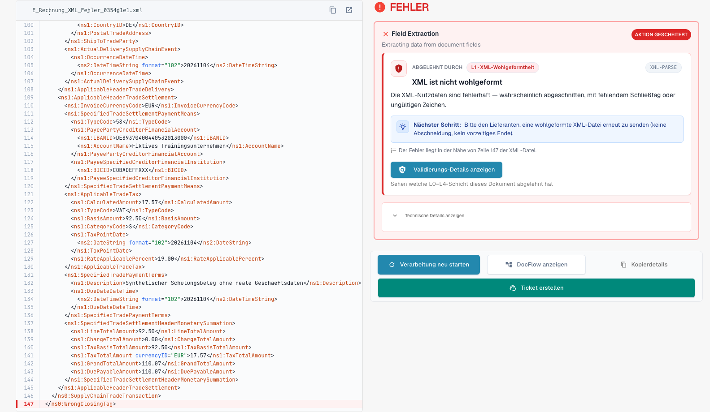
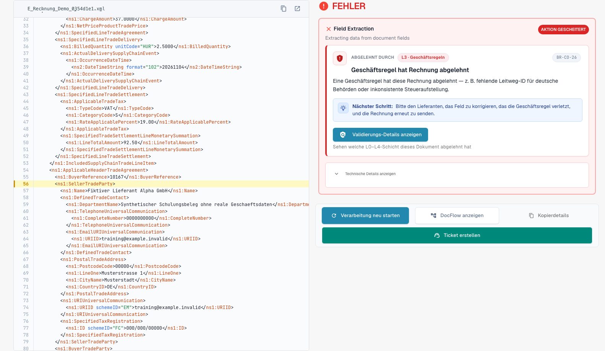

# Die Fehleransicht einer abgelehnten E-Rechnung

> Einzelne Produkttexte können in dieser Version noch Englisch oder sprachlich fehlerhaft sein. Die Anleitung erklärt die Bedeutung; die Screenshots zeigen die unveränderte Oberfläche.

Wenn Sie eine fehlerhafte E-Rechnung hochladen, geht sie in DocBits nicht verloren. Das Dokument erhält den Status **Fehler**, und die Fehleransicht sagt Ihnen, was falsch ist, wo und was Sie als Nächstes tun können. Diese Seite zeigt zwei Beispiele: eine XML-Datei, die nicht wohlgeformt ist, und eine Rechnung, die gegen eine Geschäftsregel verstößt.

> Eine Rechnung erhält den Status **Fehler** nur, wenn die Prüfung für ihren Dokumenttyp **aktiviert** und **blockierend** ist. Siehe [Prüfung je Dokumenttyp](validation-per-document-type.md).

## Beispiel 1: Die XML-Datei ist beschädigt

Ein Lieferant sendet eine XML-Datei, in der ein schließendes Tag nicht zum öffnenden Tag passt. Die Datei kann nicht gelesen werden, daher stoppt DocBits bei der ersten Prüfung, **L1 · XML-Wohlgeformtheit**.

<figure><figcaption>
Fehleransicht einer synthetischen XML-Datei mit einem absichtlich beschädigten Abschluss-Tag. Einzelne Produkttexte können in dieser Version noch Englisch oder sprachlich fehlerhaft sein. Die Anleitung erklärt die Bedeutung; die Screenshots zeigen die unveränderte Oberfläche.
</figcaption></figure>

Die Ansicht hat zwei Seiten:

* **Links: die XML-Datei.** DocBits zeigt die Datei mit Zeilennummern. Die Zeile mit dem Problem ist rot markiert. Mit den Schaltflächen über der Datei kopieren Sie das XML oder öffnen es in einem neuen Tab.
* **Rechts: die Erklärung.** Die Karte **Abgelehnt durch** nennt die Prüfung, die die Datei gestoppt hat (hier **L1 · XML-Wohlgeformtheit**), und den Regelcode (hier `XML-PARSE`). Darunter sehen Sie einen Titel in verständlicher Sprache (*XML ist nicht wohlgeformt*), eine kurze Erklärung und den Block **Nächster Schritt**.

Wählen Sie **Validierungs-Details anzeigen**, um den vollständigen [Prüfbericht](validation-report.md) zu öffnen.

<figure><figcaption>
Prüfbericht zur beschädigten synthetischen XML-Datei.
</figcaption></figure>

Der Bericht nennt die genaue Position (Zeile und Spalte stehen im Bericht) und gibt die technische Meldung des XML-Parsers wieder. Wählen Sie **Im XML anzeigen**, um zu dieser Zeile zu springen. Der Hinweis **So beheben Sie den Fehler** sagt Ihnen, dass Sie den Absender um eine korrigierte Datei bitten sollen.

## Beispiel 2: Die Rechnung verstößt gegen eine Geschäftsregel

Das XML ist in Ordnung, aber ein Pflichtfeld fehlt. Zum Beispiel kann der Verkäufer nicht identifiziert werden, weil weder eine Verkäufer-Kennung, noch eine Registrierungskennung, noch eine Umsatzsteuer-Kennung vorhanden ist (Regel `BR-CO-26`).

<figure><figcaption>
Fehleransicht einer rein synthetischen Beispielrechnung. Einzelne Produkttexte können in dieser Version noch Englisch oder sprachlich fehlerhaft sein. Die Anleitung erklärt die Bedeutung; die Screenshots zeigen die unveränderte Oberfläche.
</figcaption></figure>

Die Karte zeigt das erste blockierende Ergebnis. Im vollständigen Bericht finden Sie auch den Code `BR-CO-26` und die weiteren Prüfhinweise der Rechnung.

## Die Schaltflächen unter der Karte

| Schaltfläche | Was sie bewirkt |
| --- | --- |
| **Verarbeitung neu starten** | Führt die Verarbeitung des Dokuments erneut aus, zum Beispiel nachdem Sie eine Einstellung geändert haben. Die Prüfung verwendet die aktuellen Einstellungen. |
| **DocFlow anzeigen** | Zeigt den Workflow des Dokuments. |
| **Fehlerdetails kopieren** | Kopiert die Fehlerdetails, zum Beispiel für eine Nachricht an Ihren Administrator. |
| **Ticket erstellen** | Öffnet ein Support-Ticket mit den Fehlerdetails. |

Wählen Sie **Technische Details anzeigen** auf der Karte, um die technischen Rohinformationen zu sehen.

## Was Sie als Nächstes tun

* **Fehler:** Bitten Sie den Absender um eine korrigierte Rechnung oder [lehnen Sie das Dokument ab](validation-next-step-and-reject.md). Eine korrigierte Rechnung ist ein neues Dokument.
* **Nur Warnungen:** Das Dokument ist nicht blockiert. Sie können fortfahren.

## Verwandte Seiten

* [Prüfbericht](validation-report.md): alle Prüfhinweise, Ebene für Ebene.
* [Nächster Schritt und Dokument ablehnen](validation-next-step-and-reject.md)
* [Prüfung je Dokumenttyp](validation-per-document-type.md): Prüfung einschalten und Blockierung festlegen.
