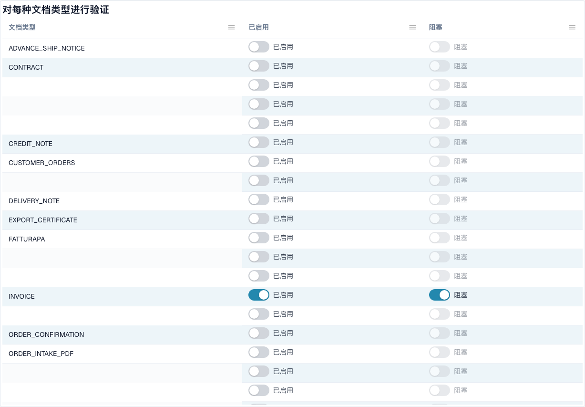

# 电子发票验证

演示视频使用英语；本页的操作说明与截图使用中文。



**电子发票验证**页面（**设置 → 电子文档 → 电子发票验证**，路径 `/settings/einvoice-validation`；早期称为 _验证规则_）用于控制 DocBits 如何验证收到的电子发票。该功能基于官方 **KoSIT XRechnung + ZUGFeRD** 规则集，以及验证器内部的校验代码，并允许您为所在组织覆盖每条规则的严重级别。

> 此页面适用于**电子发票**（XRechnung、ZUGFeRD、Factur-X）。它不同于**数据验证规则**，后者用于检查提取出的文档字段。

## 此页面包含的内容

<figure><figcaption>
按文档类型设置验证与阻止处理。已隐藏自定义名称。Dev 示例。
</figcaption></figure>

| 主题 | 功能 | 适用对象 |
| --- | --- | --- |
| [验证设置和接受的版本](validation-setup.md) | 设置向导、接受的 XRechnung 版本、接受的规范配置，以及各严重级别的含义。 | 组织管理员 |
| [规则严重级别](validation-rule-severities.md) | 规则表：更改所在组织每条规则的严重级别。 | 组织管理员 |
| [按文档类型验证](validation-per-document-type.md) | 启用验证（**已启用**），并决定检查失败时是否阻止文档（**阻止处理**）。每次更改都需要确认。 | 组织管理员 |
| [变更日志](validation-change-log.md) | 每次设置变更的记录：时间、操作人、规则以及变更前 → 变更后。 | 组织管理员 |
| [被拒绝电子发票的错误界面](validation-error-screen.md) | 上传错误 XML 时显示的内容：说明、出错行和后续步骤。 | 所有处理发票的人员 |
| [验证报告](validation-report.md) | 发票验证失败时用户看到的内容：以通俗语言说明各项校验问题。报告从文档中打开，而不是从此页面打开。 | 所有处理发票的人员 |
| [下一步操作与拒绝文档](validation-next-step-and-reject.md) | 阅读报告后的操作、报告下载，以及 **拒绝文档**。 | 所有处理发票的人员 |
