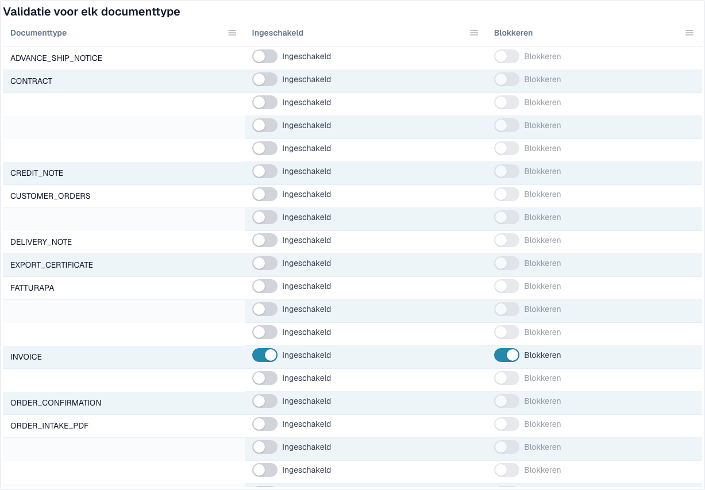

# E-factuurvalidatie



De pagina **E-factuurvalidatie** (**Settings → E-Documents → E-Invoice Validation**, pad `/settings/einvoice-validation`; eerder _Validation Rules_ geheten) bepaalt hoe DocBits inkomende e-facturen valideert. De pagina is gebaseerd op de officiële regelset **KoSIT XRechnung + ZUGFeRD** plus de interne foutcodes van de validator, en laat u de ernst van elke regel voor uw organisatie overschrijven.

> Deze pagina gaat over **e-facturen** (XRechnung, ZUGFeRD, Factur-X). Het is niet hetzelfde als **Data Validation Rules**, die geëxtraheerde documentvelden controleren.

## Wat er op deze pagina staat

<figure><figcaption>
Validatie en blokkering per documenttype. Ingestelde namen zijn afgeschermd. Voorbeeld uit de ontwikkelomgeving.
</figcaption></figure>

| Onderwerp | Wat het doet | Voor wie |
| ----------------------------------------------------------------------- | ---------------------------------------------------------------------------------------------------------------------------------------- | ------------------------------- |
| [Validatie instellen en geaccepteerde versies](validation-setup.md) | De installatiewizard, de geaccepteerde XRechnung-versies, de geaccepteerde profielen en wat elke ernst betekent. | Organisatiebeheerders |
| [Ernst van regels](validation-rule-severities.md) | De regeltabel: de ernst van elke regel voor uw organisatie wijzigen. | Organisatiebeheerders |
| [Validatie per documenttype](validation-per-document-type.md) | Validatie aanzetten (**Enabled**) en bepalen of een mislukte controle het document tegenhoudt (**Blocking**). Elke wijziging vraagt om een bevestiging. | Organisatiebeheerders |
| [Wijzigingslogboek](validation-change-log.md) | Elke wijziging van de instellingen: wanneer, wie, welke regel, van → naar. | Organisatiebeheerders |
| [Het foutscherm voor een afgekeurde e-factuur](validation-error-screen.md) | Wat u ziet wanneer u een onjuiste XML uploadt: de uitleg, de foutieve regel en de volgende stap. | Iedereen die facturen verwerkt |
| [Validatierapport](validation-report.md) | Wat een gebruiker ziet wanneer een factuur mislukt: de bevindingen in begrijpelijke taal. Het opent vanuit het document, niet vanaf deze pagina. | Iedereen die facturen verwerkt |
| [Volgende stap en een document afkeuren](validation-next-step-and-reject.md) | Wat u doet nadat u het rapport hebt gelezen, downloads van het rapport en **Reject document**. | Iedereen die facturen verwerkt |
