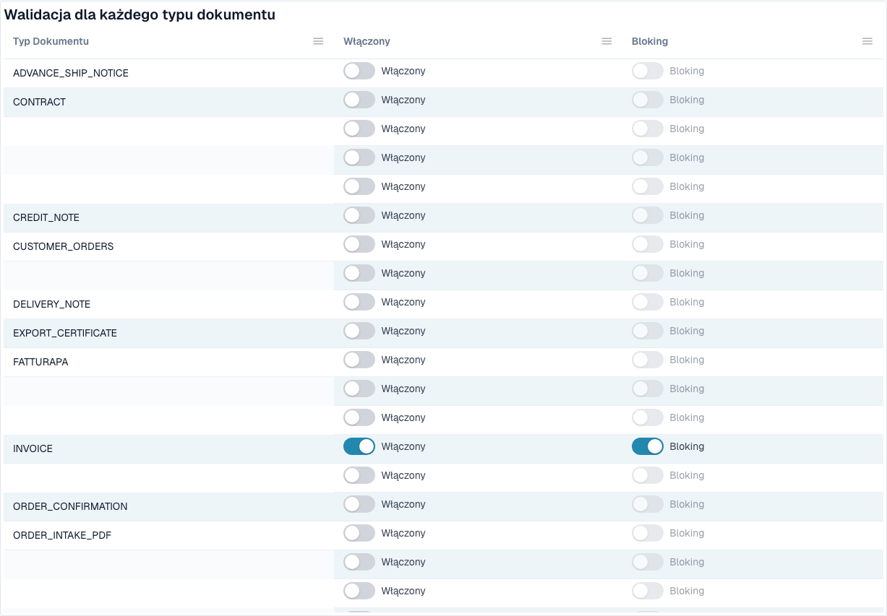

# Walidacja faktur elektronicznych



Strona **Walidacja faktur elektronicznych** (**Settings → E-Documents → E-Invoice Validation**, ścieżka `/settings/einvoice-validation`; wcześniej _Validation Rules_) kontroluje, jak DocBits waliduje przychodzące faktury elektroniczne. Opiera się na oficjalnym zestawie reguł **KoSIT XRechnung + ZUGFeRD** oraz wewnętrznych kodach ustaleń walidatora i pozwala nadpisać wagę każdej reguły dla Twojej organizacji.

> Ta strona dotyczy **faktur elektronicznych** (XRechnung, ZUGFeRD, Factur-X). To nie jest to samo co **Data Validation Rules**, które sprawdzają wyodrębnione pola dokumentów.

## Co jest na tej stronie

<figure><figcaption>
Walidacja i blokowanie według typu dokumentu. Skonfigurowane nazwy są ukryte. Przykład ze środowiska deweloperskiego.
</figcaption></figure>

| Temat | Co robi | Dla kogo |
| ----------------------------------------------------------------------- | ---------------------------------------------------------------------------------------------------------------------------------------- | ------------------------------- |
| [Konfiguracja walidacji i akceptowane wersje](validation-setup.md) | Kreator konfiguracji, akceptowane wersje XRechnung, akceptowane profile i znaczenie każdej wagi. | Administratorzy organizacji |
| [Waga reguł](validation-rule-severities.md) | Tabela reguł: zmiana wagi każdej reguły dla Twojej organizacji. | Administratorzy organizacji |
| [Walidacja według typu dokumentu](validation-per-document-type.md) | Włączenie walidacji (**Enabled**) i decyzja, czy nieudane sprawdzenie zatrzymuje dokument (**Blocking**). Każda zmiana wymaga potwierdzenia. | Administratorzy organizacji |
| [Dziennik zmian](validation-change-log.md) | Każda zmiana ustawień: kiedy, kto, która reguła, z → na. | Administratorzy organizacji |
| [Ekran błędu odrzuconej faktury elektronicznej](validation-error-screen.md) | Co widzisz po przesłaniu nieprawidłowego XML: wyjaśnienie, błędny wiersz i następny krok. | Wszyscy, którzy przetwarzają faktury |
| [Raport walidacji](validation-report.md) | Co widzi użytkownik, gdy faktura nie przechodzi walidacji: ustalenia prostym językiem. Otwiera się z dokumentu, a nie z tej strony. | Wszyscy, którzy przetwarzają faktury |
| [Następny krok i odrzucenie dokumentu](validation-next-step-and-reject.md) | Co zrobić po przeczytaniu raportu, pobieranie raportu i **Reject document**. | Wszyscy, którzy przetwarzają faktury |
