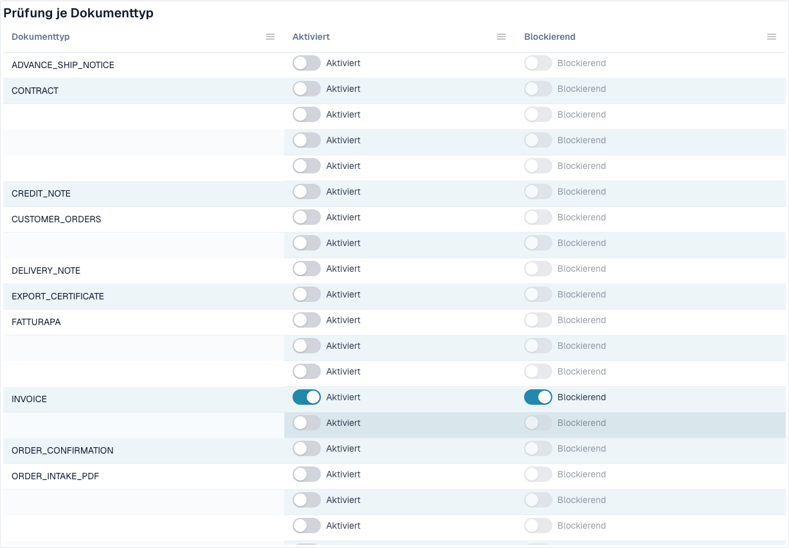

# E-Rechnungs-Prüfung



Die Seite **E-Rechnungs-Prüfung** (**Settings → E-Documents → E-Invoice Validation**, Pfad `/settings/einvoice-validation`; früher _Validation Rules_) steuert, wie DocBits eingehende E-Rechnungen prüft. Sie beruht auf dem offiziellen Regelsatz **KoSIT XRechnung + ZUGFeRD** sowie auf den internen Befundcodes des Validators und erlaubt es, den Schweregrad jeder Regel für Ihre Organisation zu überschreiben.

> Diese Seite gilt für **E-Rechnungen** (XRechnung, ZUGFeRD, Factur-X). Sie ist nicht dasselbe wie **Data Validation Rules**, die extrahierte Dokumentfelder prüfen.

## Was auf dieser Seite steht

<figure><figcaption>
Prüfung und Blockierung je Dokumenttyp. Konfigurierte Namen sind ausgeblendet. Entwicklungsbeispiel.
</figcaption></figure>

| Thema | Was es bewirkt | Für wen |
| ----------------------------------------------------------------------- | ---------------------------------------------------------------------------------------------------------------------------------------- | ------------------------------- |
| [Validierungs-Setup und akzeptierte Versionen](validation-setup.md) | Der Einrichtungsassistent, die akzeptierten XRechnung-Versionen, die akzeptierten Profile und was die einzelnen Schweregrade bedeuten. | Organisationsadministratoren |
| [Regel-Schweregrade](validation-rule-severities.md) | Die Regeltabelle: den Schweregrad jeder Regel für Ihre Organisation ändern. | Organisationsadministratoren |
| [Prüfung je Dokumenttyp](validation-per-document-type.md) | Prüfung einschalten (**Enabled**) und entscheiden, ob eine fehlgeschlagene Prüfung das Dokument stoppt (**Blocking**). Jede Änderung braucht eine Bestätigung. | Organisationsadministratoren |
| [Änderungsprotokoll](validation-change-log.md) | Jede Änderung der Einstellungen: wann, wer, welche Regel, von → nach. | Organisationsadministratoren |
| [Die Fehleransicht einer abgelehnten E-Rechnung](validation-error-screen.md) | Was Sie sehen, wenn Sie ein fehlerhaftes XML hochladen: die Erklärung, die fehlerhafte Zeile und der nächste Schritt. | Alle, die Rechnungen bearbeiten |
| [Prüfbericht](validation-report.md) | Was ein Benutzer sieht, wenn eine Rechnung fehlschlägt: die Befunde in verständlicher Sprache. Er öffnet sich aus dem Dokument, nicht von dieser Seite aus. | Alle, die Rechnungen bearbeiten |
| [Nächster Schritt und Dokument ablehnen](validation-next-step-and-reject.md) | Was nach dem Lesen des Berichts zu tun ist, Downloads des Berichts und **Reject document**. | Alle, die Rechnungen bearbeiten |
