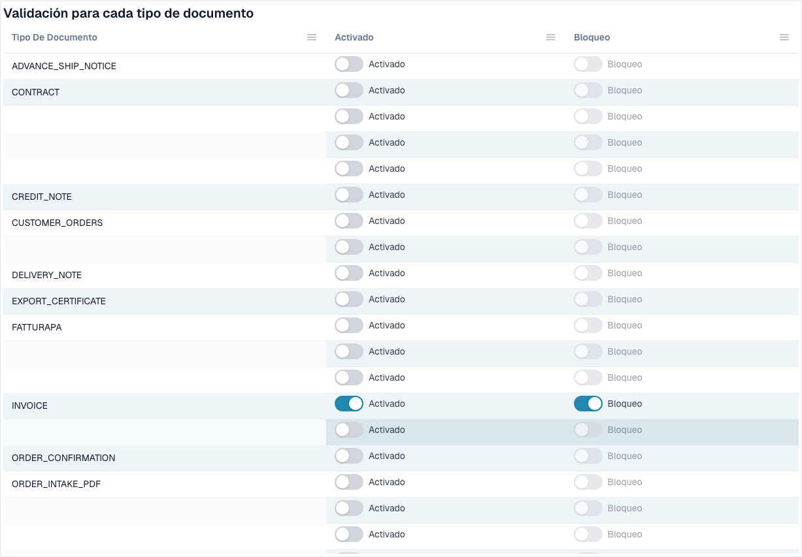

# Validación de facturas electrónicas



La página **Validación de facturas electrónicas** (**Settings → E-Documents → E-Invoice Validation**, ruta `/settings/einvoice-validation`; antes llamada _Validation Rules_) controla cómo valida DocBits las facturas electrónicas entrantes. Se basa en el conjunto de reglas oficial **KoSIT XRechnung + ZUGFeRD** y en los códigos de hallazgo internos del validador, y permite anular la gravedad de cada regla para su organización.

> Esta página es para **facturas electrónicas** (XRechnung, ZUGFeRD, Factur-X). No es lo mismo que **Data Validation Rules**, que comprueban campos extraídos de documentos.

## Qué hay en esta página

<figure><figcaption>
Validación y bloqueo por tipo de documento. Los nombres configurados están ocultos. Ejemplo del entorno de desarrollo.
</figcaption></figure>

| Tema | Qué hace | Para quién |
| ----------------------------------------------------------------------- | ---------------------------------------------------------------------------------------------------------------------------------------- | ------------------------------- |
| [Configuración de la validación y versiones aceptadas](validation-setup.md) | El asistente de configuración, las versiones de XRechnung aceptadas, los perfiles aceptados y qué significa cada gravedad. | Administradores de la organización |
| [Gravedad de las reglas](validation-rule-severities.md) | La tabla de reglas: cambiar la gravedad de cada regla para su organización. | Administradores de la organización |
| [Validación por tipo de documento](validation-per-document-type.md) | Activar la validación (**Enabled**) y decidir si una comprobación fallida detiene el documento (**Blocking**). Cada cambio requiere confirmación. | Administradores de la organización |
| [Registro de cambios](validation-change-log.md) | Cada cambio de los ajustes: cuándo, quién, qué regla, de → a. | Administradores de la organización |
| [La pantalla de error de una factura electrónica rechazada](validation-error-screen.md) | Qué ve cuando sube un XML incorrecto: la explicación, la línea defectuosa y el siguiente paso. | Todos los que procesan facturas |
| [Informe de validación](validation-report.md) | Qué ve un usuario cuando una factura falla: los hallazgos en lenguaje claro. Se abre desde el documento, no desde esta página. | Todos los que procesan facturas |
| [Siguiente paso y rechazar un documento](validation-next-step-and-reject.md) | Qué hacer después de leer el informe, las descargas del informe y **Reject document**. | Todos los que procesan facturas |
