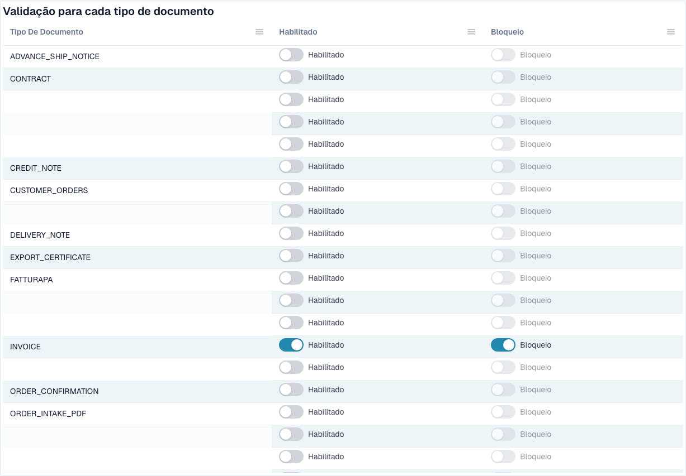

# Validação de faturas eletrónicas



A página **E-Invoice Validation** (**Settings → E-Documents → E-Invoice Validation**, caminho `/settings/einvoice-validation`; anteriormente _Validation Rules_) controla como o DocBits valida as faturas eletrónicas recebidas. Baseia-se no conjunto de regras oficial **KoSIT XRechnung + ZUGFeRD** e nos códigos de constatação internos do validador, e permite sobrepor a gravidade de cada regra para a sua organização.

> Esta página é para **faturas eletrónicas** (XRechnung, ZUGFeRD, Factur-X). Não é o mesmo que **Data Validation Rules**, que verificam campos extraídos dos documentos.

## O que existe nesta página

<figure><figcaption>
Validação e bloqueio por tipo de documento. Os nomes configurados estão ocultos. Exemplo do ambiente de desenvolvimento.
</figcaption></figure>

| Tópico | O que faz | Para quem |
| ----------------------------------------------------------------------- | ---------------------------------------------------------------------------------------------------------------------------------------- | ------------------------------- |
| [Configuração da validação e versões aceites](validation-setup.md) | O assistente de configuração, as versões de XRechnung aceites, os perfis aceites e o que significa cada gravidade. | Administradores da organização |
| [Gravidade das regras](validation-rule-severities.md) | A tabela de regras: alterar a gravidade de cada regra para a sua organização. | Administradores da organização |
| [Validação por tipo de documento](validation-per-document-type.md) | Ativar a validação (**Enabled**) e decidir se uma verificação falhada bloqueia o documento (**Blocking**). Cada alteração exige confirmação. | Administradores da organização |
| [Registo de alterações](validation-change-log.md) | Cada alteração das definições: quando, quem, que regra, de → para. | Administradores da organização |
| [O ecrã de erro de uma fatura eletrónica rejeitada](validation-error-screen.md) | O que vê quando carrega um XML incorreto: a explicação, a linha com erro e o passo seguinte. | Todos os que processam faturas |
| [Relatório de validação](validation-report.md) | O que um utilizador vê quando uma fatura falha: as constatações em linguagem clara. Abre-se a partir do documento, não desta página. | Todos os que processam faturas |
| [Passo seguinte e rejeitar um documento](validation-next-step-and-reject.md) | O que fazer depois de ler o relatório, as transferências do relatório e **Reject document**. | Todos os que processam faturas |
