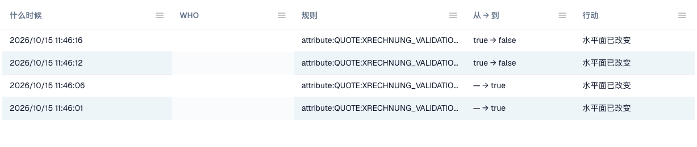

# 变更日志

> 界面中的“WHO”列表示执行变更的用户。

**Change log**记录验证设置的每次变更。它属于 [电子发票验证](./)。只有组织管理员可以查看。

打开 **Rules and policy** 旁边的 **Change log** 选项卡。

<figure><figcaption>
变更日志片段。已隐藏用户数据。 此版本的部分界面文字仍可能使用英语或存在翻译错误。本指南解释正确含义；截图保留实际界面文字。
</figcaption></figure>

| 列            | 显示内容                                                                                 |
| ------------- | --------------------------------------------------------------------------------------- |
| **When**      | 变更时间。                                                                               |
| **Who**       | 执行变更的用户。                                                                         |
| **Rule**      | 已变更的设置或规则。                                                                     |
| **From → To** | 旧值和新值。                                                                             |
| **Action**    | 变更类型。可打开设置向导中的记录，查看各项具体变更。                                     |

每页显示 50 条记录。

确认后，[按文档类型验证](validation-per-document-type.md)表中的每项变更都会创建一条记录。
