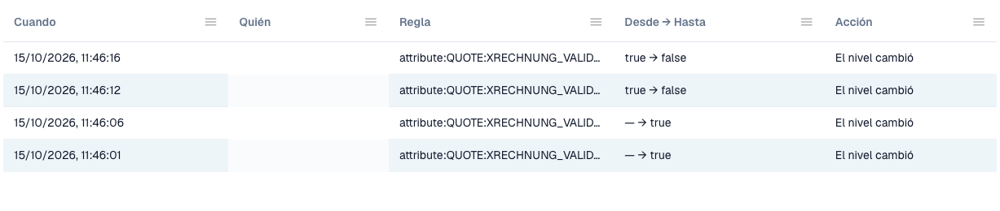

# Registro de cambios

El **registro de cambios** recoge cada cambio de los ajustes de validación. Pertenece a [Validación de facturas electrónicas](./). Solo los administradores de la organización pueden verlo.

Abra la pestaña **Change log**, junto a **Rules and policy**.

<figure><figcaption>
Extracto del registro de cambios. Los datos de usuario están ocultos.
</figcaption></figure>

| Columna | Qué muestra |
| ------------- | --------------------------------------------------------------------------------------- |
| **When** | El momento del cambio. |
| **Who** | El usuario que hizo el cambio. |
| **Rule** | El ajuste o la regla que cambió. |
| **From → To** | El valor anterior y el nuevo. |
| **Action** | El tipo de cambio. Las filas del asistente de configuración se pueden abrir para ver los cambios individuales. |

La lista muestra 50 entradas por página.

Cada cambio en la tabla [Validación por tipo de documento](validation-per-document-type.md) crea una entrada después de que lo confirme.
