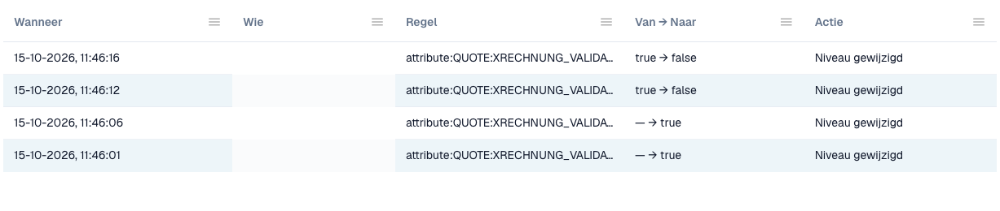

# Wijzigingslogboek

Het **wijzigingslogboek** legt elke wijziging van de validatie-instellingen vast. Het hoort bij [E-factuurvalidatie](./). Alleen organisatiebeheerders kunnen het zien.

Open het tabblad **Change log** naast **Rules and policy**.

<figure><figcaption>
Fragment uit het wijzigingslogboek. Gebruikersgegevens zijn afgeschermd.
</figcaption></figure>

| Kolom | Wat die toont |
| ------------- | --------------------------------------------------------------------------------------- |
| **When** | Het tijdstip van de wijziging. |
| **Who** | De gebruiker die de wijziging heeft aangebracht. |
| **Rule** | De instelling of regel die is gewijzigd. |
| **From → To** | De oude en de nieuwe waarde. |
| **Action** | Het soort wijziging. Regels uit de installatiewizard kunnen worden geopend om de afzonderlijke wijzigingen te zien. |

De lijst toont 50 items per pagina.

Elke wijziging in de tabel [Validatie per documenttype](validation-per-document-type.md) maakt na uw bevestiging een item aan.
