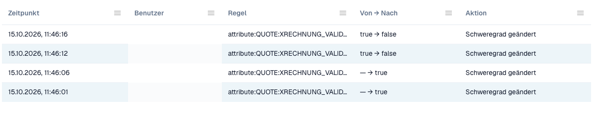

# Änderungsprotokoll

Das **Änderungsprotokoll** zeichnet jede Änderung der Validierungseinstellungen auf. Es gehört zur [E-Rechnungs-Prüfung](./). Nur Organisationsadministratoren können es sehen.

Öffnen Sie den Tab **Change log** neben **Rules and policy**.

<figure><figcaption>
Ausschnitt aus dem Änderungsprotokoll. Benutzerangaben sind ausgeblendet.
</figcaption></figure>

| Spalte | Was sie zeigt |
| ------------- | --------------------------------------------------------------------------------------- |
| **When** | Der Zeitpunkt der Änderung. |
| **Who** | Der Benutzer, der die Änderung vorgenommen hat. |
| **Rule** | Die Einstellung oder Regel, die sich geändert hat. |
| **From → To** | Der alte und der neue Wert. |
| **Action** | Die Art der Änderung. Zeilen aus dem Einrichtungsassistenten lassen sich öffnen, um die einzelnen Änderungen zu sehen. |

Die Liste zeigt 50 Einträge pro Seite.

Jede Änderung in der Tabelle [Prüfung je Dokumenttyp](validation-per-document-type.md) erzeugt einen Eintrag, nachdem Sie sie bestätigt haben.
