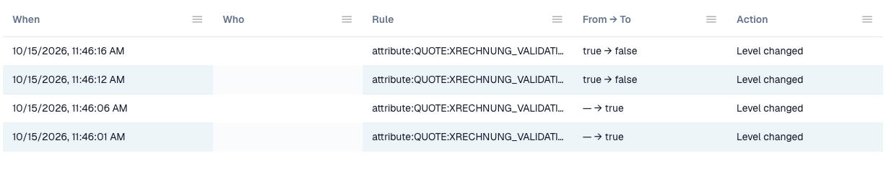

# Change log

The **Change log** records every change of the validation settings. It belongs to [E-Invoice Validation](./). Only organisation administrators can see it.

Open the tab **Change log** next to **Rules and policy**.

<figure><figcaption>
Excerpt from the change log. User details are hidden.
</figcaption></figure>

| Column        | What it shows                                                                           |
| ------------- | --------------------------------------------------------------------------------------- |
| **When**      | The time of the change.                                                                 |
| **Who**       | The user who made the change.                                                           |
| **Rule**      | The setting or rule that changed.                                                       |
| **From → To** | The old and the new value.                                                              |
| **Action**    | The kind of change. Rows from the setup wizard can be opened to see the single changes. |

The list shows 50 entries on each page.

Every change in the table [Validation for each document type](validation-per-document-type.md) creates an entry after you confirm it.
