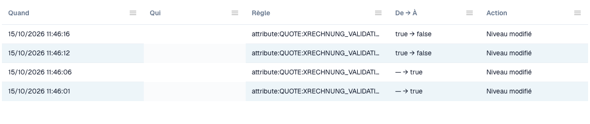

# Journal des modifications

Le **journal des modifications** enregistre chaque changement des paramètres de validation. Il fait partie de [Validation des factures électroniques](./). Seuls les administrateurs de l'organisation peuvent le voir.

Ouvrez l'onglet **Change log** à côté de **Rules and policy**.

<figure><figcaption>
Extrait du journal des modifications. Les données utilisateur sont masquées.
</figcaption></figure>

| Colonne | Ce qu'elle montre |
| ------------- | --------------------------------------------------------------------------------------- |
| **When** | Le moment du changement. |
| **Who** | L'utilisateur qui a effectué le changement. |
| **Rule** | Le paramètre ou la règle qui a changé. |
| **From → To** | L'ancienne et la nouvelle valeur. |
| **Action** | Le type de changement. Les lignes issues de l'assistant de configuration peuvent être ouvertes pour voir les changements individuels. |

La liste affiche 50 entrées par page.

Chaque changement dans le tableau [Validation par type de document](validation-per-document-type.md) crée une entrée après votre confirmation.
