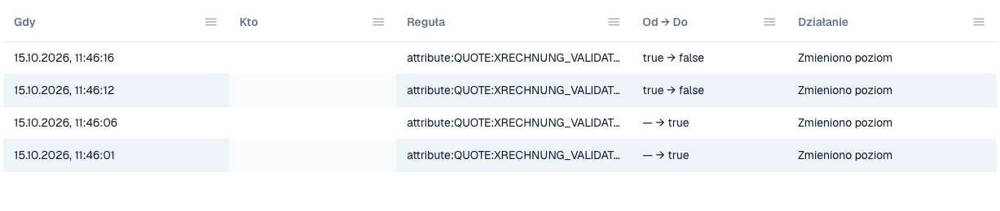

# Dziennik zmian

**Dziennik zmian** rejestruje każdą zmianę ustawień walidacji. Należy do [Walidacja faktur elektronicznych](./). Widzą go tylko administratorzy organizacji.

Otwórz zakładkę **Change log** obok **Rules and policy**.

<figure><figcaption>
Fragment dziennika zmian. Dane użytkowników są ukryte.
</figcaption></figure>

| Kolumna | Co pokazuje |
| ------------- | --------------------------------------------------------------------------------------- |
| **When** | Czas zmiany. |
| **Who** | Użytkownik, który dokonał zmiany. |
| **Rule** | Ustawienie lub reguła, która się zmieniła. |
| **From → To** | Stara i nowa wartość. |
| **Action** | Rodzaj zmiany. Wiersze z kreatora konfiguracji można otworzyć, aby zobaczyć pojedyncze zmiany. |

Lista pokazuje 50 wpisów na stronie.

Każda zmiana w tabeli [Walidacja według typu dokumentu](validation-per-document-type.md) tworzy wpis po potwierdzeniu.
