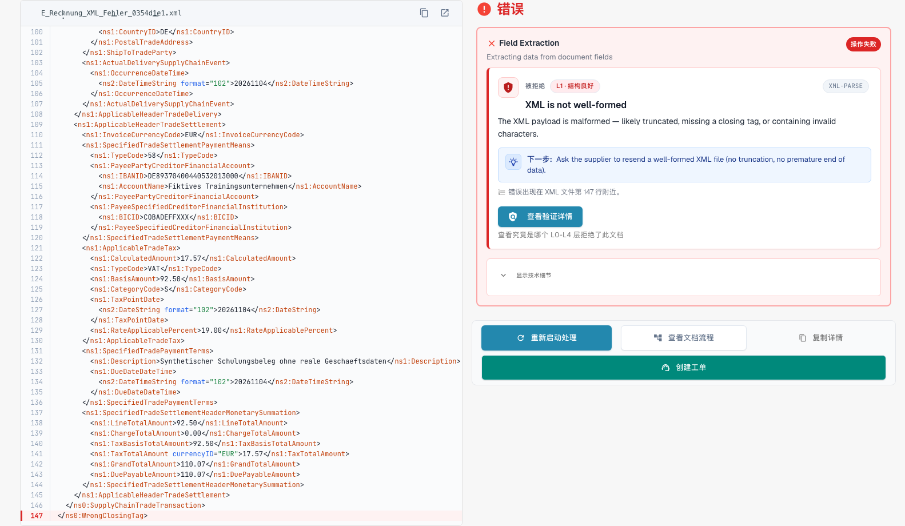
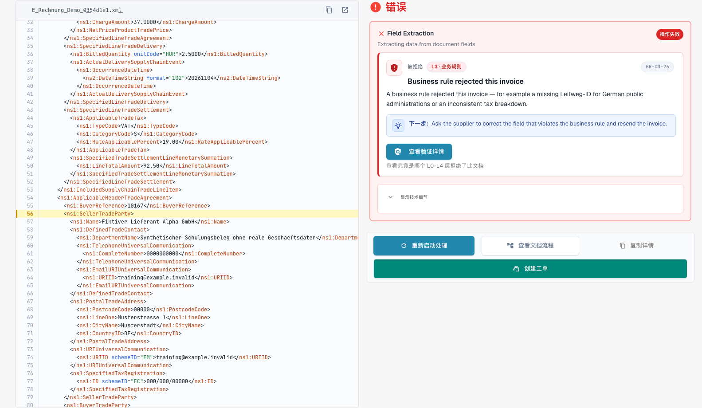

# 被拒绝电子发票的错误界面

> 此版本的部分界面文字仍可能使用英语或存在翻译错误。本指南解释正确含义；截图保留实际界面文字。

上传有误的电子发票时，DocBits 不会丢弃它。文档的状态会变为 **Error**，错误界面会告诉您问题所在、出现的位置以及接下来该怎么做。本页展示两个示例：格式不正确的 XML 文件，以及违反业务规则的发票。

> 只有在该文档类型已启用验证且验证设为**blocking**时，发票的状态才会变为 **Error**。请参阅[按文档类型验证](validation-per-document-type.md)。

被校验器拒绝的电子发票带有自己的电子发票校验状态，而不是简单的 **Error**。仪表板上的状态徽章会附加一个工具提示，说明文档停止的原因，因此在筛选文档列表时可以把被拒绝的发票与其他错误区分开。错误界面和下方的报告在两种情况下相同。

## 示例 1：XML 文件已损坏

供应商发送的 XML 文件中，结束标签与开始标签不匹配。该文件无法读取，因此 DocBits 会在第一个检查 **L1 · Well-formedness**处停止。

<figure><figcaption>
虚构 XML 文件的错误界面；结束标签已被故意损坏。 此版本的部分界面文字仍可能使用英语或存在翻译错误。本指南解释正确含义；截图保留实际界面文字。
</figcaption></figure>

界面分为两部分：

* **左侧：XML 文件。** DocBits 会显示带行号的文件。出现问题的行会标为红色。使用文件上方的按钮复制 XML 或在新标签页中打开。
* **右侧：说明。** **Rejected by** 卡片会显示导致文件处理停止的检查项（此处为 **L1 · Well-formedness**）和规则代码（此处为 `XML-PARSE`）。下方会显示通俗易懂的标题（_XML 格式不正确_）、简短说明和 **Next step** 区块。

选择 **View validation details**，打开完整的[验证报告](validation-report.md)。

<figure><figcaption>
损坏文件的报告：第 1 层语法的一个错误，包含技术消息和位置。
</figcaption></figure>

报告会指出准确位置（此处为第 5 行、第 4081 列），并提供 XML 解析器的技术消息。选择 **Show in XML** 可跳转到该行。**How to fix** 提示建议您向发送方索取修正后的文件。

## 示例 2：发票违反业务规则

XML 本身没有问题，但缺少必填字段。例如，没有卖方标识符、注册标识符或 VAT 标识符，因此无法识别卖方（规则 `BR-CO-26`）。

<figure><figcaption>
完全虚构的示例发票的错误界面：层级 L3 · Business Rules、规则代码和一个下一步。
</figcaption></figure>

卡片会显示层级 **L3 · Business Rules** 和代码 `BR-CO-26`。报告中列出了该发票的所有校验问题，请参阅[验证报告](validation-report.md)。

## 当 DocBits 无法检查该文档时

并非每个错误都是拒绝。如果校验器根本无法读取文件，消息会以 _could not check this document_ 开头，并指明使其停止的检查，例如损坏的 XML 文件为 `XML-PARSE`，无法打开的 PDF 为 `PDF-UNREADABLE`。DocBits 显示的说明卡片与被拒绝的发票相同，包含检查名称、代码和技术消息。

这是技术故障，而不是对发票的判定：

* DocBits 不会将文档标记为已拒绝。
* 重新启动可能成功，因为原因可能出在文件读取上。在要求发件人提供新发票之前，请选择 **Restart Processing**。
* 如果重新启动后再次出现相同的代码，请将文件和代码发送给管理员。

## Next step 框和按钮

对于无效的电子发票，页面以 **Next step** 框开头。其中包含在此情况下有帮助的操作：

| 操作 | 功能 |
| --- | --- |
| **Reject** | 拒绝该文档。对话框会显示文件、供应商和发票编号，告知您文档将获得 **Rejected** 状态并在历史记录中添加备注，且不会通知供应商，同时说明如何撤销拒绝。对话框要求填写原因，并通过 **Reject now** 确认。如果出现错误，消息会显示在对话框内，您可以重试。 |
| **Download invoice XML** | 下载收到的原始文件，例如在 DocBits 之外检查，或退还给供应商。 |
| **Print report** | 打印[验证报告](validation-report.md)。 |

卡片还会用通俗的词语说明该检查，并以规则代码作为小号参照。

**Restart Processing** 会重新处理文档，例如在您更改设置之后；检查会使用当前设置。它位于 Next step 框下方，因为重启未更改的文件也会以同样方式失败。其他按钮位于其旁：

| 按钮                   | 功能                                                                                                                       |
| ---------------------- | ------------------------------------------------------------------------------------------------------------------------ |
| **Restart Processing** | 重新处理文档，例如在您更改设置后。检查会使用当前设置。 |
| **View DocFlow**       | 显示文档的工作流。                                                                                      |
| **Copy Details**       | 复制错误详情，例如用于向管理员发送消息。                                               |
| **Create ticket**      | 创建包含错误详情的支持工单。                                                                           |

在卡片上选择 **Show technical details**，查看原始技术信息。

原因加载期间，页面显示占位符，而不是写了一半的卡片。如果无法加载原因，页面会提供重新加载；名称未知的步骤会标明为未知，而不是显示空字段。在窄屏上，XML 与说明上下排列，而不是并排显示。

## 接下来该怎么做

* **错误：**向发送方索取修正后的发票，或[拒绝该文档](validation-next-step-and-reject.md)。修正后的发票会作为新文档处理。
* **只有警告：**文档不会被阻止。您可以继续操作。

## 相关页面

* [验证报告](validation-report.md)：按级别列出所有校验问题。
* [下一步操作与拒绝文档](validation-next-step-and-reject.md)
* [按文档类型验证](validation-per-document-type.md)：启用验证并将其设为阻止。
