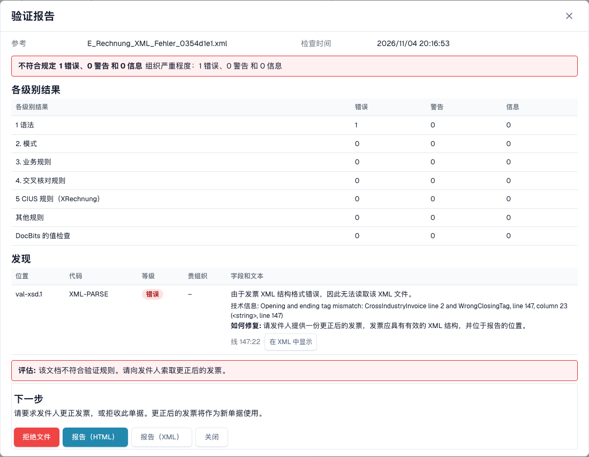

# 被拒绝电子发票的错误界面

> 此版本的部分界面文字仍可能使用英语或存在翻译错误。本指南解释正确含义；截图保留实际界面文字。

上传有误的电子发票时，DocBits 不会丢弃它。文档的状态会变为 **错误**，错误界面会告诉您问题所在、出现的位置以及接下来该怎么做。本页展示两个示例：格式不正确的 XML 文件，以及违反业务规则的发票。

> 只有在该文档类型已启用验证且验证设为**阻止**时，发票的状态才会变为 **错误**。请参阅[按文档类型验证](validation-per-document-type.md)。

## 示例 1：XML 文件已损坏

供应商发送的 XML 文件中，结束标签与开始标签不匹配。该文件无法读取，因此 DocBits 会在第一个检查 **L1 · 格式正确性**处停止。

<figure><figcaption>
虚构 XML 文件的错误界面；结束标签已被故意损坏。 此版本的部分界面文字仍可能使用英语或存在翻译错误。本指南解释正确含义；截图保留实际界面文字。
</figcaption></figure>

界面分为两部分：

* **左侧：XML 文件。** DocBits 会显示带行号的文件。出现问题的行会标为红色。使用文件上方的按钮复制 XML 或在新标签页中打开。
* **右侧：说明。** **拒绝原因** 卡片会显示导致文件处理停止的检查项（此处为 **L1 · 格式正确性**）和规则代码（此处为 `XML-PARSE`）。下方会显示通俗易懂的标题（_XML 格式不正确_）、简短说明和 **下一步** 区块。

选择 **查看验证详情**，打开完整的[验证报告](validation-report.md)。

<figure><figcaption>
虚构的损坏 XML 文件检查报告。
</figcaption></figure>

报告会指出准确位置（具体行号和列号见报告），并提供 XML 解析器的技术消息。选择 **在 XML 中显示** 可跳转到该行。**修复方法** 提示建议您向发送方索取修正后的文件。

## 示例 2：发票违反业务规则

XML 本身没有问题，但缺少必填字段。例如，没有卖方标识符、注册标识符或 VAT 标识符，因此无法识别卖方（规则 `BR-CO-26`）。

<figure><figcaption>
完全虚构的示例发票错误界面。 此版本的部分界面文字仍可能使用英语或存在翻译错误。本指南解释正确含义；截图保留实际界面文字。
</figcaption></figure>

卡片显示首个阻止处理的校验问题。完整报告中还包含代码 `BR-CO-26` 和发票的其他校验问题。

## 卡片下方的按钮

| 按钮                   | 功能                                                                                                                       |
| ---------------------- | ------------------------------------------------------------------------------------------------------------------------ |
| **重新处理** | 重新处理文档，例如在您更改设置后。检查会使用当前设置。 |
| **查看 DocFlow**       | 显示文档的工作流。                                                                                      |
| **复制详情**       | 复制错误详情，例如用于向管理员发送消息。                                               |
| **创建支持工单**      | 创建包含错误详情的支持工单。                                                                           |

在卡片上选择 **显示技术详情**，查看原始技术信息。

## 接下来该怎么做

* **错误：**向发送方索取修正后的发票，或[拒绝该文档](validation-next-step-and-reject.md)。修正后的发票会作为新文档处理。
* **只有警告：**文档不会被阻止。您可以继续操作。

## 相关页面

* [验证报告](validation-report.md)：按级别列出所有校验问题。
* [下一步操作与拒绝文档](validation-next-step-and-reject.md)
* [按文档类型验证](validation-per-document-type.md)：启用验证并将其设为阻止。
