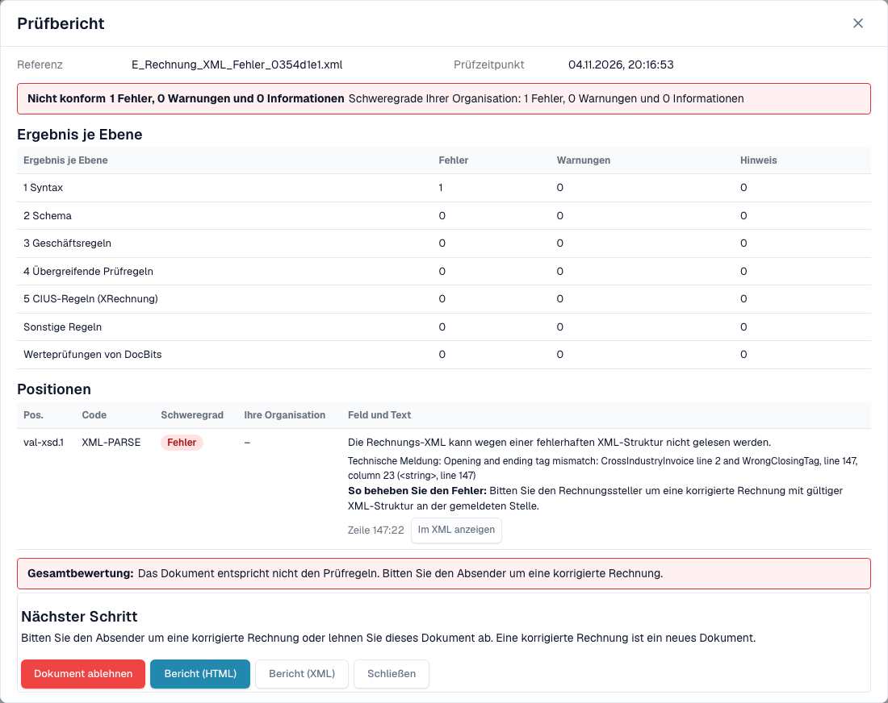

# Die Fehleransicht einer abgelehnten E-Rechnung

> Einzelne Produkttexte können in dieser Version noch Englisch oder sprachlich fehlerhaft sein. Die Anleitung erklärt die Bedeutung; die Screenshots zeigen die unveränderte Oberfläche.

Wenn Sie eine fehlerhafte E-Rechnung hochladen, geht sie in DocBits nicht verloren. Das Dokument erhält den Status **Error**, und die Fehleransicht sagt Ihnen, was falsch ist, wo und was Sie als Nächstes tun können. Diese Seite zeigt zwei Beispiele: eine XML-Datei, die nicht wohlgeformt ist, und eine Rechnung, die gegen eine Geschäftsregel verstößt.

> Eine Rechnung erhält den Status **Error** nur, wenn die Prüfung für ihren Dokumenttyp **aktiviert** und **blockierend** ist. Siehe [Prüfung je Dokumenttyp](validation-per-document-type.md).

## Beispiel 1: Die XML-Datei ist beschädigt

Ein Lieferant sendet eine XML-Datei, in der ein schließendes Tag nicht zum öffnenden Tag passt. Die Datei kann nicht gelesen werden, daher stoppt DocBits bei der ersten Prüfung, **L1 · Well-formedness**.

<figure><figcaption>
Fehleransicht einer synthetischen XML-Datei mit einem absichtlich beschädigten Abschluss-Tag. Einzelne Produkttexte können in dieser Version noch Englisch oder sprachlich fehlerhaft sein. Die Anleitung erklärt die Bedeutung; die Screenshots zeigen die unveränderte Oberfläche.
</figcaption></figure>

Die Ansicht hat zwei Seiten:

* **Links: die XML-Datei.** DocBits zeigt die Datei mit Zeilennummern. Die Zeile mit dem Problem ist rot markiert. Mit den Schaltflächen über der Datei kopieren Sie das XML oder öffnen es in einem neuen Tab.
* **Rechts: die Erklärung.** Die Karte **Rejected by** nennt die Prüfung, die die Datei gestoppt hat (hier **L1 · Well-formedness**), und den Regelcode (hier `XML-PARSE`). Darunter sehen Sie einen Titel in verständlicher Sprache (*XML ist nicht wohlgeformt*), eine kurze Erklärung und den Block **Next step**.

Wählen Sie **View validation details**, um den vollständigen [Prüfbericht](validation-report.md) zu öffnen.

<figure><figcaption>
Prüfbericht zur beschädigten Datei: ein Fehler auf Ebene 1 Syntax, mit der technischen Meldung und der Position
</figcaption></figure>

Der Bericht nennt die genaue Position (hier Zeile 5, Spalte 4081) und gibt die technische Meldung des XML-Parsers wieder. Wählen Sie **Show in XML**, um zu dieser Zeile zu springen. Der Hinweis **How to fix** sagt Ihnen, dass Sie den Absender um eine korrigierte Datei bitten sollen.

## Beispiel 2: Die Rechnung verstößt gegen eine Geschäftsregel

Das XML ist in Ordnung, aber ein Pflichtfeld fehlt. Zum Beispiel kann der Verkäufer nicht identifiziert werden, weil weder eine Verkäufer-Kennung, noch eine Registrierungskennung, noch eine Umsatzsteuer-Kennung vorhanden ist (Regel `BR-CO-26`).

<figure><figcaption>
Fehleransicht einer rein synthetischen Beispielrechnung: die Ebene L3 · Business Rules, der Regelcode und ein nächster Schritt
</figcaption></figure>

Die Karte nennt die Ebene **L3 · Business Rules** und den Code `BR-CO-26`. Der Bericht listet alle Prüfhinweise der Rechnung auf, siehe [Prüfbericht](validation-report.md).

## Die Next-step-Box und die Schaltflächen

Bei einer ungültigen E-Rechnung führt die Seite mit einer Box **Next step** ein. Sie trägt die Aktion, die in diesem Fall hilft:

| Aktion | Was sie bewirkt |
| --- | --- |
| **Reject** | Lehnt das Dokument ab. Der Dialog nennt Datei, Verkäufer und Rechnungsnummer, sagt Ihnen, dass das Dokument den Status **Rejected** mit einer Notiz in seiner Historie erhält und dass der Lieferant nicht informiert wird, und er erklärt, wie Sie die Ablehnung zurücknehmen. Er fragt nach einem Grund und bestätigt mit **Reject now**. Schlägt etwas fehl, erscheint die Meldung im Dialog und Sie können es erneut versuchen. |
| **Download invoice XML** | Lädt die Datei so herunter, wie sie empfangen wurde, zum Beispiel um sie außerhalb von DocBits zu prüfen oder an den Lieferanten zurückzusenden. |
| **Print report** | Druckt den [Prüfbericht](validation-report.md). |

Die Karte nennt die Prüfung außerdem in verständlichen Worten, mit dem Regelcode als kleine Referenz.

**Restart Processing** führt die Verarbeitung des Dokuments erneut aus, zum Beispiel nachdem Sie eine Einstellung geändert haben; die Prüfung verwendet die aktuellen Einstellungen. Die Schaltfläche steht unter der Next-step-Box, weil ein Neustart einer unveränderten Datei auf dieselbe Weise scheitert. Die übrigen Schaltflächen bleiben daneben:

| Schaltfläche | Was sie bewirkt |
| --- | --- |
| **Restart Processing** | Führt die Verarbeitung des Dokuments erneut aus, zum Beispiel nachdem Sie eine Einstellung geändert haben. Die Prüfung verwendet die aktuellen Einstellungen. |
| **View DocFlow** | Zeigt den Workflow des Dokuments. |
| **Copy Details** | Kopiert die Fehlerdetails, zum Beispiel für eine Nachricht an Ihren Administrator. |
| **Create ticket** | Öffnet ein Support-Ticket mit den Fehlerdetails. |

Wählen Sie **Show technical details** auf der Karte, um die technischen Rohinformationen zu sehen.

Solange der Grund lädt, zeigt die Seite einen Platzhalter statt einer halb geschriebenen Karte. Lässt sich der Grund nicht laden, bietet die Seite an, ihn neu zu laden, und ein Schritt mit unbekanntem Namen wird als solcher gekennzeichnet, statt ein leeres Feld zu zeigen. Auf einem schmalen Bildschirm stehen XML und Erläuterung übereinander, statt nebeneinander.

## Was Sie als Nächstes tun

* **Fehler:** Bitten Sie den Absender um eine korrigierte Rechnung oder [lehnen Sie das Dokument ab](validation-next-step-and-reject.md). Eine korrigierte Rechnung ist ein neues Dokument.
* **Nur Warnungen:** Das Dokument ist nicht blockiert. Sie können fortfahren.

## Verwandte Seiten

* [Prüfbericht](validation-report.md): alle Prüfhinweise, Ebene für Ebene.
* [Nächster Schritt und Dokument ablehnen](validation-next-step-and-reject.md)
* [Prüfung je Dokumenttyp](validation-per-document-type.md): Prüfung einschalten und Blockierung festlegen.
