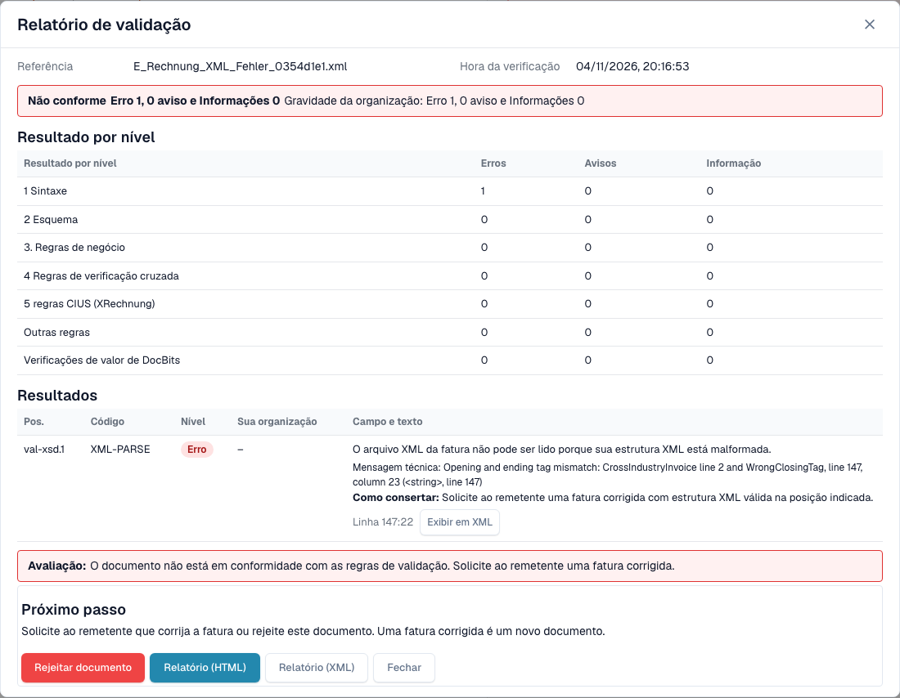
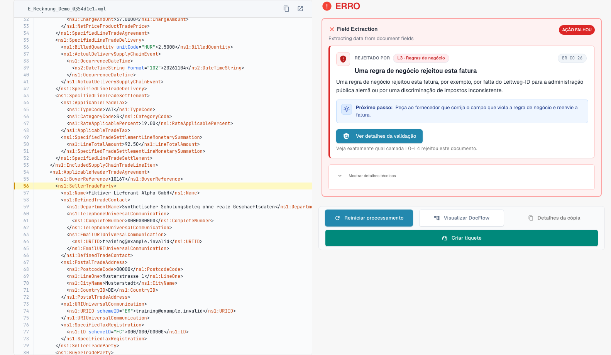

# O ecrã de erro de uma fatura eletrónica rejeitada

> Nesta versão, alguns textos da interface podem ainda estar em inglês ou ter traduções incorretas. A documentação explica o significado; as capturas mostram a interface sem alterações.

Quando carrega uma fatura eletrónica incorreta, o DocBits não a perde. O documento fica com o estado **Error** e o ecrã de erro diz-lhe o que está errado, onde, e o que fazer a seguir. Esta página mostra dois exemplos: um ficheiro XML que não está bem formado e uma fatura que viola uma regra de negócio.

> Uma fatura só fica com o estado **Error** quando a validação está **ativada** e em **bloqueio** para o seu tipo de documento. Ver [Validação para cada tipo de documento](validation-per-document-type.md).

Uma e-invoice rejeitada pelo validador tem o seu próprio estado de validação de e-invoice em vez de um simples **Error**. O badge de estado no dashboard acrescenta um tooltip que indica porque é que o documento parou, para poder distinguir uma fatura rejeitada dos outros erros ao filtrar a lista de documentos. O ecrã de erro e o relatório abaixo são iguais nos dois casos.

## Exemplo 1: o ficheiro XML está danificado

Um fornecedor envia um ficheiro XML em que uma etiqueta de fecho não corresponde à etiqueta de abertura. O ficheiro não pode ser lido, por isso o DocBits para na primeira verificação, **L1 · Well-formedness**.

<figure><figcaption>
Ecrã de erro de um XML fictício com uma etiqueta de fecho danificada intencionalmente. Nesta versão, alguns textos da interface podem ainda estar em inglês ou ter traduções incorretas. A documentação explica o significado; as capturas mostram a interface sem alterações.
</figcaption></figure>

O ecrã tem dois lados:

* **Esquerda: o ficheiro XML.** O DocBits mostra o ficheiro com números de linha. A linha com o problema está marcada a vermelho. Use os botões acima do ficheiro para copiar o XML ou abri-lo num novo separador.
* **Direita: a explicação.** O cartão **Rejected by** indica a verificação que parou o ficheiro (aqui **L1 · Well-formedness**) e o código da regra (aqui `XML-PARSE`). Abaixo vê um título em linguagem simples (*O XML não está bem formado*), uma explicação curta e o bloco **Next step**.

Selecione **View validation details** para abrir o [relatório de validação](validation-report.md) completo.

<figure><figcaption>
Relatório do ficheiro danificado: um erro no nível 1 Sintaxe, com a mensagem técnica e a posição
</figcaption></figure>

O relatório indica a posição exata (aqui a linha 5, a coluna 4081) e dá a mensagem técnica do analisador de XML. Selecione **Show in XML** para saltar para essa linha. A dica **How to fix** diz-lhe para pedir ao remetente um ficheiro corrigido.

## Exemplo 2: a fatura viola uma regra de negócio

O XML está correto, mas falta um campo obrigatório. Por exemplo, o vendedor não pode ser identificado porque não existe identificador do vendedor, identificador de registo nem identificador de IVA (regra `BR-CO-26`).

<figure><figcaption>
Ecrã de erro de uma fatura de exemplo inteiramente fictícia: a camada L3 · Business Rules, o código da regra e um passo seguinte
</figcaption></figure>

O cartão indica a camada **L3 · Business Rules** e o código `BR-CO-26`. O relatório enumera todos os resultados da fatura, consulte [Relatório de validação](validation-report.md).

## Quando o DocBits não conseguiu verificar o documento

Nem todo o erro é uma rejeição. Se o validador não conseguir ler o ficheiro, a mensagem começa por _could not check this document_ e indica a verificação que o parou, por exemplo `XML-PARSE` para um ficheiro XML danificado ou `PDF-UNREADABLE` para um PDF que não abre. O DocBits mostra o mesmo cartão de explicação de uma fatura rejeitada, com o nome da verificação, o código e a mensagem técnica.

Trata-se de uma falha técnica, não de um veredicto sobre a fatura:

* O DocBits não marca o documento como rejeitado.
* Um reinício pode resultar, porque a causa pode estar na leitura do ficheiro. Selecione **Restart Processing** antes de pedir ao remetente uma nova fatura.
* Se o mesmo código voltar a aparecer após um reinício, envie o ficheiro e o código ao seu administrador.

## A caixa Next step e os botões

Numa fatura eletrónica inválida a página começa com uma caixa **Next step**. Contém a ação que ajuda neste caso:

| Ação | O que faz |
| --- | --- |
| **Reject** | Rejeita o documento. A caixa de diálogo indica o ficheiro, o fornecedor e o número da fatura, avisa que o documento recebe o estado **Rejected** com uma nota no seu histórico e que o fornecedor não é informado, e explica como anular a rejeição. Pede um motivo e confirma com **Reject now**. Se algo falhar, a mensagem aparece dentro da caixa de diálogo e pode tentar de novo. |
| **Download invoice XML** | Transfere o ficheiro tal como foi recebido, por exemplo para o verificar fora do DocBits ou para o devolver ao fornecedor. |
| **Print report** | Imprime o [relatório de validação](validation-report.md). |

O cartão também nomeia a verificação em palavras compreensíveis, com o código da regra como pequena referência.

**Restart Processing** executa de novo o processamento do documento, por exemplo depois de alterar uma definição; a verificação usa as definições atuais. Fica abaixo da caixa Next step porque um reinício de um ficheiro inalterado falha da mesma forma. Os outros botões ficam ao lado:

| Botão | O que faz |
| --- | --- |
| **Restart Processing** | Executa de novo o processamento do documento, por exemplo depois de alterar uma definição. A verificação usa as definições atuais. |
| **View DocFlow** | Mostra o fluxo de trabalho do documento. |
| **Copy Details** | Copia os detalhes do erro, por exemplo para uma mensagem ao seu administrador. |
| **Create ticket** | Abre um pedido de suporte com os detalhes do erro. |

Selecione **Show technical details** no cartão para ver a informação técnica em bruto.

Enquanto o motivo carrega, a página mostra um marcador de posição em vez de um cartão meio escrito. Se o motivo não puder ser carregado, a página propõe recarregá-lo, e um passo cujo nome é desconhecido é assinalado como tal em vez de mostrar um campo vazio. Num ecrã estreito, o XML e a explicação ficam empilhados em vez de lado a lado.

## O que fazer a seguir

* **Erros:** peça ao remetente uma fatura corrigida ou [rejeite o documento](validation-next-step-and-reject.md). Uma fatura corrigida é um novo documento.
* **Apenas avisos:** o documento não fica bloqueado. Pode continuar.

## Páginas relacionadas

* [Relatório de validação](validation-report.md): todos os resultados, nível a nível.
* [Próximo passo e rejeitar um documento](validation-next-step-and-reject.md)
* [Validação para cada tipo de documento](validation-per-document-type.md): ative a validação e defina o bloqueio.
