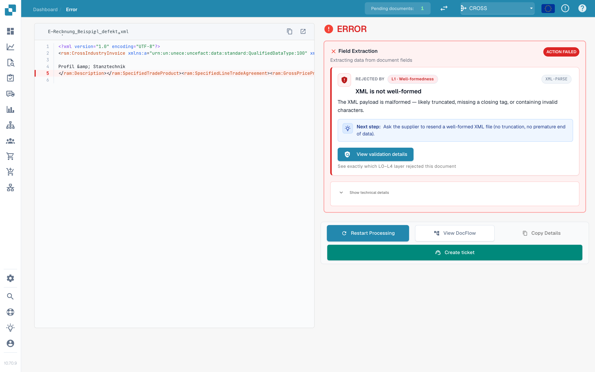
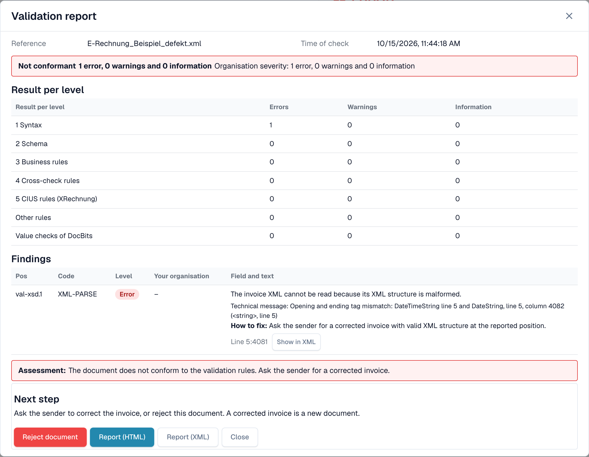
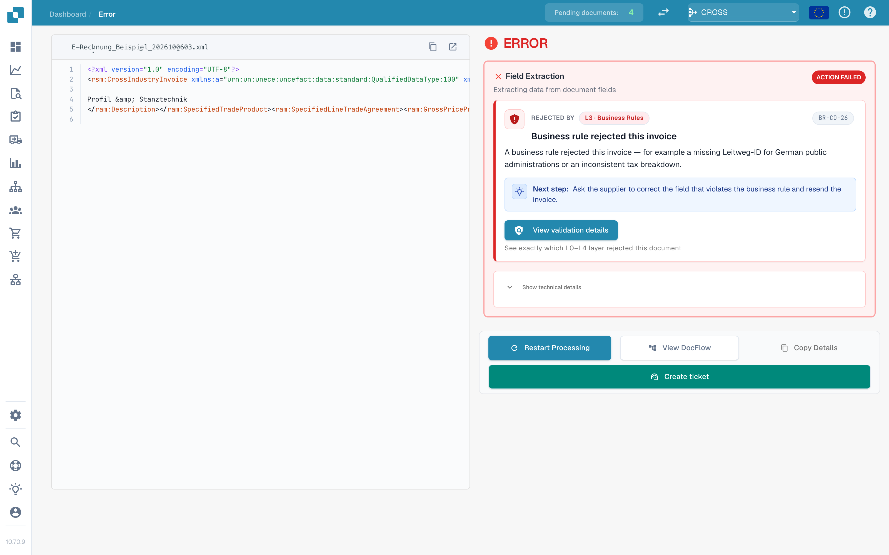

# The error screen for a rejected e-invoice

When you upload an e-invoice that is wrong, DocBits does not lose it. The document gets the status **Error**, and the error screen tells you what is wrong, where, and what to do next. This page shows two examples: an XML file that is not well-formed, and an invoice that breaks a business rule.

> An invoice gets the status **Error** only when validation is **on** and **blocking** for its document type. See [Validation for each document type](validation-per-document-type.md).

## Example 1: the XML file is damaged

A supplier sends an XML file in which a closing tag does not match its opening tag. The file cannot be read, so DocBits stops at the first check, **L1 · Well-formedness**.

<figure><figcaption>
The error screen for a damaged XML file. The faulty line is marked in the XML. Example file with fictional data.
</figcaption></figure>

The screen has two sides:

* **Left: the XML file.** DocBits shows the file with line numbers. The line with the problem is marked in red. Use the buttons above the file to copy the XML or open it in a new tab.
* **Right: the explanation.** The card **Rejected by** names the check that stopped the file (here **L1 · Well-formedness**) and the rule code (here `XML-PARSE`). Below you see a title in plain language (_XML is not well-formed_), a short explanation and the block **Next step**.

Select **View validation details** to open the full [validation report](validation-report.md).

<figure><figcaption>
The report of the damaged file: one error at level 1 Syntax, with the technical message and the position
</figcaption></figure>

The report names the exact position (here line 5, column 4081) and gives the technical message of the XML parser. Select **Show in XML** to jump to that line. The hint **How to fix** tells you to ask the sender for a corrected file.

## Example 2: the invoice breaks a business rule

The XML is fine, but a required field is missing. For example, the seller cannot be identified because no seller identifier, registration identifier or VAT identifier is present (rule `BR-CO-26`).

<figure><figcaption>
The error screen for a business-rule error: the layer L3 · Business Rules, the rule code and a next step
</figcaption></figure>

Here the card names the layer **L3 · Business Rules** and the code `BR-CO-26`. The report lists all findings of the invoice, see [Validation report](validation-report.md).

## The next step box and the buttons

For an invalid e-invoice the page leads with a **Next step** box. It carries the action that helps in this case:

| Action | What it does |
| --- | --- |
| **Reject** | Rejects the document. The dialog names the file, the seller and the invoice number, tells you that the document gets the status **Rejected** with a note in its history and that the supplier is not told, and it explains how to undo the rejection. It asks for a reason and confirms with **Reject now**. If something fails, the message appears inside the dialog and you can try again. |
| **Download invoice XML** | Downloads the file as it was received, for example to check it outside DocBits or to send it back to the supplier. |
| **Print report** | Prints the [validation report](validation-report.md). |

The card also names the check in plain words, with the rule code as a small reference.

**Restart Processing** runs the processing of the document again, for example after you changed a setting; the check uses the current settings. It sits below the next step box because a restart of an unchanged file fails in the same way. The other buttons stay next to it:

| Button                 | What it does                                                                                                             |
| ---------------------- | ------------------------------------------------------------------------------------------------------------------------ |
| **Restart Processing** | Runs the processing of the document again, for example after you changed a setting. The check uses the current settings. |
| **View DocFlow**       | Shows the workflow of the document.                                                                                      |
| **Copy Details**       | Copies the error details, for example for a message to your administrator.                                               |
| **Create ticket**      | Opens a support ticket with the error details.                                                                           |

Select **Show technical details** on the card for the raw technical information.

While the reason loads, the page shows a placeholder instead of a half-written card. If the reason cannot be loaded, the page offers to reload it, and a step whose name is unknown is labelled as such instead of showing an empty field. On a narrow screen the XML and the explanation stack above each other instead of standing side by side.

## What to do next

* **Errors:** ask the sender for a corrected invoice, or [reject the document](validation-next-step-and-reject.md). A corrected invoice is a new document.
* **Only warnings:** the document is not blocked. You can continue.

## Related pages

* [Validation report](validation-report.md): all findings, level by level.
* [Next step and reject a document](validation-next-step-and-reject.md)
* [Validation for each document type](validation-per-document-type.md): turn validation on and set blocking.
