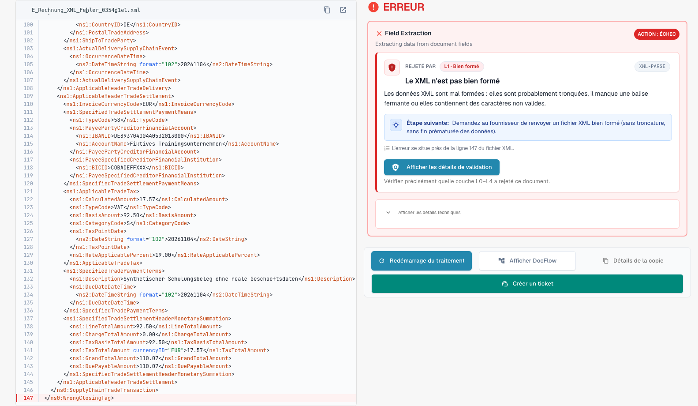
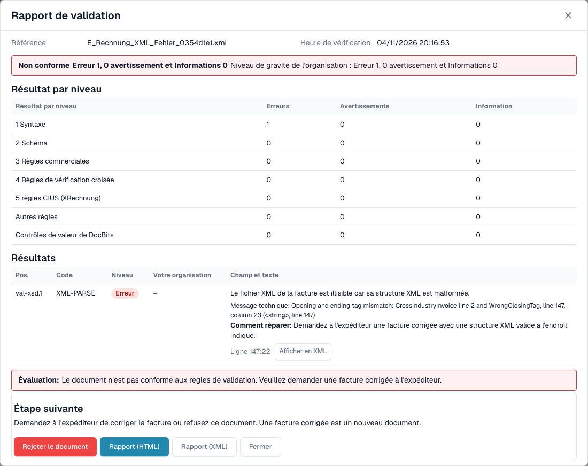
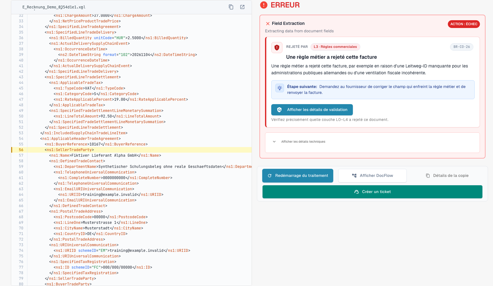

# L'écran d'erreur d'une facture électronique rejetée

> Dans cette version, certains textes de l’interface peuvent encore être en anglais ou mal traduits. Le guide explique leur sens ; les captures montrent l’interface sans modification.

Lorsque vous importez une facture électronique erronée, DocBits ne la perd pas. Le document reçoit le statut **Error**, et l'écran d'erreur vous indique ce qui ne va pas, où, et ce qu'il faut faire ensuite. Cette page présente deux exemples : un fichier XML mal formé et une facture qui enfreint une règle commerciale.

> Une facture reçoit le statut **Error** uniquement lorsque la validation est **activée** et **bloquante** pour son type de document. Voir [Validation pour chaque type de document](validation-per-document-type.md).

## Exemple 1 : le fichier XML est endommagé

Un fournisseur envoie un fichier XML dans lequel une balise fermante ne correspond pas à la balise ouvrante. Le fichier ne peut pas être lu, et DocBits s'arrête donc au premier contrôle, **L1 · Well-formedness**.

<figure><figcaption>
Écran d’erreur d’un XML fictif dont une balise fermante a été volontairement endommagée. Dans cette version, certains textes de l’interface peuvent encore être en anglais ou mal traduits. Le guide explique leur sens ; les captures montrent l’interface sans modification.
</figcaption></figure>

L'écran comporte deux parties :

* **À gauche : le fichier XML.** DocBits affiche le fichier avec les numéros de ligne. La ligne qui pose problème est marquée en rouge. Utilisez les boutons au-dessus du fichier pour copier le XML ou l'ouvrir dans un nouvel onglet.
* **À droite : l'explication.** La carte **Rejected by** indique le contrôle qui a arrêté le fichier (ici **L1 · Well-formedness**) et le code de la règle (ici `XML-PARSE`). Vous voyez ensuite un titre (*Le XML n’est pas bien formé*), une courte explication et le bloc **Next step**. Les messages techniques du validateur peuvent conserver leur langue d’origine.

Sélectionnez **View validation details** pour ouvrir le [rapport de validation](validation-report.md) complet.

<figure><figcaption>
Rapport du fichier endommagé : une erreur au niveau 1 Syntaxe, avec le message technique et la position.
</figcaption></figure>

Le rapport indique la position exacte (ici ligne 5, colonne 4081) et fournit le message technique de l'analyseur XML. Sélectionnez **Show in XML** pour accéder directement à cette ligne. L'indication **How to fix** vous invite à demander un fichier corrigé à l'expéditeur.

## Exemple 2 : la facture enfreint une règle commerciale

Le XML est correct, mais un champ obligatoire est manquant. Par exemple, le vendeur ne peut pas être identifié parce qu'aucun identifiant de vendeur, identifiant d'enregistrement ou identifiant de TVA n'est présent (règle `BR-CO-26`).

<figure><figcaption>
Écran d’erreur d’une facture d’exemple entièrement fictive : la couche L3 · Business Rules, le code de la règle et une étape suivante. Dans cette version, certains textes de l’interface peuvent encore être en anglais ou mal traduits. Le guide explique leur sens ; les captures montrent l’interface sans modification.
</figcaption></figure>

La carte indique la couche **L3 · Business Rules** et le code `BR-CO-26`. Le rapport énumère tous les résultats de la facture, voir [Rapport de validation](validation-report.md).

## Le bloc Next step et les boutons

Pour une facture électronique invalide, la page commence par un bloc **Next step**. Il porte l'action qui aide dans ce cas :

| Action | Ce qu'elle fait |
| --- | --- |
| **Reject** | Rejette le document. Le dialogue indique le fichier, le vendeur et le numéro de facture, vous informe que le document reçoit le statut **Rejected** avec une note dans son historique et que le fournisseur n'est pas informé, et explique comment annuler le rejet. Il demande un motif et confirme avec **Reject now**. Si quelque chose échoue, le message apparaît dans le dialogue et vous pouvez réessayer. |
| **Download invoice XML** | Télécharge le fichier tel qu'il a été reçu, par exemple pour le vérifier hors de DocBits ou pour le renvoyer au fournisseur. |
| **Print report** | Imprime le [rapport de validation](validation-report.md). |

La carte nomme aussi le contrôle en mots compréhensibles, avec le code de la règle comme petite référence.

**Restart Processing** relance le traitement du document, par exemple après avoir modifié un paramètre ; le contrôle utilise les paramètres actuels. Le bouton se trouve sous le bloc Next step parce qu'un redémarrage d'un fichier inchangé échoue de la même manière. Les autres boutons restent à côté :

| Bouton | Ce qu'il fait |
| --- | --- |
| **Restart Processing** | Relance le traitement du document, par exemple après avoir modifié un paramètre. Le contrôle utilise les paramètres actuels. |
| **View DocFlow** | Affiche le workflow du document. |
| **Copy Details** | Copie les détails de l'erreur, par exemple pour un message à votre administrateur. |
| **Create ticket** | Ouvre un ticket de support avec les détails de l'erreur. |

Sélectionnez **Show technical details** sur la carte pour obtenir les informations techniques brutes.

Pendant le chargement du motif, la page affiche un espace réservé au lieu d'une carte à moitié écrite. Si le motif ne peut pas être chargé, la page propose de le recharger, et une étape dont le nom est inconnu est signalée comme telle au lieu d'afficher un champ vide. Sur un écran étroit, le XML et l'explication sont empilés au lieu d'être côte à côte.

## Que faire ensuite

* **Erreurs :** demandez une facture corrigée à l'expéditeur, ou [rejetez le document](validation-next-step-and-reject.md). Une facture corrigée est un nouveau document.
* **Uniquement des avertissements :** le document n'est pas bloqué. Vous pouvez continuer.

## Pages associées

* [Rapport de validation](validation-report.md) : tous les résultats, niveau par niveau.
* [Étape suivante et rejet d'un document](validation-next-step-and-reject.md)
* [Validation pour chaque type de document](validation-per-document-type.md) : activer la validation et définir le blocage.
