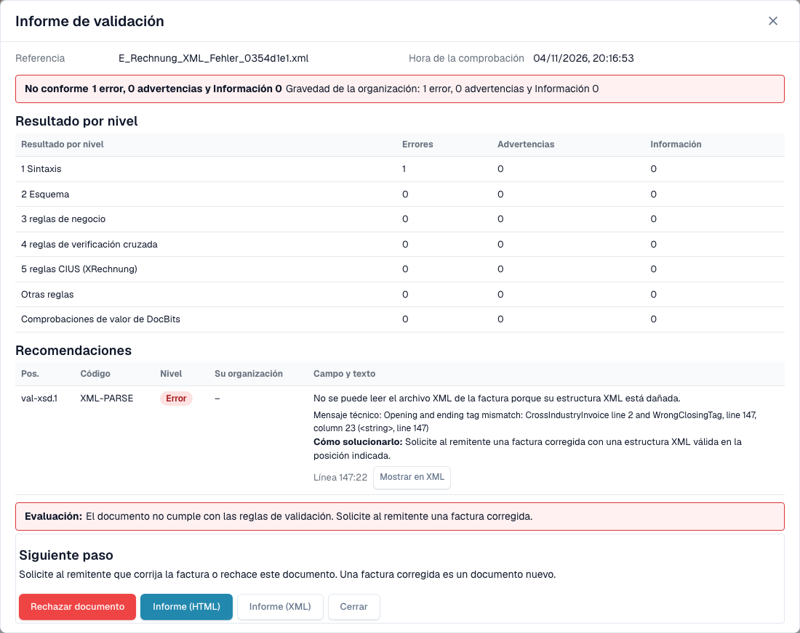

# La pantalla de error de una factura electrónica rechazada

> En esta versión, algunos textos de la interfaz pueden seguir en inglés o contener traducciones incorrectas. La guía explica su significado; las capturas muestran la interfaz sin modificar.

> El botón «Crear billete» de algunas versiones abre un ticket de soporte.

Cuando carga una factura electrónica incorrecta, DocBits no la pierde. El documento recibe el estado **Error** y la pantalla de error le indica qué está mal, dónde y qué hacer a continuación. Esta página muestra dos ejemplos: un archivo XML que no está bien formado y una factura que infringe una regla de negocio.

> Una factura recibe el estado **Error** solo cuando la validación está **activada** y **bloquea** para su tipo de documento. Consulte [Validación para cada tipo de documento](validation-per-document-type.md).

Una e-invoice que el validador ha rechazado lleva su propio estado de validación de e-invoice en lugar de un simple **Error**. La insignia de estado del dashboard añade un tooltip que indica por qué se detuvo el documento, de modo que puede distinguir una factura rechazada de otros errores mientras filtra la lista de documentos. La pantalla de error y el informe que se describen a continuación son iguales en ambos casos.

## Ejemplo 1: el archivo XML está dañado

Un proveedor envía un archivo XML en el que una etiqueta de cierre no coincide con su etiqueta de apertura. El archivo no se puede leer, por lo que DocBits se detiene en la primera comprobación, **L1 · Well-formedness**.

<figure><figcaption>
Pantalla de error de un XML ficticio con una etiqueta de cierre dañada intencionadamente. En esta versión, algunos textos de la interfaz pueden seguir en inglés o contener traducciones incorrectas. La guía explica su significado; las capturas muestran la interfaz sin modificar.
</figcaption></figure>

La pantalla tiene dos lados:

* **Izquierda: el archivo XML.** DocBits muestra el archivo con números de línea. La línea con el problema está marcada en rojo. Use los botones situados sobre el archivo para copiar el XML o abrirlo en una pestaña nueva.
* **Derecha: la explicación.** La tarjeta **Rejected by** indica la comprobación que detuvo el archivo (aquí **L1 · Well-formedness**) y el código de la regla (aquí `XML-PARSE`). Debajo verá un título en lenguaje claro (*El XML no está bien formado*), una breve explicación y el bloque **Next step**.

Seleccione **View validation details** para abrir el [informe de validación](validation-report.md) completo.

<figure><figcaption>
Informe del archivo dañado: un error en el nivel 1 Sintaxis, con el mensaje técnico y la posición
</figcaption></figure>

El informe indica la posición exacta (aquí la línea 5, la columna 4081) y el mensaje técnico del analizador XML. Seleccione **Show in XML** para saltar a esa línea. La indicación **How to fix** le dice que solicite al remitente un archivo corregido.

## Ejemplo 2: la factura infringe una regla de negocio

El XML es correcto, pero falta un campo obligatorio. Por ejemplo, no se puede identificar al vendedor porque no hay identificador del vendedor, identificador de registro ni identificador de IVA (regla `BR-CO-26`).

<figure><figcaption>
Pantalla de error de una factura de ejemplo totalmente ficticia: la capa L3 · Business Rules, el código de la regla y un paso siguiente
</figcaption></figure>

La tarjeta indica la capa **L3 · Business Rules** y el código `BR-CO-26`. El informe enumera todos los hallazgos de la factura, consulte [Informe de validación](validation-report.md).

## Cuando DocBits no pudo comprobar el documento

No todo error es un rechazo. Si el validador no puede leer el archivo en absoluto, el mensaje comienza con _could not check this document_ y nombra la comprobación que lo detuvo, por ejemplo `XML-PARSE` para un archivo XML dañado o `PDF-UNREADABLE` para un PDF que no se puede abrir. DocBits muestra la misma tarjeta de explicación que para una factura rechazada, con el nombre de la comprobación, el código y el mensaje técnico.

Se trata de un fallo técnico, no de un veredicto sobre la factura:

* DocBits no marca el documento como rechazado.
* Un reinicio puede tener éxito, porque la causa puede estar en la lectura del archivo. Seleccione **Restart Processing** antes de pedir al remitente una nueva factura.
* Si el mismo código vuelve a aparecer tras un reinicio, envíe el archivo y el código a su administrador.

## El cuadro Next step y los botones

En una factura electrónica no válida la página empieza con un cuadro **Next step**. Contiene la acción que ayuda en este caso:

| Acción | Qué hace |
| --- | --- |
| **Reject** | Rechaza el documento. El diálogo indica el archivo, el vendedor y el número de factura, te avisa de que el documento recibe el estado **Rejected** con una nota en su historial y de que no se informa al proveedor, y explica cómo deshacer el rechazo. Pide un motivo y confirma con **Reject now**. Si algo falla, el mensaje aparece dentro del diálogo y puedes intentarlo de nuevo. |
| **Download invoice XML** | Descarga el archivo tal como se recibió, por ejemplo para revisarlo fuera de DocBits o para devolverlo al proveedor. |
| **Print report** | Imprime el [informe de validación](validation-report.md). |

La tarjeta también nombra la comprobación en palabras comprensibles, con el código de la regla como referencia pequeña.

**Restart Processing** ejecuta de nuevo el procesamiento del documento, por ejemplo después de cambiar un ajuste; la comprobación usa los ajustes actuales. Está debajo del cuadro Next step porque un reinicio de un archivo sin cambios falla de la misma manera. Los demás botones siguen al lado:

| Botón | Qué hace |
| --- | --- |
| **Restart Processing** | Ejecuta de nuevo el procesamiento del documento, por ejemplo después de cambiar un ajuste. La comprobación usa los ajustes actuales. |
| **View DocFlow** | Muestra el flujo de trabajo del documento. |
| **Copy Details** | Copia los detalles del error, por ejemplo para un mensaje a su administrador. |
| **Create ticket** | Abre un ticket de soporte con los detalles del error. |

Seleccione **Show technical details** en la tarjeta para ver la información técnica sin procesar.

Mientras se carga el motivo, la página muestra un marcador de posición en lugar de una tarjeta a medio escribir. Si el motivo no se puede cargar, la página ofrece recargarlo, y un paso cuyo nombre se desconoce se etiqueta como tal en lugar de mostrar un campo vacío. En una pantalla estrecha, el XML y la explicación se apilan en lugar de estar uno al lado del otro.

## Qué hacer a continuación

* **Errores:** solicite al remitente una factura corregida o [rechace el documento](validation-next-step-and-reject.md). Una factura corregida es un documento nuevo.
* **Solo advertencias:** el documento no está bloqueado. Puede continuar.

## Páginas relacionadas

* [Informe de validación](validation-report.md): todos los hallazgos, nivel por nivel.
* [Siguiente paso y rechazar un documento](validation-next-step-and-reject.md)
* [Validación para cada tipo de documento](validation-per-document-type.md): active la validación y defina el bloqueo.
