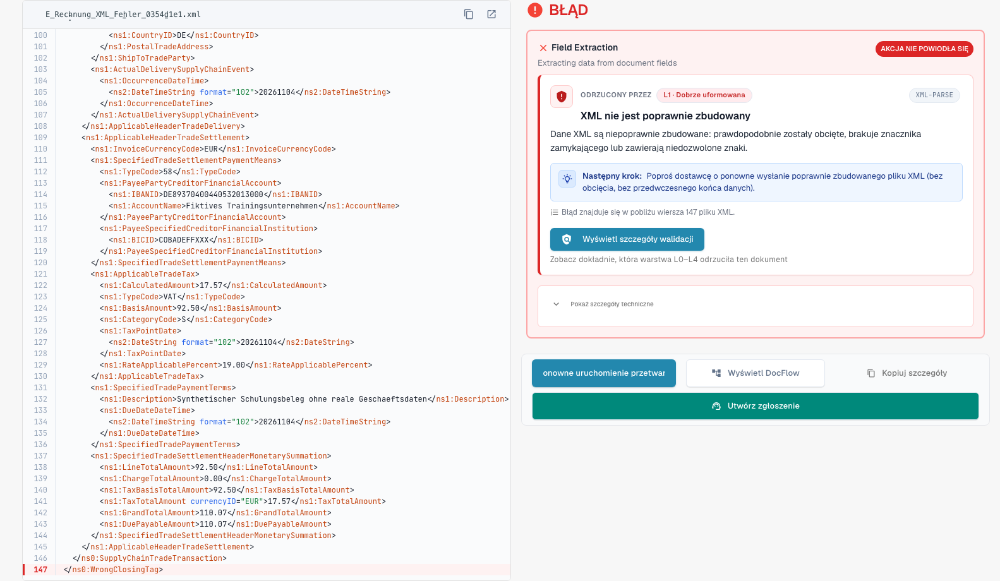
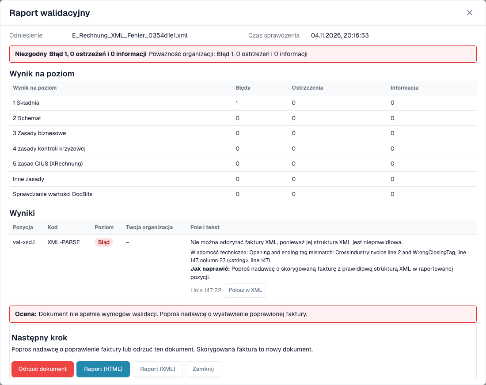
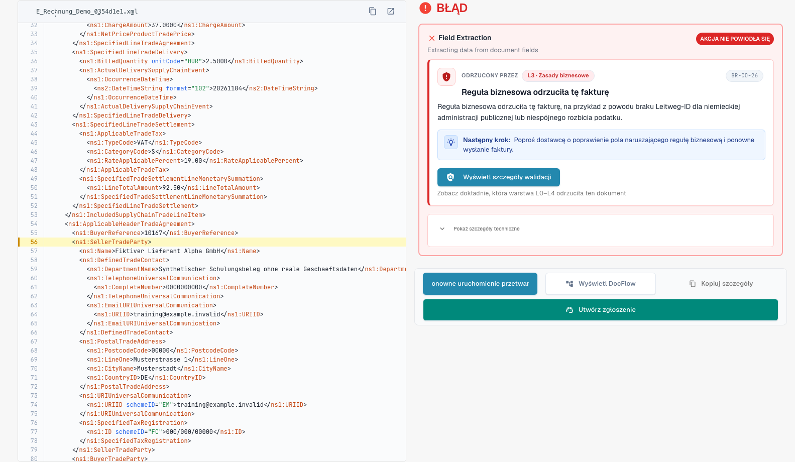

# Ekran błędu odrzuconej e-faktury

> W tej wersji niektóre teksty interfejsu mogą nadal być po angielsku lub mieć błędne tłumaczenie. Instrukcja wyjaśnia ich znaczenie; zrzuty pokazują niezmieniony interfejs.

Gdy wgrasz błędną e-fakturę, DocBits jej nie gubi. Dokument dostaje status **Error**, a ekran błędu pokazuje, co jest nie tak, gdzie i co zrobić dalej. Ta strona pokazuje dwa przykłady: plik XML, który nie jest poprawnie sformułowany, oraz fakturę, która łamie regułę biznesową.

> Faktura dostaje status **Error** tylko wtedy, gdy walidacja jest **włączona** i **blokująca** dla jej typu dokumentu. Zobacz [Walidacja dla każdego typu dokumentu](validation-per-document-type.md).

## Przykład 1: plik XML jest uszkodzony

Dostawca wysyła plik XML, w którym znacznik zamykający nie pasuje do znacznika otwierającego. Pliku nie można odczytać, więc DocBits zatrzymuje się na pierwszej kontroli, **L1 · Well-formedness**.

<figure><figcaption>
Ekran błędu fikcyjnego pliku XML z celowo uszkodzonym znacznikiem zamykającym. W tej wersji niektóre teksty interfejsu mogą nadal być po angielsku lub mieć błędne tłumaczenie. Instrukcja wyjaśnia ich znaczenie; zrzuty pokazują niezmieniony interfejs.
</figcaption></figure>

Ekran ma dwie strony:

* **Po lewej: plik XML.** DocBits pokazuje plik z numerami linii. Linia z problemem jest zaznaczona na czerwono. Przyciskami nad plikiem skopiujesz XML lub otworzysz go w nowej karcie.
* **Po prawej: wyjaśnienie.** Karta **Rejected by** wskazuje kontrolę, która zatrzymała plik (tutaj **L1 · Well-formedness**), oraz kod reguły (tutaj `XML-PARSE`). Poniżej widzisz tytuł (*Plik XML ma niepoprawną składnię*), krótkie wyjaśnienie i blok **Next step**.

Wybierz **View validation details**, aby otworzyć pełny [raport walidacyjny](validation-report.md).

<figure><figcaption>
Raport uszkodzonego pliku: jeden błąd na poziomie 1 Składnia, z komunikatem technicznym i pozycją
</figcaption></figure>

Raport podaje dokładną pozycję (tutaj wiersz 5, kolumna 4081) i techniczny komunikat parsera XML. Wybierz **Show in XML**, aby przejść do tej linii. Wskazówka **How to fix** mówi, że należy poprosić nadawcę o poprawiony plik.

## Przykład 2: faktura łamie regułę biznesową

XML jest poprawny, ale brakuje wymaganego pola. Na przykład nie można zidentyfikować sprzedawcy, ponieważ brak identyfikatora sprzedawcy, identyfikatora rejestracyjnego lub identyfikatora VAT (reguła `BR-CO-26`).

<figure><figcaption>
Ekran błędu całkowicie fikcyjnej przykładowej faktury: warstwa L3 · Business Rules, kod reguły i następny krok
</figcaption></figure>

Karta podaje warstwę **L3 · Business Rules** i kod `BR-CO-26`. Raport wymienia wszystkie wyniki faktury, zobacz [Raport walidacyjny](validation-report.md).

## Pole Next step i przyciski

Dla nieprawidłowej e-faktury strona zaczyna się od pola **Next step**. Zawiera ono akcję, która pomaga w tym przypadku:

| Akcja | Co robi |
| --- | --- |
| **Reject** | Odrzuca dokument. Okno podaje nazwę pliku, dostawcę i numer faktury, informuje, że dokument otrzyma status **Rejected** z notatką w historii i że dostawca nie zostanie powiadomiony, oraz wyjaśnia, jak cofnąć odrzucenie. Prosi o powód i potwierdza przyciskiem **Reject now**. Jeśli coś się nie uda, komunikat pojawia się w oknie i możesz spróbować ponownie. |
| **Download invoice XML** | Pobiera plik w takiej postaci, w jakiej został odebrany, na przykład aby sprawdzić go poza DocBits lub odesłać dostawcy. |
| **Print report** | Drukuje [raport walidacyjny](validation-report.md). |

Karta podaje też nazwę kontroli zrozumiałymi słowami, z kodem reguły jako małym odniesieniem.

**Restart Processing** uruchamia przetwarzanie dokumentu ponownie, na przykład po zmianie ustawienia; kontrola używa bieżących ustawień. Znajduje się pod polem Next step, ponieważ ponowne uruchomienie niezmienionego pliku kończy się tak samo. Pozostałe przyciski stoją obok:

| Przycisk | Co robi |
| --- | --- |
| **Restart Processing** | Uruchamia przetwarzanie dokumentu ponownie, na przykład po zmianie ustawienia. Kontrola używa bieżących ustawień. |
| **View DocFlow** | Pokazuje przepływ pracy dokumentu. |
| **Copy Details** | Kopiuje szczegóły błędu, na przykład do wiadomości dla administratora. |
| **Create ticket** | Otwiera zgłoszenie do wsparcia ze szczegółami błędu. |

Wybierz **Show technical details** na karcie, aby zobaczyć surowe informacje techniczne.

Podczas ładowania powodu strona pokazuje symbol zastępczy zamiast na wpół zapisanej karty. Jeśli powodu nie można wczytać, strona proponuje wczytanie go ponownie, a krok o nieznanej nazwie jest tak oznaczony zamiast pokazywać puste pole. Na wąskim ekranie XML i wyjaśnienie układają się jeden pod drugim zamiast obok siebie.

## Co zrobić dalej

* **Błędy:** poproś nadawcę o poprawioną fakturę lub [odrzuć dokument](validation-next-step-and-reject.md). Poprawiona faktura to nowy dokument.
* **Tylko ostrzeżenia:** dokument nie jest blokowany. Możesz kontynuować.

## Powiązane strony

* [Raport walidacyjny](validation-report.md): wszystkie wyniki, poziom po poziomie.
* [Następny krok i odrzucenie dokumentu](validation-next-step-and-reject.md)
* [Walidacja dla każdego typu dokumentu](validation-per-document-type.md): włącz walidację i ustaw blokowanie.
