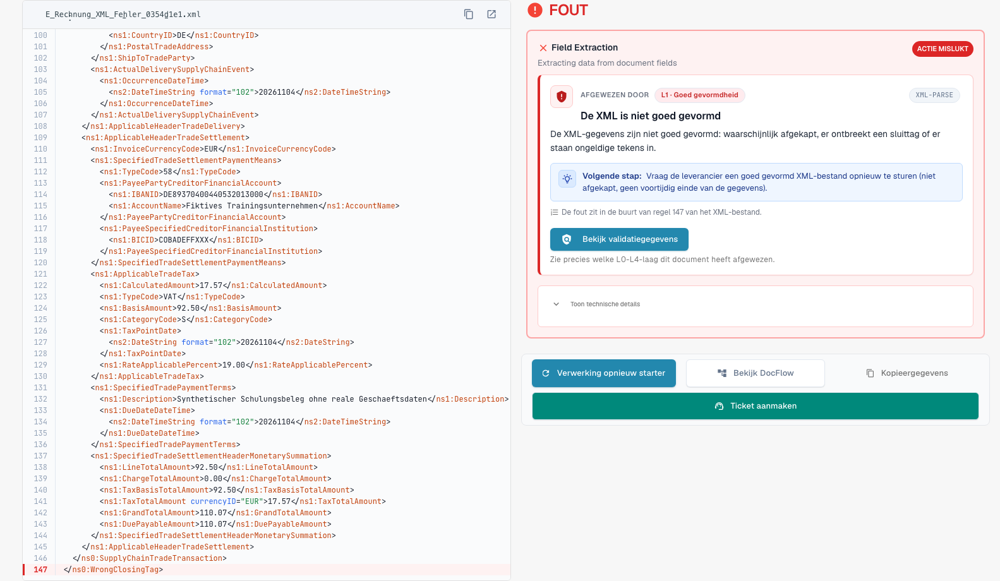
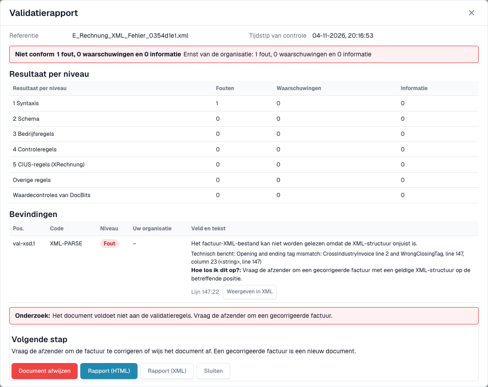

# Het foutscherm voor een afgewezen e-factuur

> Sommige interfaceteksten zijn in deze versie nog Engels of onjuist vertaald. De handleiding legt de betekenis uit; de schermafbeeldingen tonen de ongewijzigde interface.

Wanneer u een onjuiste e-factuur uploadt, raakt DocBits die niet kwijt. Het document krijgt de status **Error** en het foutscherm vertelt u wat er mis is, waar en wat u daarna kunt doen. Deze pagina toont twee voorbeelden: een XML-bestand dat niet goed gevormd is en een factuur die een bedrijfsregel schendt.

> Een factuur krijgt alleen de status **Error** wanneer validatie **on** staat en **blocking** is voor het documenttype. Zie [Validatie voor elk documenttype](validation-per-document-type.md).

Een e-invoice die de validator heeft afgewezen, draagt zijn eigen e-invoice-validatiestatus in plaats van een gewone **Error**. De statusbadge op het dashboard voegt een tooltip toe die zegt waarom het document stopte, zodat u een afgewezen factuur bij het filteren van de documentlijst van andere fouten kunt onderscheiden. Het foutscherm en het rapport hieronder zijn voor beide gevallen gelijk.

## Voorbeeld 1: het XML-bestand is beschadigd

Een leverancier stuurt een XML-bestand waarin een sluittag niet overeenkomt met de openingstag. Het bestand kan niet worden gelezen, dus DocBits stopt bij de eerste controle, **L1 · Well-formedness**.

<figure><figcaption>
Foutscherm van een fictief XML-bestand met een bewust beschadigde sluittag. Sommige interfaceteksten zijn in deze versie nog Engels of onjuist vertaald. De handleiding legt de betekenis uit; de schermafbeeldingen tonen de ongewijzigde interface.
</figcaption></figure>

Het scherm heeft twee kanten:

* **Links: het XML-bestand.** DocBits toont het bestand met regelnummers. De regel met het probleem is rood gemarkeerd. Met de knoppen boven het bestand kopieert u de XML of opent u die in een nieuw tabblad.
* **Rechts: de uitleg.** De kaart **Rejected by** noemt de controle die het bestand heeft gestopt (hier **L1 · Well-formedness**) en de regelcode (hier `XML-PARSE`). Daaronder ziet u een titel (*Het XML-bestand is niet correct opgebouwd*), een korte uitleg en het blok **Next step**.

Selecteer **View validation details** om het volledige [validatierapport](validation-report.md) te openen.

<figure><figcaption>
Rapport van het beschadigde bestand: één fout op niveau 1 Syntaxis, met het technische bericht en de positie
</figcaption></figure>

Het rapport noemt de exacte positie (hier regel 5, kolom 4081) en geeft het technische bericht van de XML-parser. Selecteer **Show in XML** om naar die regel te springen. De hint **How to fix** zegt dat u de afzender om een gecorrigeerd bestand moet vragen.

## Voorbeeld 2: de factuur schendt een bedrijfsregel

De XML is in orde, maar een verplicht veld ontbreekt. De verkoper kan bijvoorbeeld niet worden geïdentificeerd omdat er geen verkopersidentificatie, registratie-identificatie of btw-identificatie aanwezig is (regel `BR-CO-26`).

<figure><figcaption>
Foutscherm van een volledig fictieve voorbeeldfactuur: de laag L3 · Business Rules, de regelcode en een volgende stap
</figcaption></figure>

De kaart noemt de laag **L3 · Business Rules** en de code `BR-CO-26`. Het rapport somt alle bevindingen van de factuur op, zie [Validatierapport](validation-report.md).

## Wanneer DocBits het document niet kon controleren

Niet elke fout is een afwijzing. Kan de validator het bestand helemaal niet lezen, dan begint de melding met _could not check this document_ en noemt de controle die het stopte, bijvoorbeeld `XML-PARSE` voor een beschadigd XML-bestand of `PDF-UNREADABLE` voor een PDF die niet kan worden geopend. DocBits toont dezelfde uitlegkaart als bij een afgewezen factuur, met de naam van de controle, de code en de technische melding.

Dit is een technische fout, geen oordeel over de factuur:

* DocBits markeert het document niet als afgewezen.
* Een herstart kan slagen, omdat de oorzaak in het lezen van het bestand kan liggen. Kies **Restart Processing** voordat u de afzender om een nieuwe factuur vraagt.
* Verschijnt na een herstart dezelfde code opnieuw, stuur het bestand en de code dan naar uw administrator.

## Het vak Next step en de knoppen

Bij een ongeldige e-factuur begint de pagina met een vak **Next step**. Het draagt de actie die in dit geval helpt:

| Actie | Wat die doet |
| --- | --- |
| **Reject** | Wijst het document af. De dialoog noemt het bestand, de verkoper en het factuurnummer, vertelt u dat het document de status **Rejected** krijgt met een notitie in de historie en dat de leverancier niet wordt geïnformeerd, en legt uit hoe u de afwijzing ongedaan maakt. Hij vraagt om een reden en bevestigt met **Reject now**. Mislukt er iets, dan verschijnt de melding in de dialoog en kunt u het opnieuw proberen. |
| **Download invoice XML** | Downloadt het bestand zoals het is ontvangen, bijvoorbeeld om het buiten DocBits te controleren of naar de leverancier terug te sturen. |
| **Print report** | Drukt het [validatierapport](validation-report.md) af. |

De kaart noemt de controle ook in begrijpelijke woorden, met de regelcode als kleine verwijzing.

**Restart Processing** voert de verwerking van het document opnieuw uit, bijvoorbeeld nadat u een instelling hebt gewijzigd; de controle gebruikt de huidige instellingen. De knop staat onder het vak Next step, omdat een herstart van een ongewijzigd bestand op dezelfde manier mislukt. De overige knoppen staan ernaast:

| Knop | Wat hij doet |
| --- | --- |
| **Restart Processing** | Voert de verwerking van het document opnieuw uit, bijvoorbeeld nadat u een instelling hebt gewijzigd. De controle gebruikt de huidige instellingen. |
| **View DocFlow** | Toont de workflow van het document. |
| **Copy Details** | Kopieert de foutgegevens, bijvoorbeeld voor een bericht aan uw beheerder. |
| **Create ticket** | Opent een supportticket met de foutgegevens. |

Selecteer **Show technical details** op de kaart voor de ruwe technische informatie.

Terwijl de reden laadt, toont de pagina een plaatshouder in plaats van een half geschreven kaart. Kan de reden niet worden geladen, dan biedt de pagina aan om die opnieuw te laden, en een stap met een onbekende naam wordt als zodanig aangeduid in plaats van een leeg veld te tonen. Op een smal scherm staan XML en uitleg boven elkaar in plaats van naast elkaar.

## Wat u daarna doet

* **Fouten:** vraag de afzender om een gecorrigeerde factuur, of [wijs het document af](validation-next-step-and-reject.md). Een gecorrigeerde factuur is een nieuw document.
* **Alleen waarschuwingen:** het document wordt niet geblokkeerd. U kunt doorgaan.

## Gerelateerde pagina's

* [Validatierapport](validation-report.md): alle bevindingen, niveau voor niveau.
* [Volgende stap en een document afwijzen](validation-next-step-and-reject.md)
* [Validatie voor elk documenttype](validation-per-document-type.md): schakel validatie in en stel blokkeren in.
