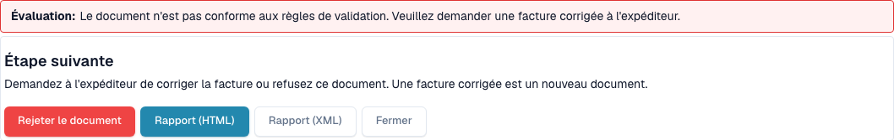
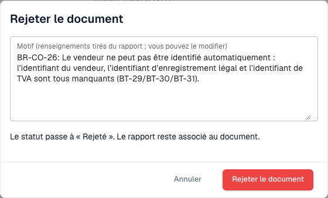

# Étape suivante et rejet d'un document

> Dans cette version, certains textes de l’interface peuvent encore être en anglais ou mal traduits. Le guide explique leur sens ; les captures montrent l’interface sans modification.

Après la lecture du [rapport de validation](validation-report.md), le rapport vous indique quoi faire. Vous pouvez aussi rejeter le document.

## Que faire ensuite

<figure><figcaption>
Évaluation, étape suivante et actions du rapport.
</figcaption></figure>

L'**Assessment** indique en une phrase si la facture est conforme. Le bloc **Next step** vous dit quoi faire :

| Résultat | Étape suivante |
| --- | --- |
| Au moins une **erreur** | Demandez à l'expéditeur une facture corrigée, ou rejetez le document. Une facture corrigée est un nouveau document. |
| Uniquement des **avertissements** | Vous pouvez poursuivre avec le document. |

Les boutons à la fin du rapport :

* **Reject document** : ouvre la boîte de dialogue de rejet (voir ci-dessous).
* **Report (HTML)** et **Report (XML)** : téléchargent le rapport, par exemple pour l'envoyer au fournisseur.
* **Close** (ou **Back to document**) : revient au document.

## Rejeter un document

<figure><figcaption>
Boîte de dialogue de rejet de la facture fictive. Le rejet a été annulé.
</figcaption></figure>

1. Dans le rapport, cliquez sur **Reject document**.
2. Vérifiez le **Reason**. DocBits le remplit à partir des erreurs du rapport. Vous pouvez modifier le texte.
3. Cliquez sur **Reject document** pour confirmer. Le statut passe à **Rejected**. Le motif est enregistré comme note et le rapport reste associé au document.

Cliquez sur **Cancel** pour laisser le document tel quel.

> Seuls les utilisateurs autorisés à modifier les documents voient **Reject document**. Le bouton est masqué lorsque le document est déjà rejeté ou terminé.
