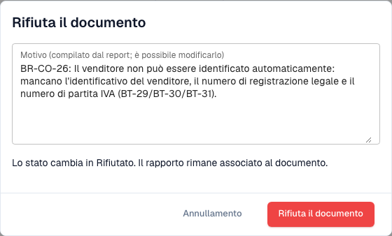

# Passo successivo e rifiuto di un documento

> In questa versione alcuni testi dell’interfaccia possono essere ancora in inglese o tradotti in modo errato. La guida ne spiega il significato; le schermate mostrano l’interfaccia originale.

Dopo aver letto il [rapporto di convalida](validation-report.md), il rapporto ti dice cosa fare. Puoi anche rifiutare il documento.

## Cosa fare dopo

<figure><figcaption>
Valutazione, passo successivo e azioni del rapporto.
</figcaption></figure>

La **Assessment** dice in una frase se la fattura è conforme. Il blocco **Next step** ti dice cosa fare:

| Risultato | Passo successivo |
| --- | --- |
| Almeno un **errore** | Chiedi al mittente una fattura corretta, oppure rifiuta il documento. Una fattura corretta è un nuovo documento. |
| Solo **avvertenze** | Puoi proseguire con il documento. |

I pulsanti alla fine del rapporto:

* **Reject document**: apre la finestra di rifiuto (vedi sotto).
* **Report (HTML)** e **Report (XML)**: scaricano il rapporto, ad esempio per inviarlo al fornitore.
* **Close** (o **Back to document**): chiude il rapporto e ti riporta al documento.

## Rifiutare un documento

<figure><figcaption>
Finestra di rifiuto della fattura fittizia. Il rifiuto è stato annullato.
</figcaption></figure>

1. Nel rapporto, seleziona **Reject document**.
2. Controlla il **Reason**. DocBits lo compila dagli errori del rapporto. Puoi modificare il testo.
3. Seleziona **Reject document** per confermare. Lo stato cambia in **Rejected**. Il motivo viene salvato come nota e il rapporto rimane associato al documento.

Seleziona **Cancel** per lasciare il documento com'è.

> Solo gli utenti autorizzati a modificare i documenti vedono **Reject document**. Il pulsante è nascosto quando il documento è già rifiutato o completato.
