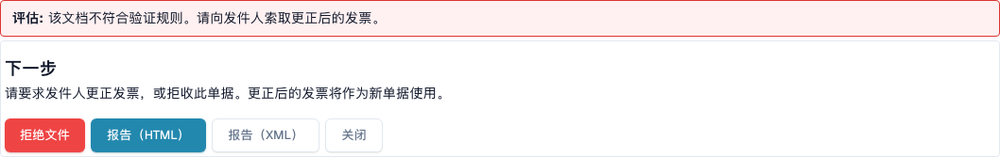
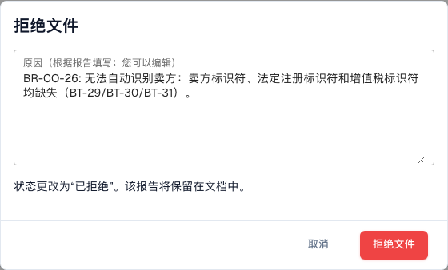

# 下一步操作与拒绝文档

> 此版本的部分界面文字仍可能使用英语或存在翻译错误。本指南解释正确含义；截图保留实际界面文字。

阅读[验证报告](validation-report.md)后，报告会告诉您接下来该怎么做。您也可以拒绝该文档。

## 接下来要做什么

<figure><figcaption>
报告中的评估结果、下一步和操作按钮。
</figcaption></figure>

**Assessment** 用一句话说明发票是否符合要求。**Next step** 区块会告诉您该怎么做：

| 结果                   | 下一步                                                                                  |
| ---------------------- | -------------------------------------------------------------------------------------- |
| 至少有一个**Error**     | 请发件人提供更正后的发票，或者拒绝该文档。更正后的发票属于一份新文档。 |
| 只有**Warning**           | 您可以继续处理该文档。                                                                    |

报告末尾的按钮：

* **Reject document**：打开拒绝对话框（见下文）。
* **Report (HTML)** 和 **Report (XML)**：下载报告，例如发送给供应商。
* **Close**（或 **Back to document**）：返回文档。

## 拒绝文档

<figure><figcaption>
拒绝虚构示例发票的对话框。本次操作已取消。
</figcaption></figure>

1. 在报告中，选择 **Reject document**。
2. 检查 **Reason**。DocBits 会根据报告中的错误填写原因。您可以编辑文本。
3. 选择 **Reject document** 进行确认。状态会变为 **Rejected**。原因会保存为备注，报告会保留在文档中。

选择 **Cancel**，即可保持文档现状。

> 只有获准编辑文档的用户才能看到 **Reject document**。如果文档已被拒绝或已完成，该按钮会隐藏。
