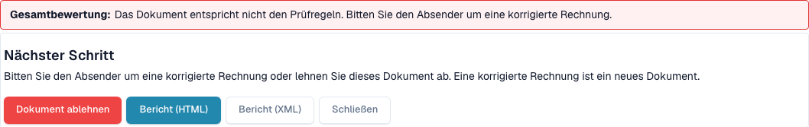
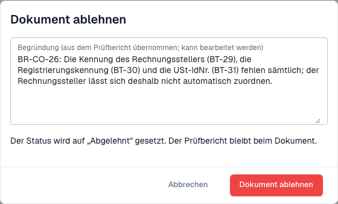

# Nächster Schritt und Dokument ablehnen

> Einzelne Produkttexte können in dieser Version noch Englisch oder sprachlich fehlerhaft sein. Die Anleitung erklärt die Bedeutung; die Screenshots zeigen die unveränderte Oberfläche.

Nachdem Sie den [Prüfbericht](validation-report.md) gelesen haben, sagt Ihnen der Bericht, was zu tun ist. Sie können das Dokument auch ablehnen.

## Was als Nächstes zu tun ist

<figure><figcaption>
Gesamtbewertung, nächster Schritt und Aktionen im Prüfbericht.
</figcaption></figure>

Die **Assessment** sagt in einem Satz, ob die Rechnung konform ist. Der Block **Next step** sagt Ihnen, was zu tun ist:

| Ergebnis | Nächster Schritt |
| --- | --- |
| Mindestens ein **Error** | Bitten Sie den Absender um eine korrigierte Rechnung oder lehnen Sie das Dokument ab. Eine korrigierte Rechnung ist ein neues Dokument. |
| Nur **Warnungen** | Sie können mit dem Dokument fortfahren. |

Die Schaltflächen am Ende des Berichts:

* **Reject document**: öffnet den Dialog zum Ablehnen (siehe unten).
* **Report (HTML)** und **Report (XML)**: laden den Bericht herunter, zum Beispiel um ihn an den Lieferanten zu senden.
* **Close**: zurück zum Dokument.

## Ein Dokument ablehnen

<figure><figcaption>
Dialog zum Ablehnen der synthetischen Beispielrechnung. Die Ablehnung wurde abgebrochen.
</figcaption></figure>

1. Wählen Sie im Bericht **Reject document**.
2. Prüfen Sie die **Reason**. DocBits übernimmt sie aus den Fehlern im Bericht. Sie können den Text bearbeiten.
3. Wählen Sie **Reject document**, um zu bestätigen. Der Status wechselt zu **Rejected**. Die Begründung wird als Notiz gespeichert, und der Prüfbericht bleibt beim Dokument.

Wählen Sie **Cancel**, um das Dokument unverändert zu lassen.

> **Reject document** sehen nur Benutzer, die Dokumente bearbeiten dürfen. Die Schaltfläche ist ausgeblendet, wenn das Dokument bereits abgelehnt oder abgeschlossen ist.
