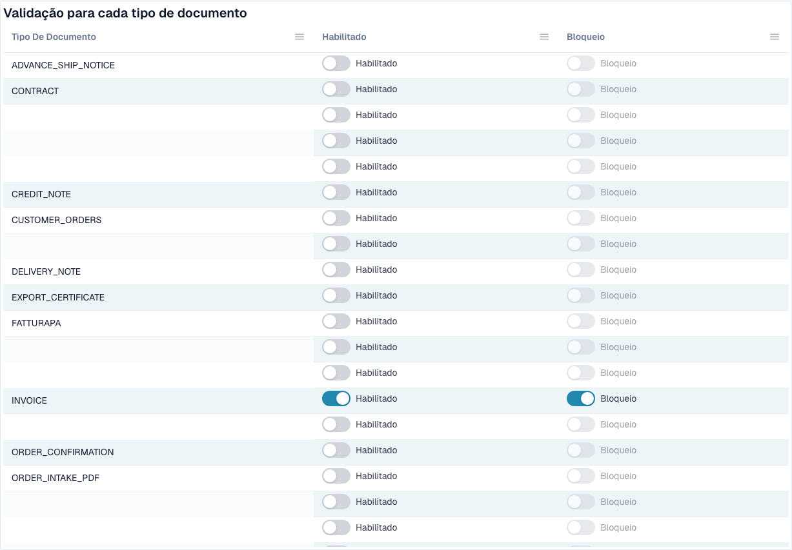
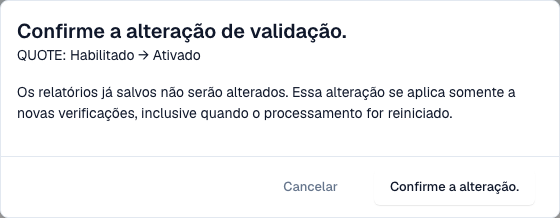

# Validação para cada tipo de documento

Os administradores decidem, para cada tipo de documento, se o DocBits valida as faturas eletrónicas recebidas e se uma verificação falhada bloqueia o documento. Cada alteração é confirmada e escrita no [registo de alterações](validation-change-log.md).

> Só os **administradores da organização** podem alterar estas definições. Os outros utilizadores veem a tabela só de leitura, ou não a veem.

## A tabela

Vá a **Settings → E-Documents → E-Invoice Validation**. O separador **Rules and policy** começa com a tabela **Validation for each document type**.

<figure><figcaption>
Validação e bloqueio por tipo de documento. Os nomes configurados estão ocultos. Exemplo em Dev.
</figcaption></figure>

| Interruptor | O que faz |
| --- | --- |
| **Enabled** | O DocBits valida cada fatura eletrónica recebida deste tipo de documento e guarda um [relatório de validação](validation-report.md). |
| **Blocking** | Um resultado que é um erro para o documento. Fica com o estado **Error**. Com o bloqueio desativado, o DocBits guarda o relatório e o documento continua. Só pode ativar **Blocking** quando **Enabled** está ativo. |

Se um tipo de documento tiver substituições por subtipo, a tabela mostra uma nota sobre elas.

## Alterar uma definição

1. Selecione o interruptor que quer alterar.
2. O DocBits mostra **Confirm validation change** com o tipo de documento e a alteração, por exemplo *QUOTE: Ativado → Ligado*.

<figure><figcaption>
Confirmação de uma alteração das definições. A alteração foi cancelada para esta captura.
</figcaption></figure>

3. Leia a nota: **Os relatórios já guardados não serão alterados.** A alteração aplica-se apenas a novas verificações, inclusive quando reinicia o processamento de um documento.
4. Selecione **Confirm change**, ou **Cancel** para manter a definição anterior.

Se não tiver a permissão, o DocBits mostra uma mensagem a dizer que é necessário um administrador da organização, e nada muda.

## Páginas relacionadas

* [Validação de faturas eletrónicas](./)
* [Registo de alterações](validation-change-log.md)
* [Configuração da validação e versões aceites](validation-setup.md)
* [Relatório de validação](validation-report.md)
* [Ativar ou desativar a validação de faturas eletrónicas](../#ativar-ou-desativar-a-validacao-de-faturas-eletronicas)
