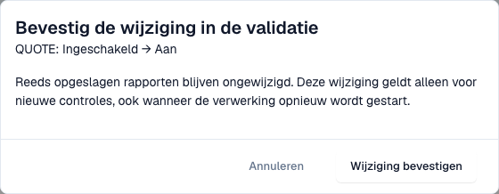

# Validatie voor elk documenttype

Beheerders bepalen per documenttype of DocBits binnenkomende e-facturen valideert en of een mislukte controle het document blokkeert. Elke wijziging wordt bevestigd en vastgelegd in het [wijzigingslogboek](validation-change-log.md).

> Alleen **organisatiebeheerders** kunnen deze instellingen wijzigen. Andere gebruikers zien de tabel alleen-lezen of zien haar niet.

## De tabel

Ga naar **Settings → E-Documents → E-Invoice Validation**. Het tabblad **Rules and policy** begint met de tabel **Validation for each document type**.

<figure><figcaption>
Validatie en blokkering per documenttype. Ingestelde namen zijn verborgen. Voorbeeld uit Dev.
</figcaption></figure>

| Schakelaar | Wat hij doet |
| --- | --- |
| **Enabled** | DocBits valideert elke binnenkomende e-factuur van dit documenttype en slaat een [validatierapport](validation-report.md) op. |
| **Blocking** | Een bevinding die een fout is, stopt het document. Het krijgt de status **Error**. Als blokkeren uit staat, slaat DocBits het rapport op en gaat het document verder. U kunt **Blocking** alleen inschakelen als **Enabled** aan staat. |

Als een documenttype overschrijvingen voor subtypen heeft, toont de tabel daarover een opmerking.

## Een instelling wijzigen

1. Selecteer de schakelaar die u wilt wijzigen.
2. DocBits toont **Confirm validation change** met het documenttype en de wijziging, bijvoorbeeld *QUOTE: Ingeschakeld → Aan*.

<figure><figcaption>
Bevestiging van een instellingswijziging. De wijziging is voor deze opname geannuleerd.
</figcaption></figure>

3. Lees de opmerking: **Reeds opgeslagen rapporten blijven ongewijzigd.** De wijziging geldt alleen voor nieuwe controles, ook wanneer u de verwerking van een document opnieuw start.
4. Selecteer **Confirm change**, of **Cancel** om de oude instelling te behouden.

Als u de rechten niet hebt, toont DocBits een melding dat een organisatiebeheerder vereist is, en verandert er niets.

## Gerelateerde pagina's

* [Validatie van elektronische facturen](./)
* [Wijzigingslogboek](validation-change-log.md)
* [Validatie-instellingen en geaccepteerde versies](validation-setup.md)
* [Validatierapport](validation-report.md)
* [E-factuurvalidatie in- of uitschakelen](../#e-factuurvalidatie-in--of-uitschakelen)
