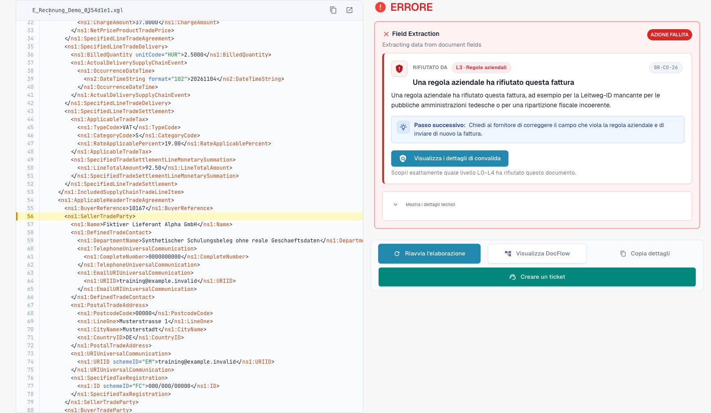
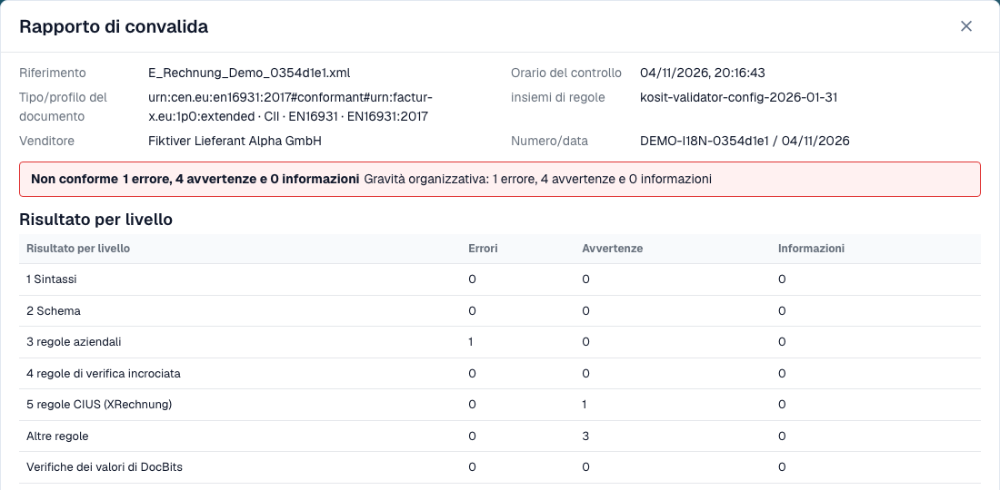
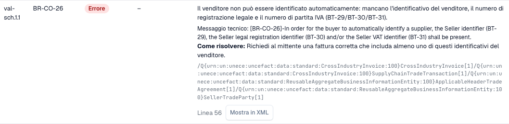

# Rapporto di convalida

> In questa versione alcuni testi dell’interfaccia possono essere ancora in inglese o tradotti in modo errato. La guida ne spiega il significato; le schermate mostrano l’interfaccia originale.

Quando DocBits rifiuta una fattura elettronica, puoi leggere esattamente il perché. Il **rapporto di convalida** elenca ogni risultato in linguaggio semplice, ti dice cosa correggere e mostra il passo successivo. Lo apri dal documento, non dalle impostazioni. La schermata in cui lo trovi è descritta in [La schermata di errore per una fattura elettronica rifiutata](validation-error-screen.md).

Questa pagina è per chi elabora le fatture. Gli amministratori impostano le regole nella pagina [Validazione della fattura elettronica](./) e scelgono per ogni tipo di documento se un controllo non superato blocca la fattura, vedi [Validazione per ogni tipo di documento](validation-per-document-type.md).

## Quando un documento riceve un errore

Se la validazione è **on** e **blocking** per il tipo di documento, una fattura con un risultato bloccante passa allo stato **Error**. Una fattura rifiutata dal validatore stesso porta invece lo stato dedicato di validazione e-invoice, vedi [La schermata di errore di una e-invoice rifiutata](validation-error-screen.md). Apri il documento dal cruscotto. La vista di errore mostra l'XML a sinistra e il motivo a destra.

<figure><figcaption>
Schermata di errore di una fattura di esempio interamente fittizia. In questa versione alcuni testi dell’interfaccia possono essere ancora in inglese o tradotti in modo errato. La guida ne spiega il significato; le schermate mostrano l’interfaccia originale.
</figcaption></figure>

La scheda a destra indica il livello che ha rifiutato la fattura (ad esempio **L3 · Business Rules**), il codice della regola (ad esempio `BR-CO-26`), una breve spiegazione e un **Next step**. Seleziona **View validation details** per aprire il rapporto completo.

## Leggere il rapporto

<figure><figcaption>
Rapporto della fattura fittizia con i dati del file e l’esito.
</figcaption></figure>

Il rapporto inizia con i dati del file:

| Campo | Cosa mostra |
| --- | --- |
| **Reference** | Il nome del file della fattura. |
| **Time of check** | Quando DocBits ha eseguito il controllo. Un rapporto salvato non cambia più. |
| **Document type / profile** | Il formato della fattura, ad esempio CII ed EN 16931. |
| **Rule sets** | La versione dei set di regole usati da DocBits. |
| **Seller** | Il venditore, letto dall'XML. |
| **Number / date** | Il numero e la data della fattura, letti dall'XML. |

Sotto i dati del file vedi il **verdetto**, ad esempio **Not conformant**, con il numero di errori, avvertenze e informazioni. Se la tua organizzazione ha cambiato la gravità di una regola, una seconda riga **Organisation severity** mostra i conteggi dopo le impostazioni della tua organizzazione.

> Il verdetto riporta **Rejected** invece di una parola di conformità quando il documento è stato rifiutato nella validazione e-invoice, e in quel caso il verdetto mostra un'icona di annullamento. Il passo successivo rimanda all'elenco degli errori. Un report il cui esito non è leggibile non mostra mai la fattura come conforme.

### Risultato per livello

La tabella **Result per level** mostra quanti errori, avvertenze e informazioni ha trovato ogni controllo. I controlli si basano l'uno sull'altro:

| Livello | Cosa controlla |
| --- | --- |
| **1 Syntax** | L'XML è ben formato. |
| **2 Schema** | La struttura rispetta lo schema XML ufficiale. |
| **3 Business rules** | I campi obbligatori sono presenti e corretti (regole `BR-…`). |
| **4 Cross-check rules** | I campi sono coerenti tra loro, ad esempio le somme. |
| **5 CIUS rules (XRechnung)** | Le regole tedesche aggiuntive di XRechnung. |
| **Other rules** | Ulteriori regole, ad esempio le regole PEPPOL. |
| **Value checks of DocBits** | Controlli aggiunti da DocBits, ad esempio IBAN e partita IVA. |

> Per le fatture con profilo EN 16931 o EXTENDED, le regole specifiche di XRechnung vengono mostrate come **avvertenze**, non come errori.

## I risultati

<figure><figcaption>
Ogni esito ha un codice, un livello, un testo leggibile e un'indicazione su come correggerlo.
</figcaption></figure>

Ogni risultato è una riga:

* **Pos** e **Code**: la posizione nel rapporto e il codice della regola, ad esempio `BR-CO-26`.
* **Level**: **Error**, **Warning** o **Information**.
* **Your organisation**: il livello dopo le impostazioni della tua organizzazione. Un trattino indica che la tua organizzazione non ha cambiato il livello.
* **Field and text**: il problema in linguaggio semplice, il campo interessato (ad esempio *BT-29 Identificativo del venditore*), il messaggio tecnico del validatore e **How to fix**.
* **Line** e **Show in XML**: seleziona **Show in XML** per chiudere il rapporto e passare alla riga nel visualizzatore XML.

DocBits ha testi in linguaggio semplice per le regole più comuni. Per una regola senza un testo di questo tipo, il rapporto mostra il messaggio tecnico del validatore.

## Lavorare con un rapporto lungo

Una fattura può violare molte regole contemporaneamente. Il rapporto tiene il verdetto e i conteggi in un'intestazione fissa mentre i risultati scorrono, così vedi sempre quanto vale l'intera fattura.

* **Filtra per livello.** I pulsanti di filtro sopra i risultati limitano l'elenco a errori, avvisi o messaggi informativi. Anche le righe **Result per level** funzionano da filtro: seleziona un livello per vedere solo i suoi risultati.
* **Cerca.** Un campo di ricerca filtra l'elenco aperto per testo, ad esempio un codice di regola, un nome di campo o una parola del messaggio.
* **Espandi e comprimi.** I risultati si aprono da soli quando sono errori o quando il rapporto ha al massimo tre righe. Usa le azioni di espansione e compressione per l'intero elenco; ogni riga si apre anche singolarmente.
* **Copia un codice o un XPath.** I risultati offrono un'azione di copia per il codice della regola e per l'XPath dell'elemento difettoso, ad esempio per un messaggio al tuo amministratore.
* **Apri i dettagli quando ti servono.** I dettagli del documento partono compressi. I dettagli tecnici come il numero di controllo e l'XPath restano nel risultato, mentre la riga stessa mostra il nome comprensibile del controllo e il codice della regola come riferimento.
* **Torna al tuo punto.** Quando selezioni **Show in XML** e riapri il rapporto, le righe aperte, il filtro e la posizione di scorrimento restano come li hai lasciati.
* **Scarica o stampa.** L'azione **Download** nel piè di pagina del rapporto offre la stampa e un PDF, oltre ai file HTML e XML del rapporto. Il nome del file, la data di esportazione e il numero di pagina compaiono sul PDF.
* **Rifiuta dal rapporto.** L'azione di rifiuto si trova a sinistra nel piè di pagina, separata dall'azione di download, così non rifiuti una fattura mentre cerchi il PDF.

Su uno schermo stretto, ad esempio su un telefono, ogni risultato diventa una scheda invece di una riga.

## Passo successivo

* [Passo successivo e rifiuto di un documento](validation-next-step-and-reject.md): cosa fare dopo aver letto il rapporto.

## Pagine correlate

* [Validazione della fattura elettronica](./): versioni accettate, profili e gravità di ogni regola.
* [Validazione per ogni tipo di documento](validation-per-document-type.md): attiva la validazione e imposta il blocco.
* [Instradamento delle notifiche](../notification-routing.md): chi gestisce quale risultato.
