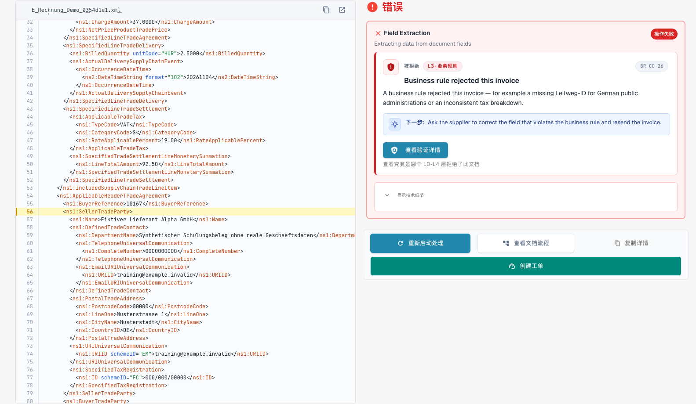
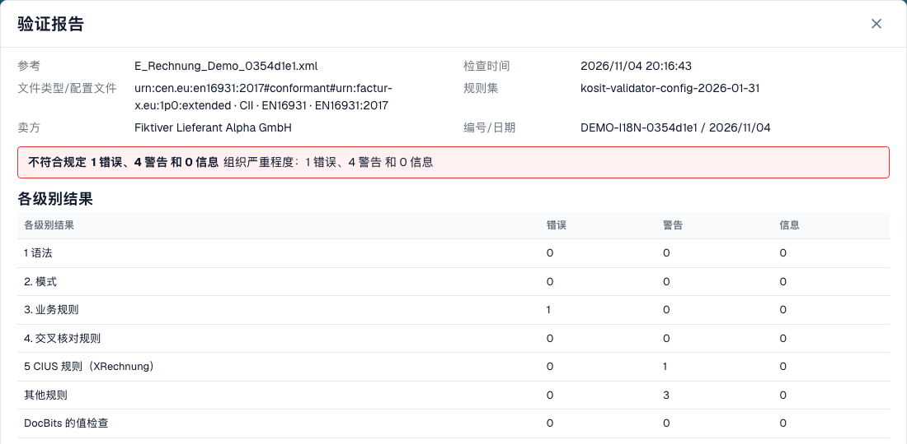
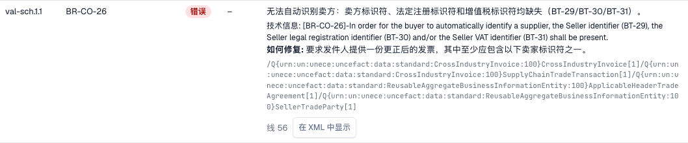

# 验证报告

> 此版本的部分界面文字仍可能使用英语或存在翻译错误。本指南解释正确含义；截图保留实际界面文字。

> 界面中的“线”指 XML 行号；本指南使用“行”。

当 DocBits 拒绝一张电子发票时，您可以准确了解原因。**验证报告**会以通俗易懂的语言列出每项校验问题，告诉您需要修正什么，并显示下一步操作。您可以从文档中打开报告，而不是从设置中打开。查找报告的界面请参阅[被拒绝电子发票的错误界面](validation-error-screen.md)。

本页面向处理发票的人员。管理员会在[电子发票验证](./)页面设置规则，并按文档类型选择检查失败时是否阻止发票，详见[按文档类型验证](validation-per-document-type.md)。

## 文档出现错误时

如果该文档类型的验证已**on**且设为**blocking**，那么出现阻止处理的校验问题的发票状态会变为**Error**。被校验器本身拒绝的发票则带有专门的电子发票校验状态，参见[被拒绝电子发票的错误界面](validation-error-screen.md)。从仪表板打开文档。错误视图左侧显示 XML，右侧显示原因。

<figure><figcaption>
完全虚构的示例发票错误界面。 此版本的部分界面文字仍可能使用英语或存在翻译错误。本指南解释正确含义；截图保留实际界面文字。
</figcaption></figure>

右侧卡片会显示拒绝发票的层级（例如 **L3 · Business Rules**）、规则代码（例如 `BR-CO-26`）、简短说明和**Next step**。选择**View validation details**以打开完整报告。

## 阅读报告

<figure><figcaption>
虚构示例发票的报告，包含文件信息和检查结果。
</figcaption></figure>

报告开头列出文件信息：

| 字段                       | 显示内容                                                     |
| --------------------------- | ----------------------------------------------------------------- |
| **Reference**               | 发票的文件名。                                     |
| **Time of check**           | DocBits 执行检查的时间。已保存的报告之后不会改变。 |
| **Document type / profile** | 发票的格式，例如 CII 和 EN 16931。          |
| **Rule sets**               | DocBits 使用的规则集版本。                   |
| **Seller**                  | 从 XML 中读取的卖方。                                    |
| **Number / date**           | 从 XML 中读取的发票编号和发票日期。       |

文件信息下方会显示**判定结果**，例如**Not conformant**，并列出错误、警告和信息消息的数量。如果您的组织更改了某条规则的严重级别，第二行**Organisation severity**会显示应用组织设置后的数量。

> 当文档在电子发票校验中被拒绝时，判定显示为 **Rejected** 而不是符合性词语，此时判定带有取消图标。下一步指向错误列表。结果无法读取的报告永远不会将发票显示为符合。

### 各级别的结果

**Result per level**表格会显示每项检查发现的错误、警告和信息消息数量。各项检查逐级进行：

| 级别                        | 检查内容                                          |
| ---------------------------- | ------------------------------------------------------- |
| **1 Syntax**                 | XML 格式良好。                                 |
| **2 Schema**                 | 结构符合官方 XML 架构。          |
| **3 Business rules**         | 必填字段齐全且正确（规则 `BR-…`）。 |
| **4 Cross-check rules**      | 字段之间相互一致，例如金额合计。         |
| **5 CIUS rules (XRechnung)** | XRechnung 的附加德国规则。                  |
| **Other rules**              | 其他规则，例如 PEPPOL 规则。            |
| **Value checks of DocBits**  | DocBits 添加的检查，例如 IBAN 和 VAT ID。  |

> 对于使用 EN 16931 或 EXTENDED 规范配置的发票，XRechnung 专用规则会显示为**warnings**，而非错误。

## 校验问题

<figure><figcaption>
每个校验问题都包含代码、级别、可读文本和修正提示。
</figcaption></figure>

每项校验问题占一行：

* **Pos**和**Code**：报告中的位置和规则代码，例如 `BR-CO-26`。
* **Level**：**Error**、**Warning**或**Information**。
* **Your organisation**：应用组织设置后的级别。短横线表示您的组织未更改该级别。
* **Field and text**：用通俗语言说明问题、指出相关字段（例如 _BT-29 卖方标识符_）、显示验证器的技术消息，并提供**How to fix**。
* **Line**和**Show in XML**：选择**Show in XML**以关闭报告，并跳转到 XML 查看器中的相应行。

DocBits 为最常见的规则提供通俗易懂的说明。如果某条规则没有此类说明，报告会显示验证器的技术消息。

## 处理较长的报告

一张发票可能同时违反多条规则。报告会把判定结果和计数固定在顶部，校验问题在下方滚动，因此您始终能看到整张发票的结果。

* **按级别筛选。** 校验问题上方的筛选按钮可将列表缩小到错误、警告或信息消息。**Result per level** 行同样起到筛选作用：选择某个级别，即可只查看该级别的问题。
* **搜索。** 搜索框按文本筛选当前列表，例如规则代码、字段名或消息中的某个词。
* **展开与折叠。** 当问题是错误，或报告最多只有三行时，问题会自动展开。整份列表可使用展开和折叠操作；每一行也可以单独打开。
* **复制代码或 XPath。** 每个问题都提供复制规则代码和错误元素 XPath 的操作，例如用于向管理员发送消息。
* **需要时再打开详情。** 文档详情默认折叠。检查编号和 XPath 等技术详情保留在问题内部，而行本身显示易懂的检查名称和作为参照的规则代码。
* **回到原来的位置。** 当您选择 **Show in XML** 并再次打开报告时，已展开的行、筛选条件和滚动位置会保持您离开时的状态。
* **下载或打印。** 报告页脚的 **Download** 操作提供打印和 PDF，以及报告的 HTML 和 XML 文件。文件名、导出日期和页码会显示在 PDF 上。
* **在报告中拒绝。** 拒绝操作位于页脚左侧，与下载操作分开，这样您在查找 PDF 时不会误拒发票。

在窄屏（例如手机）上，每个问题会变成一张卡片，而不是一行。

## 下一步

* [下一步操作与拒绝文档](validation-next-step-and-reject.md)：阅读报告后要采取的操作。

## 相关页面

* [电子发票验证](./)：受支持的版本、规范配置以及各条规则的严重级别。
* [按文档类型验证](validation-per-document-type.md)：启用验证并设置阻止选项。
* [通知路由](../notification-routing.md)：由谁处理各项校验问题。
