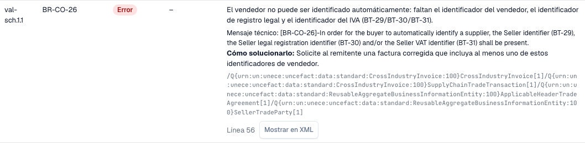

# Informe de validación

> En esta versión, algunos textos de la interfaz pueden seguir en inglés o contener traducciones incorrectas. La guía explica su significado; las capturas muestran la interfaz sin modificar.

Cuando DocBits rechaza una factura electrónica, puede ver exactamente el motivo. El **informe de validación** enumera cada hallazgo en lenguaje claro, indica qué corregir y muestra el siguiente paso. Se abre desde el documento, no desde los ajustes. La pantalla donde lo encuentra se describe en [La pantalla de error de una factura electrónica rechazada](validation-error-screen.md).

Esta página es para las personas que procesan facturas. Los administradores configuran las reglas en la página [Validación de facturas electrónicas](./) y eligen por tipo de documento si una comprobación fallida bloquea la factura; consulte [Validación para cada tipo de documento](validation-per-document-type.md).

## Cuando un documento recibe un error

Si la validación está **on** y **blocking** para el tipo de documento, una factura con un hallazgo bloqueante recibe el estado **Error**. Una factura que el propio validador ha rechazado lleva en su lugar el estado dedicado de validación de e-invoice, véase [La pantalla de error de una e-invoice rechazada](validation-error-screen.md). Abra el documento desde el panel. La vista de error muestra el XML a la izquierda y el motivo a la derecha.

<figure><figcaption>
Pantalla de error de una factura de ejemplo totalmente ficticia. En esta versión, algunos textos de la interfaz pueden seguir en inglés o contener traducciones incorrectas. La guía explica su significado; las capturas muestran la interfaz sin modificar.
</figcaption></figure>

La tarjeta de la derecha indica la capa que rechazó la factura (por ejemplo, **L3 · Business Rules**), el código de la regla (por ejemplo, `BR-CO-26`), una breve explicación y un **Next step**. Seleccione **View validation details** para abrir el informe completo.

## Leer el informe

<figure><figcaption>
Informe de la factura ficticia con los datos del archivo y el resultado.
</figcaption></figure>

El informe empieza con los datos del archivo:

| Campo | Qué muestra |
| --- | --- |
| **Reference** | El nombre de archivo de la factura. |
| **Time of check** | Cuándo ejecutó DocBits la comprobación. Un informe guardado no cambia después. |
| **Document type / profile** | El formato de la factura, por ejemplo CII y EN 16931. |
| **Rule sets** | La versión de los conjuntos de reglas que usó DocBits. |
| **Seller** | El vendedor, leído del XML. |
| **Number / date** | El número y la fecha de la factura, leídos del XML. |

Debajo de los datos del archivo verá el **veredicto**, por ejemplo **Not conformant**, con el número de errores, advertencias y mensajes de información. Si su organización cambió la gravedad de una regla, una segunda línea **Organisation severity** muestra los recuentos según los ajustes de su organización.

> El veredicto indica **Rejected** en lugar de una palabra de conformidad cuando el documento se ha rechazado en la validación de e-invoice, y en ese caso el veredicto lleva un icono de cancelación. El siguiente paso remite a la lista de errores. Un informe cuyo resultado no se puede leer nunca muestra la factura como conforme.

### Resultado por nivel

La tabla **Result per level** muestra cuántos errores, advertencias y mensajes de información encontró cada comprobación. Las comprobaciones se apoyan unas en otras:

| Nivel | Qué comprueba |
| --- | --- |
| **1 Syntax** | El XML está bien formado. |
| **2 Schema** | La estructura sigue el esquema XML oficial. |
| **3 Business rules** | Los campos obligatorios están presentes y son correctos (reglas `BR-…`). |
| **4 Cross-check rules** | Los campos concuerdan entre sí, por ejemplo las sumas. |
| **5 CIUS rules (XRechnung)** | Las reglas alemanas adicionales de XRechnung. |
| **Other rules** | Otras reglas, por ejemplo las reglas PEPPOL. |
| **Value checks of DocBits** | Comprobaciones que añade DocBits, por ejemplo IBAN e IVA. |

> En las facturas con perfil EN 16931 o EXTENDED, las reglas específicas de XRechnung se muestran como **advertencias**, no como errores.

## Los hallazgos

<figure><figcaption>
Cada hallazgo tiene un código, un nivel, un texto legible y una indicación de cómo corregirlo
</figcaption></figure>

Cada hallazgo es una fila en la sección **Pos**:

* **Pos** y **Code**: la posición en el informe y el código de la regla, por ejemplo `BR-CO-26`.
* **Level**: **Error**, **Warning** o **Information**.
* **Your organisation**: el nivel según los ajustes de su organización. Un guion significa que su organización no cambió el nivel.
* **Field and text**: el problema en lenguaje claro, el campo afectado (por ejemplo, *BT-29 Identificador del vendedor*), el **Mensaje técnico** del validador y **How to fix**.
* **Line** y **Show in XML**: seleccione **Show in XML** para cerrar el informe y saltar a la línea en el visor XML.

DocBits tiene textos en lenguaje claro para las reglas más habituales. Para una regla sin ese texto, el informe muestra el mensaje técnico del validador.

## Trabajar con un informe largo

Una factura puede incumplir muchas reglas a la vez. El informe mantiene el veredicto y los recuentos en una cabecera fija mientras los hallazgos se desplazan, de modo que siempre ves cuánto vale la factura completa.

* **Filtrar por nivel.** Los botones de filtro encima de los hallazgos reducen la lista a errores, advertencias o mensajes informativos. Las filas **Result per level** también funcionan como filtro: selecciona un nivel para ver solo sus hallazgos.
* **Buscar.** Un campo de búsqueda filtra la lista abierta por texto, por ejemplo un código de regla, un nombre de campo o una palabra del mensaje.
* **Expandir y contraer.** Los hallazgos se abren solos cuando son errores o cuando el informe tiene como máximo tres filas. Usa las acciones de expandir y contraer para toda la lista; cada fila también se abre por separado.
* **Copiar un código o un XPath.** Los hallazgos incluyen una acción de copia para el código de la regla y para el XPath del elemento defectuoso, por ejemplo para un mensaje a tu administrador.
* **Abrir los detalles cuando los necesites.** Los detalles del documento empiezan contraídos. Los detalles técnicos, como el número de comprobación y el XPath, permanecen en el hallazgo, mientras que la fila muestra el nombre comprensible de la comprobación y el código de la regla como referencia.
* **Volver a tu sitio.** Cuando seleccionas **Show in XML** y vuelves a abrir el informe, las filas abiertas, el filtro y la posición de desplazamiento se mantienen como los dejaste.
* **Descargar o imprimir.** La acción **Download** en el pie del informe ofrece impresión y un PDF, además de los archivos HTML y XML del informe. El nombre del archivo, la fecha de exportación y el número de página aparecen en el PDF.
* **Rechazar desde el informe.** La acción de rechazo está a la izquierda en el pie del informe, separada de la acción de descarga, para que no rechaces una factura mientras buscas el PDF.

En una pantalla estrecha, por ejemplo en un teléfono, cada hallazgo se convierte en una tarjeta en lugar de una fila.

## Siguiente

* [Siguiente paso y rechazar un documento](validation-next-step-and-reject.md): qué hacer después de leer el informe.

## Páginas relacionadas

* [Validación de facturas electrónicas](./): versiones aceptadas, perfiles y la gravedad de cada regla.
* [Validación para cada tipo de documento](validation-per-document-type.md): active la validación y defina el bloqueo.
* [Enrutamiento de notificaciones](../notification-routing.md): quién gestiona cada hallazgo.
