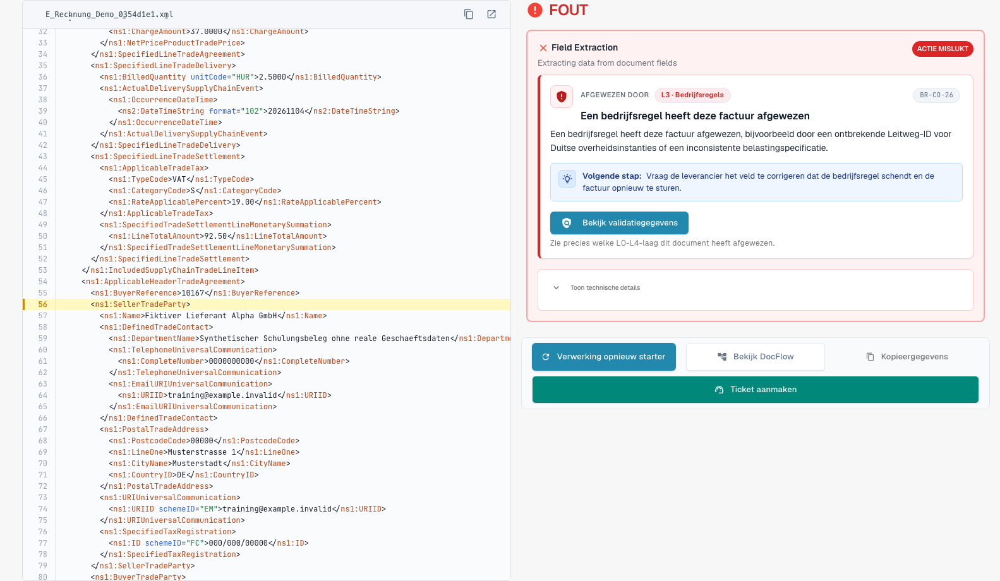
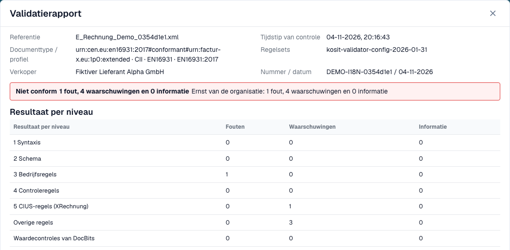
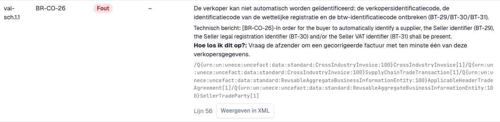

# Validatierapport

> Sommige interfaceteksten zijn in deze versie nog Engels of onjuist vertaald. De handleiding legt de betekenis uit; de schermafbeeldingen tonen de ongewijzigde interface.

Wanneer DocBits een e-factuur afwijst, kunt u precies lezen waarom. Het **validatierapport** toont elke bevinding in begrijpelijke taal, vertelt u wat u moet herstellen en toont de volgende stap. U opent het vanuit het document, niet vanuit de instellingen. Het scherm waar u het vindt, wordt beschreven in [Het foutscherm voor een afgewezen e-factuur](validation-error-screen.md).

Deze pagina is bedoeld voor mensen die facturen verwerken. Beheerders stellen de regels in op de pagina [Validatie van elektronische facturen](./) en kiezen per documenttype of een mislukte controle de factuur blokkeert, zie [Validatie voor elk documenttype](validation-per-document-type.md).

## Wanneer een document een fout krijgt

Als validatie **on** staat en **blocking** is voor het documenttype, krijgt een factuur met een blokkerende bevinding de status **Error**. Een factuur die de validator zelf heeft afgewezen, draagt in plaats daarvan de eigen e-invoice-validatiestatus, zie [Het foutscherm voor een afgewezen e-invoice](validation-error-screen.md). Open het document vanuit het dashboard. De foutweergave toont links de XML en rechts de reden.

<figure><figcaption>
Foutscherm van een volledig fictieve voorbeeldfactuur. Sommige interfaceteksten zijn in deze versie nog Engels of onjuist vertaald. De handleiding legt de betekenis uit; de schermafbeeldingen tonen de ongewijzigde interface.
</figcaption></figure>

De kaart rechts noemt de laag die de factuur heeft afgewezen (bijvoorbeeld **L3 · Business Rules**), de regelcode (bijvoorbeeld `BR-CO-26`), een korte uitleg en een **Next step**. Selecteer **View validation details** om het volledige rapport te openen.

## Het rapport lezen

<figure><figcaption>
Rapport van de fictieve factuur met bestandsgegevens en het resultaat.
</figcaption></figure>

Het rapport begint met de feiten over het bestand:

| Veld | Wat het toont |
| --- | --- |
| **Reference** | De bestandsnaam van de factuur. |
| **Time of check** | Wanneer DocBits de controle heeft uitgevoerd. Een opgeslagen rapport verandert later niet meer. |
| **Document type / profile** | Het formaat van de factuur, bijvoorbeeld CII en EN 16931. |
| **Rule sets** | De versie van de regelsets die DocBits heeft gebruikt. |
| **Seller** | De verkoper, gelezen uit de XML. |
| **Number / date** | Het factuurnummer en de factuurdatum, gelezen uit de XML. |

Onder de bestandsgegevens ziet u het **oordeel**, bijvoorbeeld **Not conformant**, met het aantal fouten, waarschuwingen en informatieve meldingen. Als uw organisatie de ernst van een regel heeft gewijzigd, toont een tweede regel **Organisation severity** de aantallen volgens de instellingen van uw organisatie.

> De uitslag luidt **Rejected** in plaats van een conformiteitswoord wanneer het document in de e-invoice-validatie is afgewezen, en de uitslag draagt dan een annuleerpictogram. De volgende stap verwijst naar de foutenlijst. Een rapport waarvan het resultaat niet leesbaar is, toont de factuur nooit als conform.

### Resultaat per niveau

De tabel **Result per level** toont hoeveel fouten, waarschuwingen en informatieve meldingen elke controle heeft gevonden. De controles bouwen op elkaar voort:

| Niveau | Wat het controleert |
| --- | --- |
| **1 Syntax** | De XML is goed gevormd. |
| **2 Schema** | De structuur volgt het officiële XML-schema. |
| **3 Business rules** | Verplichte velden zijn aanwezig en correct (regels `BR-…`). |
| **4 Cross-check rules** | Velden komen met elkaar overeen, bijvoorbeeld bedragen. |
| **5 CIUS rules (XRechnung)** | De aanvullende Duitse XRechnung-regels. |
| **Other rules** | Andere regels, bijvoorbeeld de PEPPOL-regels. |
| **Value checks of DocBits** | Controles die DocBits toevoegt, bijvoorbeeld IBAN en btw-nummer. |

> Bij facturen met het profiel EN 16931 of EXTENDED worden de XRechnung-specifieke regels getoond als **waarschuwingen**, niet als fouten.

## De bevindingen

<figure><figcaption>
Elke bevinding heeft een code, een niveau, een leesbare tekst en een hint om het op te lossen
</figcaption></figure>

Elke bevinding is één rij:

* **Pos** en **Code**: de positie in het rapport en de regelcode, bijvoorbeeld `BR-CO-26`.
* **Level**: **Error**, **Warning** of **Information**.
* **Your organisation**: het niveau volgens de instellingen van uw organisatie. Een streepje betekent dat uw organisatie het niveau niet heeft gewijzigd.
* **Field and text**: het probleem in begrijpelijke taal, het veld waar het om gaat (bijvoorbeeld *BT-29 Verkopersidentificatiecode*), het technische bericht van de validator en **How to fix**.
* **Line** en **Show in XML**: selecteer **Show in XML** om het rapport te sluiten en naar de regel in de XML-viewer te springen.

DocBits heeft teksten in begrijpelijke taal voor de meest voorkomende regels. Voor een regel zonder zo'n tekst toont het rapport het technische bericht van de validator.

## Werken met een lang rapport

Een factuur kan tegelijk tegen veel regels zondigen. Het rapport houdt het oordeel en de tellingen in een vaste kop, terwijl de bevindingen scrollen; zo ziet u altijd wat de hele factuur waard is.

* **Filter op niveau.** De filterknoppen boven de bevindingen beperken de lijst tot fouten, waarschuwingen of informatiemeldingen. De rijen **Result per level** werken ook als filter: kies een niveau om alleen de bevindingen van dat niveau te zien.
* **Zoeken.** Een zoekveld filtert de open lijst op tekst, bijvoorbeeld op een regelcode, een veldnaam of een woord uit de melding.
* **Uitklappen en inklappen.** Bevindingen openen vanzelf wanneer het fouten zijn of wanneer het rapport hoogstens drie rijen heeft. Voor de hele lijst zijn er de acties om uit en in te klappen; elke rij opent ook afzonderlijk.
* **Een code of een XPath kopiëren.** Bevindingen hebben een kopieeractie voor de regelcode en voor de XPath van het foutieve element, bijvoorbeeld voor een bericht aan uw beheerder.
* **Details openen wanneer u ze nodig hebt.** De documentdetails starten ingeklapt. Technische details zoals het controlenummer en de XPath blijven in de bevinding, terwijl de rij zelf de begrijpelijke controlenaam en de regelcode als verwijzing toont.
* **Terug naar uw plaats.** Kiest u **Show in XML** en opent u het rapport opnieuw, dan blijven de open rijen, het filter en de scrollpositie zoals u ze hebt achtergelaten.
* **Downloaden of afdrukken.** De actie **Download** in de voettekst van het rapport biedt afdrukken en een PDF, plus de HTML- en XML-bestanden van het rapport. De bestandsnaam, de exportdatum en het paginanummer staan op de PDF.
* **Afwijzen vanuit het rapport.** De actie om af te wijzen staat links in de voettekst, los van de downloadactie, zodat u een factuur niet afwijst terwijl u naar de PDF zoekt.

Op een smal scherm, bijvoorbeeld op een telefoon, wordt elke bevinding een kaart in plaats van een rij.

## Volgende

* [Volgende stap en een document afwijzen](validation-next-step-and-reject.md): wat u doet nadat u het rapport hebt gelezen.

## Gerelateerde pagina's

* [Validatie van elektronische facturen](./): geaccepteerde versies, profielen en de ernst van elke regel.
* [Validatie voor elk documenttype](validation-per-document-type.md): validatie inschakelen en blokkeren instellen.
* [Notificatierouting](../notification-routing.md): wie welke bevinding afhandelt.
