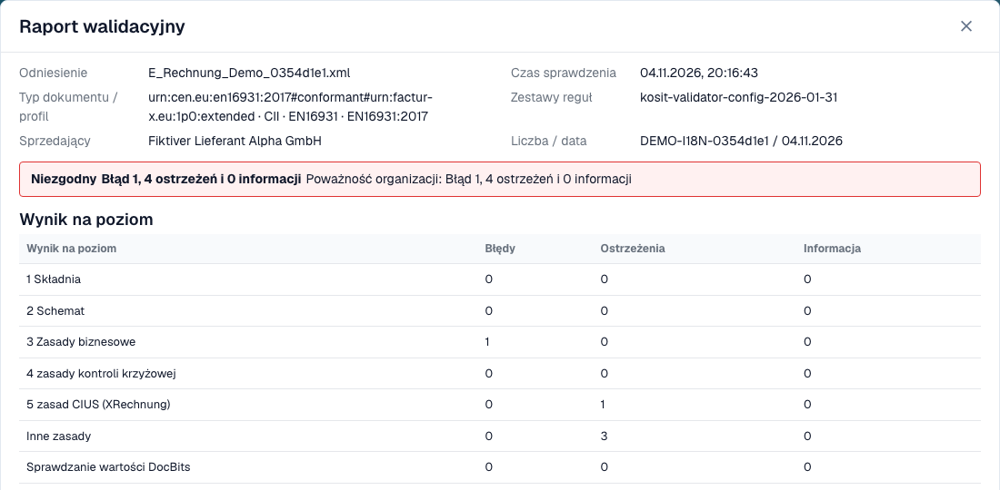
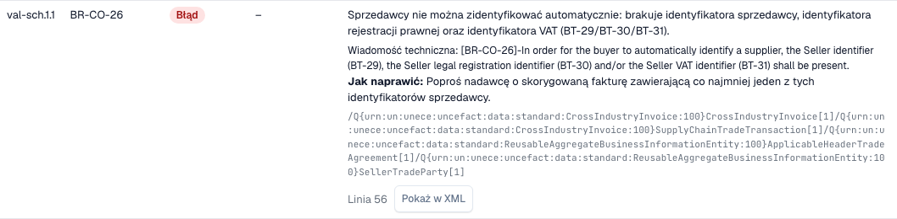

# Raport walidacyjny

> W tej wersji niektóre teksty interfejsu mogą nadal być po angielsku lub mieć błędne tłumaczenie. Instrukcja wyjaśnia ich znaczenie; zrzuty pokazują niezmieniony interfejs.

Gdy DocBits odrzuca e-fakturę, możesz sprawdzić przyczynę. **Raport walidacyjny** wymienia każdy wynik prostym językiem, mówi, co poprawić, i pokazuje następny krok. Otwierasz go z dokumentu, a nie z ustawień. Ekran, na którym go znajdziesz, opisuje strona [Ekran błędu odrzuconej e-faktury](validation-error-screen.md).

Ta strona jest dla osób, które przetwarzają faktury. Administratorzy ustawiają reguły na stronie [Walidacja e-faktury](./) i wybierają dla każdego typu dokumentu, czy nieudana kontrola blokuje fakturę, zobacz [Walidacja dla każdego typu dokumentu](validation-per-document-type.md).

## Kiedy dokument otrzymuje status **Error**

Jeśli walidacja jest **on** i **blocking** dla danego typu dokumentu, faktura z błędem blokującym otrzymuje status **Error**. Faktura odrzucona przez sam walidator ma natomiast dedykowany status walidacji e-invoice, zobacz [Ekran błędu odrzuconej faktury e-invoice](validation-error-screen.md). Otwórz dokument z Dashboardu. Widok błędu pokazuje XML po lewej stronie, a powód po prawej.

<figure><figcaption>
Ekran błędu całkowicie fikcyjnej przykładowej faktury. W tej wersji niektóre teksty interfejsu mogą nadal być po angielsku lub mieć błędne tłumaczenie. Instrukcja wyjaśnia ich znaczenie; zrzuty pokazują niezmieniony interfejs.
</figcaption></figure>

Karta po prawej wskazuje warstwę, która odrzuciła fakturę (na przykład **L3 · Business Rules**), kod reguły (na przykład `BR-CO-26`), krótkie wyjaśnienie i **Next step**. Wybierz **View validation details**, aby otworzyć pełny raport.

## Czytanie raportu

<figure><figcaption>
Raport fikcyjnej faktury z danymi pliku i wynikiem.
</figcaption></figure>

Raport zaczyna się od informacji o pliku:

| Pole | Co pokazuje |
| --- | --- |
| **Reference** | Nazwa pliku faktury. |
| **Time of check** | Kiedy DocBits wykonał kontrolę. Zapisany raport nie zmienia się później. |
| **Document type / profile** | Format faktury, na przykład CII i EN 16931. |
| **Rule sets** | Wersja zestawów reguł, których użył DocBits. |
| **Seller** | Sprzedawca odczytany z XML. |
| **Number / date** | Numer faktury i data faktury odczytane z XML. |

Pod danymi pliku widzisz **werdykt**, na przykład **Not conformant**, z liczbą błędów, ostrzeżeń i informacji. Jeśli Twoja organizacja zmieniła poziom ważności reguły, druga linia **Organisation severity** pokazuje liczby po uwzględnieniu ustawień organizacji.

> Werdykt brzmi **Rejected** zamiast słowa o zgodności, gdy dokument został odrzucony w walidacji e-invoice, a werdykt ma wtedy ikonę anulowania. Następny krok wskazuje listę błędów. Raport, którego wyniku nie można odczytać, nigdy nie pokazuje faktury jako zgodnej.

### Wyniki według poziomu

Tabela **Result per level** pokazuje, ile błędów, ostrzeżeń i informacji znalazła każda kontrola. Kontrole opierają się na sobie nawzajem:

| Poziom | Co sprawdza |
| --- | --- |
| **1 Syntax** | XML jest poprawnie zbudowany. |
| **2 Schema** | Struktura jest zgodna z oficjalnym schematem XML. |
| **3 Business rules** | Wymagane pola są obecne i poprawne (reguły `BR-…`). |
| **4 Cross-check rules** | Pola są ze sobą zgodne, na przykład sumy. |
| **5 CIUS rules (XRechnung)** | Dodatkowe niemieckie reguły XRechnung. |
| **Other rules** | Dalsze reguły, na przykład reguły PEPPOL. |
| **Value checks of DocBits** | Kontrole dodawane przez DocBits, na przykład IBAN i numer VAT. |

> Dla faktur w profilu EN 16931 lub EXTENDED reguły specyficzne dla XRechnung są pokazywane jako **ostrzeżenia**, a nie jako błędy.

## Wyniki

<figure><figcaption>
Każdy wynik ma kod, poziom, czytelny tekst i wskazówkę, jak go naprawić
</figcaption></figure>

Każdy wynik to jeden wiersz:

* **Pos** i **Code**: pozycja w raporcie i kod reguły, na przykład `BR-CO-26`.
* **Level**: **Error**, **Warning** lub **Information**.
* **Your organisation**: poziom po uwzględnieniu ustawień Twojej organizacji. Myślnik oznacza, że Twoja organizacja nie zmieniła poziomu.
* **Field and text**: problem prostym językiem, pole, którego dotyczy (na przykład *BT-29 Identyfikator sprzedawcy*), techniczny komunikat walidatora i **How to fix**.
* **Line** i **Show in XML**: wybierz **Show in XML**, aby zamknąć raport i przejść do tej linii w podglądzie XML.

DocBits ma teksty prostym językiem dla najczęstszych reguł. Dla reguły bez takiego tekstu raport pokazuje techniczny komunikat walidatora.

## Praca z długim raportem

Faktura może naruszać wiele reguł jednocześnie. Raport trzyma werdykt i liczniki w stałym nagłówku, podczas gdy ustalenia przewijają się, dzięki czemu zawsze widzisz, ile warta jest cała faktura.

* **Filtruj według poziomu.** Przyciski filtra nad ustaleniami zawężają listę do błędów, ostrzeżeń lub komunikatów informacyjnych. Wiersze **Result per level** również działają jak filtr: wybierz poziom, aby zobaczyć tylko jego ustalenia.
* **Szukaj.** Pole wyszukiwania filtruje otwartą listę po tekście, na przykład po kodzie reguły, nazwie pola lub słowie z komunikatu.
* **Rozwijaj i zwijaj.** Ustalenia otwierają się same, gdy są błędami lub gdy raport ma najwyżej trzy wiersze. Dla całej listy służą akcje rozwijania i zwijania; każdy wiersz otwiera się także osobno.
* **Kopiuj kod lub XPath.** Ustalenia mają akcję kopiowania kodu reguły i XPath błędnego elementu, na przykład do wiadomości do administratora.
* **Otwieraj szczegóły, gdy ich potrzebujesz.** Szczegóły dokumentu są początkowo zwinięte. Szczegóły techniczne, takie jak numer kontroli i XPath, pozostają w ustaleniu, a sam wiersz pokazuje zrozumiałą nazwę kontroli i kod reguły jako odniesienie.
* **Wróć na swoje miejsce.** Gdy wybierzesz **Show in XML** i otworzysz raport ponownie, otwarte wiersze, filtr i pozycja przewijania pozostają takie, jak je zostawiłeś.
* **Pobierz lub wydrukuj.** Akcja **Download** w stopce raportu oferuje drukowanie i plik PDF oraz pliki HTML i XML raportu. Nazwa pliku, data eksportu i numer strony pojawiają się na pliku PDF.
* **Odrzuć z raportu.** Akcja odrzucenia znajduje się po lewej stronie stopki, oddzielona od akcji pobierania, aby nie odrzucić faktury w trakcie szukania pliku PDF.

Na wąskim ekranie, na przykład w telefonie, każde ustalenie staje się kartą zamiast wiersza.

## Dalej

* [Następny krok i odrzucenie dokumentu](validation-next-step-and-reject.md): co zrobić po przeczytaniu raportu.

## Powiązane strony

* [Walidacja e-faktury](./): akceptowane wersje, profile i poziom ważności każdej reguły.
* [Walidacja dla każdego typu dokumentu](validation-per-document-type.md): włączanie walidacji i ustawianie blokowania.
* [Routing powiadomień](../notification-routing.md): kto obsługuje który wynik.
