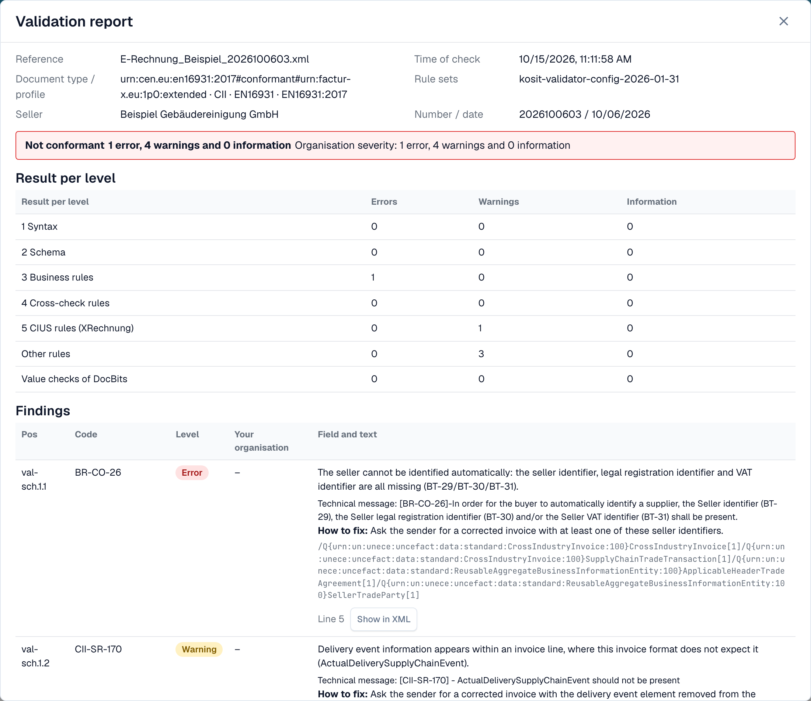
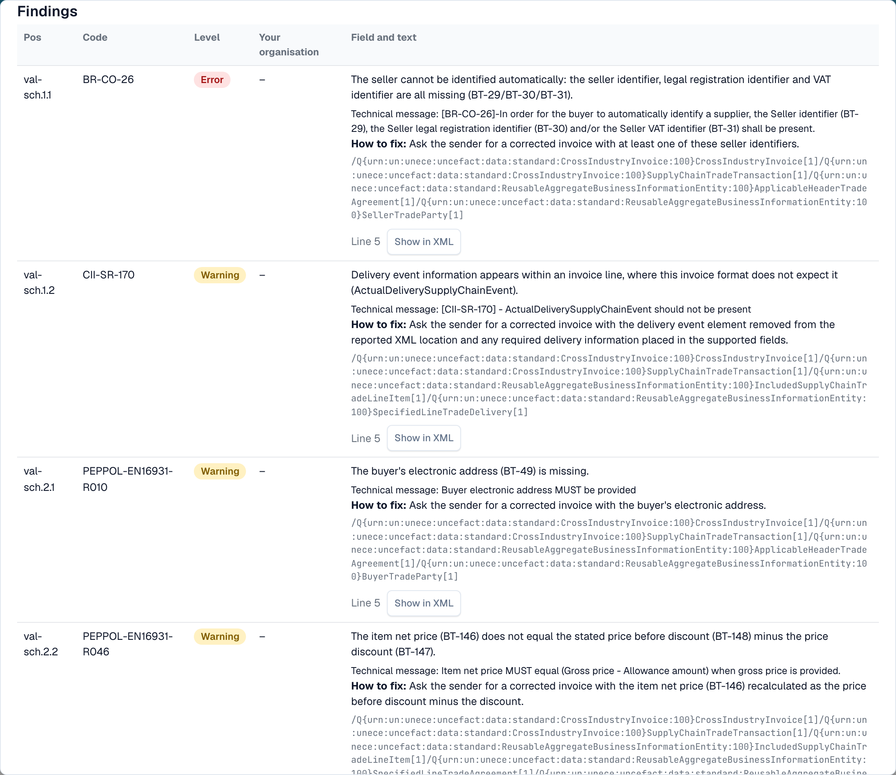

# Validation report

When DocBits rejects an e-invoice, you can read exactly why. The **validation report** lists every finding in plain language, tells you what to fix, and shows the next step. You open it from the document, not from the settings. The screen where you find it is described in [The error screen for a rejected e-invoice](validation-error-screen.md).

This page is for people who process invoices. Administrators set up the rules on the [E-Invoice Validation](./) page and choose per document type whether a failed check blocks the invoice, see [Validation for each document type](validation-per-document-type.md).

## When a document gets an error

If validation is **on** and **blocking** for the document type, an invoice with a blocking finding gets the status **Error**. An invoice that the validator itself rejected carries the dedicated e-invoice validation status instead, see [The error screen for a rejected e-invoice](validation-error-screen.md). Open the document from the dashboard. The error view shows the XML on the left and the reason on the right.

<figure><figcaption>
The error view: the XML of the invoice and the first blocking finding with a next step. Example invoice with fictional names.
</figcaption></figure>

The card on the right names the layer that rejected the invoice (for example **L3 · Business Rules**), the rule code (for example `BR-CO-26`), a short explanation and a **Next step**. Select **View validation details** to open the full report.

## Read the report

<figure><figcaption>
The top of the report: file data, the verdict and the result for each level
</figcaption></figure>

The report starts with the facts about the file:

| Field                       | What it shows                                                     |
| --------------------------- | ----------------------------------------------------------------- |
| **Reference**               | The file name of the invoice.                                     |
| **Time of check**           | When DocBits ran the check. A saved report does not change later. |
| **Document type / profile** | The format of the invoice, for example CII and EN 16931.          |
| **Rule sets**               | The version of the rule sets that DocBits used.                   |
| **Seller**                  | The seller, read from the XML.                                    |
| **Number / date**           | The invoice number and the invoice date, read from the XML.       |

Below the file data you see the **verdict**, for example **Not conformant**, with the number of errors, warnings and information messages. If your organisation changed the severity of a rule, a second line **Organisation severity** shows the counts after your organisation's settings.

> The verdict reads **Rejected** instead of a conformance word when the document was rejected in the e-invoice validation, and the verdict then carries a cancel icon. The next step points to the error list. A report whose result cannot be read never shows the invoice as conformant.

### Result per level

The table **Result per level** shows how many errors, warnings and information messages each check found. The checks build on each other:

| Level                        | What it checks                                          |
| ---------------------------- | ------------------------------------------------------- |
| **1 Syntax**                 | The XML is well-formed.                                 |
| **2 Schema**                 | The structure follows the official XML schema.          |
| **3 Business rules**         | Required fields are present and correct (rules `BR-…`). |
| **4 Cross-check rules**      | Fields agree with each other, for example sums.         |
| **5 CIUS rules (XRechnung)** | The additional German XRechnung rules.                  |
| **Other rules**              | Further rules, for example the PEPPOL rules.            |
| **Value checks of DocBits**  | Checks that DocBits adds, for example IBAN and VAT ID.  |

> For invoices in the EN 16931 or EXTENDED profile, the XRechnung-specific rules are shown as **warnings**, not as errors.

## The findings

<figure><figcaption>
Each finding has a code, a level, a text you can read and a hint how to fix it
</figcaption></figure>

Each finding is one row:

* **Pos** and **Code**: the position in the report and the rule code, for example `BR-CO-26`.
* **Level**: **Error**, **Warning** or **Information**.
* **Your organisation**: the level after your organisation's settings. A dash means your organisation did not change the level.
* **Field and text**: the problem in plain language, the field it concerns (for example _BT-29 Seller identifier_), the technical message of the validator, and **How to fix**.
* **Line** and **Show in XML**: select **Show in XML** to close the report and jump to the line in the XML viewer.

DocBits has plain-language texts for the most common rules. For a rule without such a text, the report shows the technical message of the validator.

## Work with a long report

An invoice can break many rules at once. The report keeps the verdict and the counts in a fixed header while the findings scroll, so you can always see what the whole invoice is worth.

* **Filter by level.** The filter buttons above the findings narrow the list to errors, warnings or information messages. The rows **Result per level** work as filters too: select a level to see only its findings.
* **Search.** A search field filters the open list by text, for example a rule code, a field name or a word from the message.
* **Expand and collapse.** Findings open on their own when they are errors, or when the report has at most three rows. Use the expand and collapse actions for the whole list; each row also opens on its own.
* **Copy a code or an XPath.** Findings carry a copy action for the rule code and for the XPath of the faulty element, for example for a message to your administrator.
* **Open details when you need them.** The document details start collapsed. Technical details such as the check number and the XPath stay inside the finding, while the row itself shows the plain check name and the rule code as a reference.
* **Return to your place.** When you select **Show in XML** and open the report again, the open rows, the filter and the scroll position stay as you left them.
* **Download or print.** The **Download** action in the footer of the report offers printing and a PDF, and the HTML and XML files of the report. The file name, the export date and the page number appear on the PDF.
* **Reject from the report.** The reject action sits on the left in the footer, apart from the download action, so you do not reject an invoice while looking for the PDF.

On a narrow screen, for example on a phone, each finding becomes a card instead of a row.

## Next

* [Next step and reject a document](validation-next-step-and-reject.md): what to do after you read the report.

## Related pages

* [E-Invoice Validation](./): accepted versions, profiles and the severity of each rule.
* [Validation for each document type](validation-per-document-type.md): turn validation on and set blocking.
* [Notification Routing](../notification-routing.md): who handles which finding.
