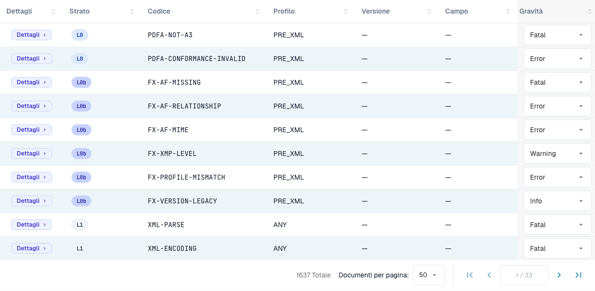

# Gravità delle regole

> In questa versione alcuni testi dell’interfaccia possono essere ancora in inglese o tradotti in modo errato. La guida ne spiega il significato; le schermate mostrano l’interfaccia originale.

Ogni regola di validazione ha una gravità. Puoi cambiare la gravità di ogni regola per la tua organizzazione. Questa pagina fa parte di [Validazione della fattura elettronica](./). Solo gli amministratori dell'organizzazione possono cambiare le gravità.

<figure><figcaption>
Tabella delle regole con le etichette effettive dell’interfaccia. In questa versione alcuni testi dell’interfaccia possono essere ancora in inglese o tradotti in modo errato. La guida ne spiega il significato; le schermate mostrano l’interfaccia originale.
</figcaption></figure>

La tabella delle regole elenca tutte le regole di validazione (oltre 1.600 in totale). Filtra per **Layer**, **Profile** o **Version**, oppure cerca per codice o campo. Per ogni regola puoi sovrascrivere la **Severity** dal menu a discesa per adattarla alla policy della tua organizzazione — ad esempio, riducendo una regola da `ERROR` a `WARNING` in modo che non rifiuti più il documento.

Il significato di **FATAL**, **ERROR**, **WARNING** e **INFO** è spiegato in [Configurazione della validazione e versioni accettate](validation-setup.md#profili-accettati-e-modello-di-gravita). Una gravità modificata compare anche nel [rapporto di convalida](validation-report.md) nella colonna **Your organisation**.
