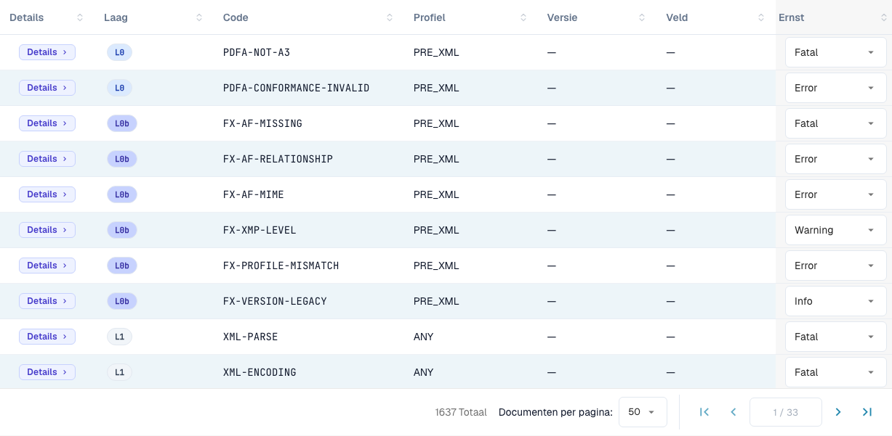

# Ernst van regels

> Sommige interfaceteksten zijn in deze versie nog Engels of onjuist vertaald. De handleiding legt de betekenis uit; de schermafbeeldingen tonen de ongewijzigde interface.

Elke validatieregel heeft een ernstniveau. U kunt de ernst van elke regel voor uw organisatie wijzigen. Deze pagina hoort bij [Validatie van elektronische facturen](./). Alleen organisatiebeheerders kunnen de ernst wijzigen.

<figure><figcaption>
Regeltabel met de werkelijke interfacelabels. Sommige interfaceteksten zijn in deze versie nog Engels of onjuist vertaald. De handleiding legt de betekenis uit; de schermafbeeldingen tonen de ongewijzigde interface.
</figcaption></figure>

De regeltabel somt elke validatieregel op (in totaal meer dan 1.600). Filter op **Layer**, **Profile** of **Version**, of zoek op code of veld. Voor elke regel kunt u de **Severity** in de vervolgkeuzelijst overschrijven om ze af te stemmen op het beleid van uw organisatie — bijvoorbeeld een regel van `ERROR` naar `WARNING` verlagen zodat ze het document niet langer afwijst.

De betekenis van **FATAL**, **ERROR**, **WARNING** en **INFO** staat op [Validatie-instellingen en geaccepteerde versies](validation-setup.md#geaccepteerde-profielen-en-het-ernstmodel). Een gewijzigde ernst ziet u ook in het [validatierapport](validation-report.md) in de kolom **Your organisation**.
