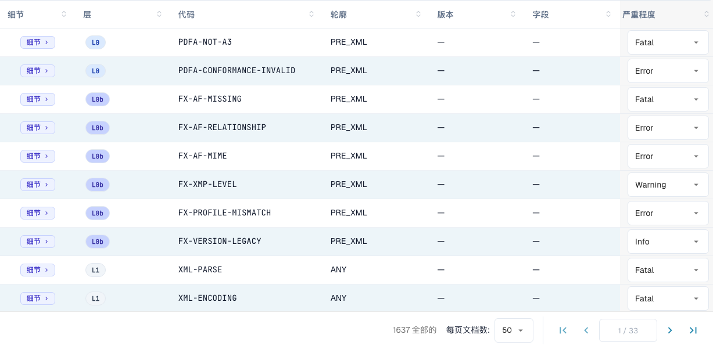

# 规则严重级别

> 此版本的部分界面文字仍可能使用英语或存在翻译错误。本指南解释正确含义；截图保留实际界面文字。

每条验证规则都有一个严重级别。您可以更改组织中每条规则的严重级别。本页面属于 [电子发票验证](./)。只有组织管理员可以更改严重级别。

<figure><figcaption>
规则表，显示实际界面标签。 此版本的部分界面文字仍可能使用英语或存在翻译错误。本指南解释正确含义；截图保留实际界面文字。
</figcaption></figure>

规则表列出了所有验证规则（总计超过 1,600 条）。您可以按 **层级**、**规范配置** 或 **版本** 筛选，也可以按代码或字段搜索。对于每条规则，您都可以通过下拉菜单覆盖 **严重级别**，使其符合组织的政策——例如，将规则从 `ERROR` 调低为 `WARNING`，这样该规则就不会再拒绝文档。

**FATAL**、**ERROR**、**WARNING** 和 **INFO** 的含义请参阅[验证设置和接受的版本](validation-setup.md#accepted-profiles-and-severity-model)。更改后的严重级别也会显示在[验证报告](validation-report.md)的 **您的组织** 列中。
