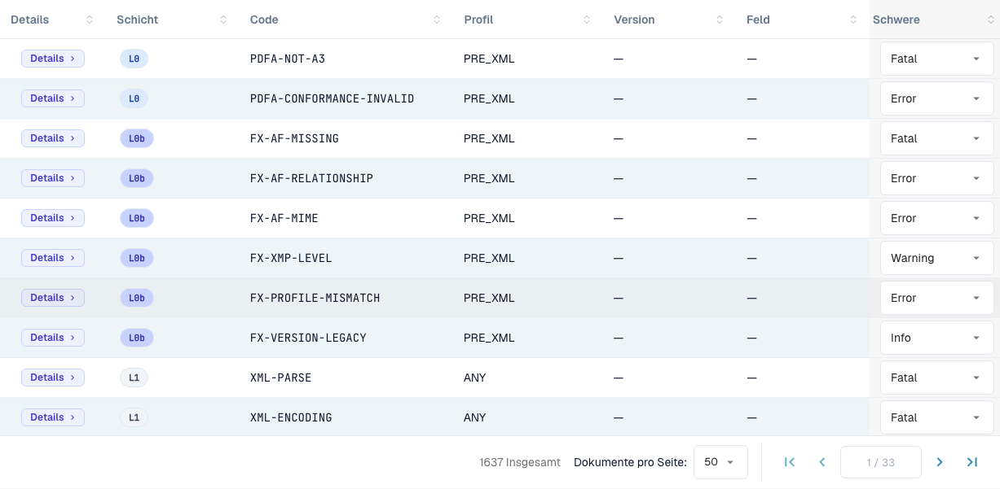

# Regel-Schweregrade

> Einzelne Produkttexte können in dieser Version noch Englisch oder sprachlich fehlerhaft sein. Die Anleitung erklärt die Bedeutung; die Screenshots zeigen die unveränderte Oberfläche.

Jede Validierungsregel hat einen Schweregrad. Sie können den Schweregrad jeder Regel für Ihre Organisation ändern. Diese Seite gehört zur [E-Rechnungs-Prüfung](./). Nur Organisationsadministratoren können die Schweregrade ändern.

<figure><figcaption>
Regeltabelle mit den tatsächlichen Beschriftungen der Oberfläche. Einzelne Produkttexte können in dieser Version noch Englisch oder sprachlich fehlerhaft sein. Die Anleitung erklärt die Bedeutung; die Screenshots zeigen die unveränderte Oberfläche.
</figcaption></figure>

Die Regeltabelle listet jede Validierungsregel auf (insgesamt über 1.600). Filtern Sie nach **Layer**, **Profile** oder **Version** oder suchen Sie nach Code oder Feld. Für jede Regel können Sie den **Severity** über das Dropdown überschreiben, um ihn an die Richtlinien Ihrer Organisation anzupassen – zum Beispiel eine Regel von `ERROR` auf `WARNING` herabstufen, damit sie das Dokument nicht mehr ablehnt.

Die Bedeutung von **FATAL**, **ERROR**, **WARNING** und **INFO** ist unter [Validierungs-Setup und akzeptierte Versionen](validation-setup.md#akzeptierte-profile-und-schweregrad-modell) erklärt. Ein geänderter Schweregrad erscheint außerdem im [Prüfbericht](validation-report.md) in der Spalte **Your organisation**.
