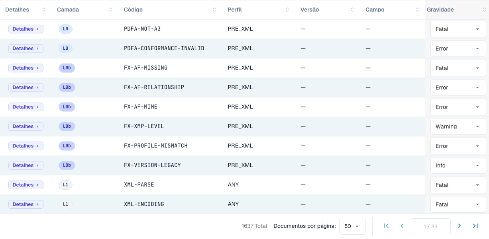

# Gravidade das regras

> Nesta versão, alguns textos da interface podem ainda estar em inglês ou ter traduções incorretas. A documentação explica o significado; as capturas mostram a interface sem alterações.

Cada regra de validação tem uma gravidade. Pode alterar a gravidade de cada regra para a sua organização. Esta página faz parte de [Validação de faturas eletrónicas](./). Só os administradores da organização podem alterar as gravidades.

<figure><figcaption>
Tabela de regras com os rótulos reais da interface. Nesta versão, alguns textos da interface podem ainda estar em inglês ou ter traduções incorretas. A documentação explica o significado; as capturas mostram a interface sem alterações.
</figcaption></figure>

A tabela de regras lista todas as regras de validação (mais de 1.600 no total). Filtre por **Layer**, **Profile** ou **Version**, ou pesquise por código ou campo. Para cada regra pode substituir a **Severity** no menu pendente para a ajustar à política da sua organização — por exemplo, baixar uma regra de `ERROR` para `WARNING` para que deixe de rejeitar o documento.

O significado de **FATAL**, **ERROR**, **WARNING** e **INFO** está explicado em [Configuração da validação e versões aceites](validation-setup.md#perfis-aceites-e-modelo-de-gravidade). Uma gravidade alterada também aparece no [relatório de validação](validation-report.md), na coluna **Your organisation**.
