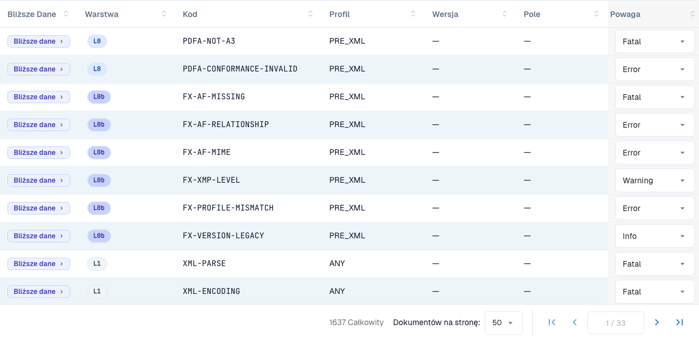

# Poziomy ważności reguł

> W tej wersji niektóre teksty interfejsu mogą nadal być po angielsku lub mieć błędne tłumaczenie. Instrukcja wyjaśnia ich znaczenie; zrzuty pokazują niezmieniony interfejs.

Każda reguła walidacji ma poziom ważności. Możesz zmienić poziom ważności każdej reguły dla swojej organizacji. Ta strona należy do sekcji [Walidacja e-faktury](README.md). Poziomy ważności mogą zmieniać tylko administratorzy organizacji.

<figure><figcaption>
Tabela reguł z rzeczywistymi etykietami interfejsu. W tej wersji niektóre teksty interfejsu mogą nadal być po angielsku lub mieć błędne tłumaczenie. Instrukcja wyjaśnia ich znaczenie; zrzuty pokazują niezmieniony interfejs.
</figcaption></figure>

Tabela reguł wymienia każdą regułę walidacji (łącznie ponad 1600). Filtruj według **Warstwy (Layer)**, **Profilu** lub **Wersji** albo wyszukuj według kodu lub pola. Dla każdej reguły możesz nadpisać **Poziom ważności** z listy rozwijanej, aby dopasować ją do polityki swojej organizacji — na przykład obniżyć regułę z `ERROR` do `WARNING`, aby nie odrzucała już dokumentu.

Znaczenie poziomów **FATAL**, **ERROR**, **WARNING** i **INFO** opisano na stronie [Konfiguracja walidacji i akceptowane wersje](validation-setup.md#akceptowane-profile-i-model-wagi). Zmieniony poziom ważności pojawia się też w [raporcie walidacyjnym](validation-report.md), w kolumnie **Twoja organizacja**.
